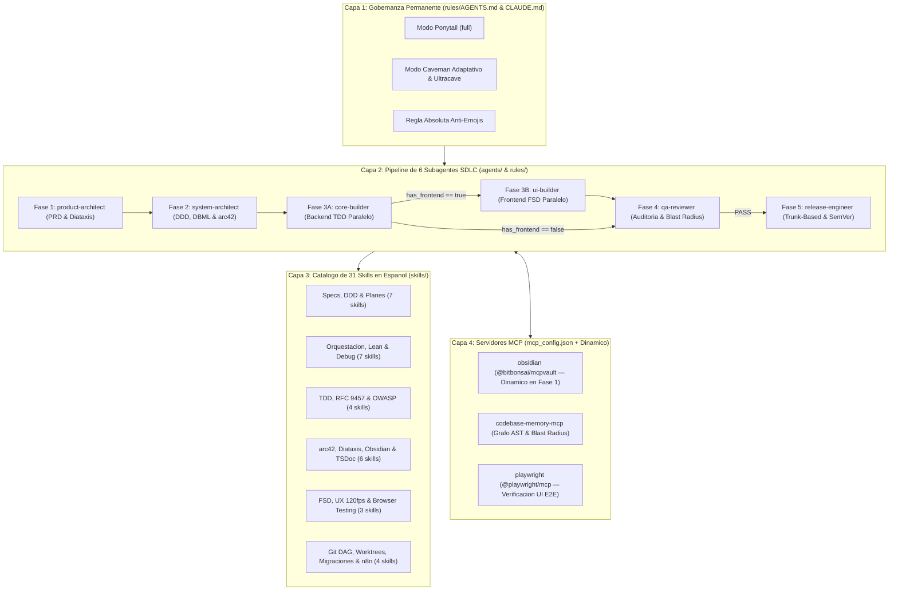

# Agent Core Skills & SDLC Subagents — Plugin Universal de Gobernanza e Ingeniería Agéntica

[](LICENSE)
[](plugin.json)
[](#instalación-y-configuración)
[](#instalación-y-configuración)
[](#visión-general-y-motivación)
[](https://github.com/RichardLitt/standard-readme)

Plugin nativo y framework integral de gobernanza arquitectónica, orquestación de **6 subagentes especializados en 5 fases del SDLC**, integración con **3 servidores MCP** (`obsidian`, `codebase-memory-mcp`, `playwright`) y catálogo de **31 skills de ingeniería de software en español** comprimidas en alta densidad de tokens (`caveman-compress`). Compatible de forma nativa con **Google Antigravity** y universalmente instalable en **Claude Code, Cursor, OpenAI Codex, Gemini CLI y OpenCode**.

---

## Tabla de Contenidos

- [Visión General y Motivación](#visión-general-y-motivación)
- [Arquitectura del Plugin y Ecosistema](#arquitectura-del-plugin-y-ecosistema)
- [Guía de Uso y Modos Operativos (AGENTS.md)](#guía-de-uso-y-modos-operativos-agentsmd)
- [Pipeline de 6 Subagentes por Fase del SDLC](#pipeline-de-6-subagentes-por-fase-del-sdlc)
- [Orquestación de Servidores MCP por Fase](#orquestación-de-servidores-mcp-por-fase)
- [Catálogo de 31 Skills Versionadas](#catálogo-de-31-skills-versionadas)
  - [1. Gobernanza Arquitectónica y Documentación](#1-gobernanza-arquitectónica-y-documentación)
  - [2. Especificación, Dominio (DDD) y Planificación](#2-especificación-dominio-ddd-y-planificación)
  - [3. Orquestación Paralela, Ejecución Lean y Debugging](#3-orquestación-paralela-ejecución-lean-y-debugging)
  - [4. Calidad, TDD, Resiliencia RFC 9457 y Seguridad OWASP](#4-calidad-tdd-resiliencia-rfc-9457-y-seguridad-owasp)
  - [5. Memoria Estructural y Grafos de Conocimiento](#5-memoria-estructural-y-grafos-de-conocimiento)
  - [6. Ecosistema Obsidian y Gestión de Bóvedas](#6-ecosistema-obsidian-y-gestión-de-bóvedas)
  - [7. Ingeniería Frontend (FSD), UX a 120 FPS y Verificación en Navegador](#7-ingeniería-frontend-fsd-ux-a-120-fps-y-verificación-en-navegador)
  - [8. Control de Versiones Avanzado, Migraciones y Automatización](#8-control-de-versiones-avanzado-migraciones-y-automatización)
- [Instalación y Configuración](#instalación-y-configuración)
  - [Autoconfiguración Asistida por Agente](#autoconfiguración-asistida-por-agente)
  - [Opción A: Instalación Nativa en Google Antigravity](#opción-a-instalación-nativa-en-google-antigravity)
  - [Opción B: Instalación Multi-Agente (Claude Code, Cursor, Codex, OpenCode)](#opción-b-instalación-multi-agente-claude-code-cursor-codex-opencode)
- [Gobernanza Git y Contribución](#gobernanza-git-y-contribución)
- [Auditoría Automatizada](#auditoría-automatizada)
- [Licencia](#licencia)

---

## Visión General y Motivación

El desarrollo de software asistido por agentes requiere contratos explícitos, aislamiento de contexto y verificación empírica. Este plugin soluciona los fallos sistémicos de los modelos de lenguaje mediante cuatro pilares:

1. **Modelo Zero-Trust y Source-Driven:** Obligación de inspeccionar el grafo de código (`codebase-memory-mcp`), tipos instalados y documentación oficial antes de afirmar o codificar.
2. **Filosofía Ponytail y Economía Caveman:** Mínimo código completo sin abstracción prematura (`ponytail`), respuestas directas con carga técnica intacta (`caveman`) y skills redactadas en español de alta densidad que ahorran entre 50% y 65% de tokens de contexto.
3. **Documentación Viva Sincronizada (Diátaxis + arc42 + DBML):** Bóveda en Obsidian inicializada dinámicamente en `Mis documentos/<nombre-proyecto>/docs` desde la Fase 1 y alimentada automáticamente desde el código en las Fases 2, 3A y 3B.
4. **Construcción TDD en Equipo Paralelo (`/teamwork`) y Barra Inquebrantable:** Subagentes concurrentes por tarea atómica (`dispatching-parallel-agents`) bajo ciclo Red-Green-Refactor y prohibición de rebajar umbrales o silenciar linters (`constraint-driven-development`).

> [!IMPORTANT]
> **Principio Cardinal de Evidencia Empírica:** Prohibido declarar una tarea, prueba o rama como completada sin haber ejecutado el runner, compilador o verificación en navegador (`playwright`) en el turno actual con salida limpia verificada.

---

## Arquitectura del Plugin y Ecosistema



---

## Guía de Uso y Modos Operativos (AGENTS.md)

Al activar el plugin, [`rules/AGENTS.md`](rules/AGENTS.md) (y [`CLAUDE.md`](CLAUDE.md) / [`AGENTS.md`](AGENTS.md) en la raíz) inyecta cuatro mandatos globales:

- **Modo Ponytail (`full`):** Escribir el mínimo código completo que resuelve el problema. Reutilizar código existente antes de dependencias; dependencias antes de código nuevo. Prohibida la abstracción prematura. Todo atajo deliberado se marca con `// shortcut:` y cada respuesta técnica cierra con 1-2 líneas declarando qué se omitió y riesgos latentes.
- **Modo Caveman Adaptativo:** Respuesta técnica en la primera línea sin preámbulos conversacionales. En código y terminal: telegráfico; en diseño y arquitectura: prosa estructurada.
- **Regla Absoluta Anti-Emojis:** Cero emojis en respuestas, código fuente, notas de Obsidian, diagramas Mermaid, commits o logs.
- **Handoff Inter-Agente (`ultracave`):** Traspaso entre subagentes compuesto exclusivamente por payload técnico (rutas, tipos, comandos, hashes de commit).

---

## Pipeline de 6 Subagentes por Fase del SDLC

Los subagentes están definidos en [`agents/`](agents/) y gobernados por [`rules/`](rules/):

| Fase | Subagente (`agents/`) | Misión Principal | Entregables en Vault Obsidian (`Mis documentos/<proyecto>/docs`) |
| :--- | :--- | :--- | :--- |
| **Fase 1** | [`product-architect`](agents/product-architect.md) | Modo Greenfield (entrevista `ask_question`) o Brownfield (ingeniería inversa de especificaciones desde código con `codebase-memory-mcp`). Inicialización dinámica de carpeta y MCP `obsidian`, requerimientos e invariantes. | **10 notas Diátaxis:** `00-PRD-Master.md`, `explicacion/` (3), `especificaciones/` (3), `criterios/` (2 con BDD Gherkin) y `referencia/01-glosario-ubicuo.md`. |
| **Fase 2** | [`system-architect`](agents/system-architect.md) | Diseño DDD, grill-me de stack, esquema relacional en **DBML** (proyectado o extraído As-Is), scaffolding y plan atómico. Si es baseline documental concluye aquí; si es evolución genera plan con tareas `[PARALELO]`. | **8 notas arc42 en `arquitectura/`:** MOC, C4 contexto, estrategia, bloques, `04-modelo-de-datos-y-contratos.md` (con bloque ```` ```dbml ```` para `dbdiagram.io` y `DBML Visualizer`), secuencia, transversales y ADR Nygard. |
| **Fase 3A** | [`core-builder`](agents/core-builder.md) | Construcción de backend y dominio mediante subagentes concurrentes en paralelo (`/teamwork`) bajo TDD Red-Green-Refactor, RFC 9457, committer diferido e indexación en `codebase-memory-mcp`. | **5 artefactos Docs-as-Code:** `05-vista-de-ejecucion.md` (secuencias reales), `02-catalogo-errores-rfc9457.md`, `03-contratos-api-publica.md`, `07-deuda-tecnica-y-riesgos.md` y `03-guia-de-testing-y-runner.md`. |
| **Fase 3B** | [`ui-builder`](agents/ui-builder.md) | *(Condicional si `has_frontend == true`)* Construcción de UI bajo Feature-Sliced Design (FSD) en paralelo, 4 estados FSM, WCAG 2.1 AA, verificación con MCP `playwright`, committer e indexación total. | **4 artefactos Docs-as-Code UI:** actualización FSD en `03-vista-de-bloques.md`, `04-catalogo-componentes-ui.md`, `04-guia-testing-ui-y-accesibilidad.md` y anexo en `07-deuda-tecnica-y-riesgos.md`. |
| **Fase 4** | [`qa-reviewer`](agents/qa-reviewer.md) | Auditoría independiente sin edición de código: validación BDD, cálculo de Blast Radius en `codebase-memory-mcp`, verificación E2E con `playwright`, RFC 9457 y seguridad OWASP. | Dictamen formal binario (`PASS` / `FAIL`) persistido en `docs/auditorias/AUDIT-Fase4.md`. |
| **Fase 5** | [`release-engineer`](agents/release-engineer.md) | Compuerta `verification-before-completion`, integración Trunk-Based (rebase/merge limpio), tags SemVer, limpieza de worktrees y reindexación final. | Actualización de `06-vista-de-despliegue.md`, transición de ADRs a `Aceptado` y reporte de cierre. |

---

## Orquestación de Servidores MCP por Fase

El archivo [`mcp_config.json`](mcp_config.json) declara los servidores estáticos (`codebase-memory-mcp` y `playwright`), mientras que `obsidian` se inicializa dinámicamente por proyecto:

1. **`obsidian` (`@bitbonsai/mcpvault@latest` — Inicialización Dinámica en Fase 1):**
   - Al arrancar el descubrimiento en Fase 1, `product-architect` pregunta al usuario el nombre clave del proyecto proponiendo la ruta `"Mis documentos/<nombre-proyecto>/docs"` (`$HOME/Documents/<nombre-proyecto>/docs`), crea físicamente el árbol de directorios e inicializa el servidor MCP apuntando a esa ruta exacta.
2. **`codebase-memory-mcp` (Grafo de Conocimiento AST):**
   - Utilizado en Fase 1 para ingeniería inversa de especificaciones en proyectos existentes (Brownfield), en Fase 2 para auditar arquitectura previa e inferir DBML As-Is, indexado obligatoriamente con `index_repository` al cierre de Fase 3A (backend) y Fase 3B (monorepo completo), y consultado en Fase 4 con `detect_changes`, `trace_path` y `check_index_coverage`.
3. **`playwright` (`@playwright/mcp@latest` — Verificación Real en Navegador):**
   - Utilizado en Fase 3B y Fase 4 para navegar la aplicación viva, comprobar los 4 estados FSM (`Loading`, `Error RFC 9457`, `Empty`, `Success`), auditar accesibilidad por teclado y asegurar cero errores en consola.

---

## Catálogo de 31 Skills Versionadas

Todas las skills residen en [`skills/`](skills/) en español de alta densidad:

### 1. Gobernanza Arquitectónica y Documentación
- **[readme-architecture-mastery](skills/readme-architecture-mastery/SKILL.md):** Auditoría de 7 dimensiones para `README.md`, `AGENTS.md`, `CLAUDE.md` y `llms.txt` con validador determinista en Deno (`validate_readme.ts`).
- **[docs-governance-mastery](skills/docs-governance-mastery/SKILL.md):** Gobernanza documental combinando los 12 capítulos de **arc42** (ISO/IEC/IEEE 42010), los 4 cuadrantes de **Diátaxis**, esquemas **DBML** y grafos en Obsidian.
- **[code-documentation-mastery](skills/code-documentation-mastery/SKILL.md):** Estándar in-code JSDoc/TSDoc bajo principio del "Por Qué" y contratos públicos en barriles `index.ts`.

### 2. Especificación, Dominio (DDD) y Planificación
- **[brainstorming](skills/brainstorming/SKILL.md):** Pensamiento arquitectónico previo al código: cuestionamiento de supuestos y evaluación de alternativas con trade-offs.
- **[spec-driven-development](skills/spec-driven-development/SKILL.md):** Compuerta bloqueante `SPECIFY -> PLAN -> TASKS -> IMPLEMENT` y Mapas de Capacidades acíclicos.
- **[interview-me](skills/interview-me/SKILL.md):** Interrogatorio quirúrgico paso a paso hasta alcanzar 95% de certeza sobre requerimientos y stack.
- **[domain-driven-design](skills/domain-driven-design/SKILL.md):** Diseño estratégico y táctico DDD: Bounded Contexts, Agregados, Entidades, Value Objects, Eventos de Dominio y mapeo a DBML.
- **[api-and-interface-design](skills/api-and-interface-design/SKILL.md):** Diseño de contratos estables REST/GraphQL/RPC, idempotencia, paginación y fronteras de módulos.
- **[writing-plans](skills/writing-plans/SKILL.md):** Redacción de planes atómicos con tareas de 2 a 5 minutos, rutas exactas, firmas y pasos TDD.
- **[planning-and-task-breakdown](skills/planning-and-task-breakdown/SKILL.md):** Descomposición de especificaciones en olas ordenadas de construcción, grafo de paralelismo (`[PARALELO]`) y matriz de commits.

### 3. Orquestación Paralela, Ejecución Lean y Debugging
- **[subagent-driven-development](skills/subagent-driven-development/SKILL.md):** Despacho de subagentes frescos con contexto aislado por tarea y revisión en dos etapas.
- **[dispatching-parallel-agents](skills/dispatching-parallel-agents/SKILL.md):** Ejecución concurrente en equipo (`/teamwork`) para tareas independientes sin estado compartido.
- **[source-driven-development](skills/source-driven-development/SKILL.md):** Anclaje obligatorio en documentación oficial y tipos instalados antes de implementar APIs de librerías.
- **[ponytail](skills/ponytail/SKILL.md):** Simplicidad radical anti-sobreingeniería (`ponytail` core), revisión anti-bloat (`ponytail-review`) y registro de deuda técnica (`ponytail-debt` con `shortcut:`).
- **[caveman](skills/caveman/SKILL.md):** Comunicación de alta señal sin relleno, handoffs `ultracave`, `caveman-commit` y compresión documental `caveman-compress`.
- **[systematic-debugging](skills/systematic-debugging/SKILL.md):** Diagnóstico científico de causa raíz en 4 fases mediante hipótesis rankeadas antes de aplicar parches.
- **[safe-refactor](skills/safe-refactor/SKILL.md):** Reestructuración y simplificación de código preservando el 100% del comportamiento observable con verificación en verde.

### 4. Calidad, TDD, Resiliencia RFC 9457 y Seguridad OWASP
- **[qa-testing-mastery](skills/qa-testing-mastery/SKILL.md):** Diamante de Pruebas, ciclo TDD Red-Green-Refactor estricto, aislamiento transaccional, matrices de casos borde, Pact.js y pruebas de carga.
- **[constraint-driven-development](skills/constraint-driven-development/SKILL.md):** Contrato de barra de calidad inquebrantable: prohíbe `@ts-ignore`, `eslint-disable`, `any`, tests saltados o aserciones eliminadas.
- **[doubt-driven-development](skills/doubt-driven-development/SKILL.md):** Revisión adversarial en contexto fresco orientada a refutar decisiones arquitectónicas riesgosas.
- **[exception-resilience-mastery](skills/exception-resilience-mastery/SKILL.md):** Resiliencia Fail-Closed (OWASP A10:2025), prevención de fugas API7:2023, estándar **RFC 9457**, W3C Trace Context y redacción de PII.
- **[security-and-hardening](skills/security-and-hardening/SKILL.md):** Controles preventivos OWASP Top 10: validación en fronteras, consultas parametrizadas, sesiones seguras, prevención de BOLA/XSS/SSRF y secretos.
- **[verification-before-completion](skills/verification-before-completion/SKILL.md):** Compuerta de evidencia empírica en terminal antes de declarar cualquier entrega como completada.

### 5. Memoria Estructural y Grafos de Conocimiento
- **[codebase-memory-mastery](skills/codebase-memory-mastery/SKILL.md):** Recetario avanzado de `codebase-memory-mcp`: análisis de Blast Radius (`detect_changes`), trazabilidad (`trace_path`) y consultas Cypher (`query_graph`).

### 6. Ecosistema Obsidian y Gestión de Bóvedas
- **[obsidian-markdown](skills/obsidian-markdown/SKILL.md):** Sintaxis Obsidian Flavored Markdown, wikilinks bidireccionales, callouts, propiedades YAML y Mermaid.
- **[obsidian-bases](skills/obsidian-bases/SKILL.md):** Modelado de vistas relacionales en archivos `.base` con filtros, fórmulas y sumarios.
- **[obsidian-cli](skills/obsidian-cli/SKILL.md):** Automatización de bóvedas y desarrollo de plugins mediante la CLI de Obsidian.

### 7. Ingeniería Frontend (FSD), UX a 120 FPS y Verificación en Navegador
- **[ui-ux-mastery](skills/ui-ux-mastery/SKILL.md):** Diseño centrado en intención, Máquinas de Estado Finito (FSM), 41 patrones de interacción, Umbral Doherty (<400ms), WCAG 2.1 AA y física de movimiento a 120 FPS.
- **[frontend-ui-engineering](skills/frontend-ui-engineering/SKILL.md):** Arquitectura Feature-Sliced Design (FSD), separación de estado (servidor, URL, local) y semántica accesible.
- **[browser-testing-with-devtools](skills/browser-testing-with-devtools/SKILL.md):** Verificación empírica en navegador real mediante **Playwright MCP** y Chrome DevTools (DOM, árbol ARIA, 4 estados FSM y consola limpia).

### 8. Control de Versiones Avanzado, Migraciones y Automatización
- **[git-workflow-mastery](skills/git-workflow-mastery/SKILL.md):** Operaciones avanzadas en DAG, `git worktree`, stacked branches (`--update-refs`), `rerere`, `range-diff`, Trunk-Based Development y committer diferido.
- **[finishing-a-development-branch](skills/finishing-a-development-branch/SKILL.md):** Protocolo de cierre, rebase lineal, integración en `main` o Pull Request y limpieza de worktrees en Fase 5.
- **[migration](skills/migration/SKILL.md):** Migraciones reversibles sin tiempo de inactividad mediante el patrón Expand-Migrate-Contract para bases de datos y APIs.
- **[n8n-mastery](skills/n8n-mastery/SKILL.md):** Arquitectura de flujos en n8n, Code Nodes, Queue Mode, nodos personalizados en TypeScript e integración con servidores MCP.

---

## Instalación y Configuración

### Autoconfiguración Asistida por Agente

Proporciona el siguiente prompt a tu agente de IA para que instale y configure automáticamente el plugin según el entorno que utilices:

> [!TIP]
> **Prompt de Autoconfiguración Universal:**
> ```text
> Instala y configura el plugin desde https://github.com/EdwinDragusin/agent-core-skills.git siguiendo los pasos para mi entorno actual:
> 1. Si estoy en Google Antigravity:
>    - Clona el repositorio en "$HOME/.gemini/config/plugins/agent-core-skills".
>    - Verifica que plugin.json, mcp_config.json, rules/AGENTS.md, agents/ y skills/ esten presentes.
> 2. Si estoy en Claude Code, Cursor, Codex u OpenCode:
>    - Clona el repositorio e integra las skills en el directorio correspondiente (~/.claude/skills, ~/.cursor/skills o .agents/skills) y enlaza AGENTS.md / CLAUDE.md.
> 3. Verifica la disponibilidad de los servidores MCP codebase-memory-mcp y @playwright/mcp@latest. Recuerda que el MCP de Obsidian (@bitbonsai/mcpvault@latest) se inicializa dinamicamente al comenzar la Fase 1 en "Mis documentos/<nombre-proyecto>/docs".
> ```

### Opción A: Instalación Nativa en Google Antigravity

Clona el repositorio directamente en el directorio de plugins de Antigravity para activar en un solo paso las reglas permanentes (`rules/AGENTS.md`), los 6 subagentes (`agents/`), las 31 skills (`skills/`) y los servidores MCP (`mcp_config.json`):

```bash
# Windows (PowerShell)
git clone https://github.com/EdwinDragusin/agent-core-skills.git "$HOME\.gemini\config\plugins\agent-core-skills"

# macOS / Linux
git clone https://github.com/EdwinDragusin/agent-core-skills.git "$HOME/.gemini/config/plugins/agent-core-skills"
```

### Opción B: Instalación Multi-Agente (Claude Code, Cursor, Codex, OpenCode)

El repositorio incluye manifiestos nativos en [`.claude-plugin/`](.claude-plugin/plugin.json), [`.cursor-plugin/`](.cursor-plugin/plugin.json), [`.codex-plugin/`](.codex-plugin/plugin.json) y [`gemini-extension.json`](gemini-extension.json):

```bash
# 1. Claude Code (via sistema de plugins o instalacion global)
git clone https://github.com/EdwinDragusin/agent-core-skills.git "$HOME/.claude/plugins/agent-core-skills"
cp "$HOME/.claude/plugins/agent-core-skills/ rules/AGENTS.md" "$HOME/.claude/CLAUDE.md"

# 2. Cursor IDE / OpenAI Codex / Proyecto Local (Workspace)
mkdir -p .agents
git clone https://github.com/EdwinDragusin/agent-core-skills.git .agents/agent-core-skills
cp .agents/agent-core-skills/AGENTS.md ./AGENTS.md
```

---

## Gobernanza Git y Contribución

Todo cambio en este repositorio se rige por las siguientes normas:

1. **Trunk-Based Development:** Ramas efímeras integradas mediante rebase lineal. Prohibido el auto-merge directo a `main` sin revisión.
2. **Atomicidad Cuantitativa de Commits:** Cada commit representa un incremento cohesivo de **100 a 400 LOC** (techo estricto de 500 LOC). Prohibido usar `git add .` monolítico.
3. **Conventional Commits en Español (`caveman-commit`):**
   ```text
   <tipo>(<alcance>): <descripcion imperativa en minusculas sin punto final>
   ```
4. **Prohibición Total de Emojis:** Cero emojis en commits, Pull Requests, código o documentación.

---

## Auditoría Automatizada

Ejecuta el validador determinista de `readme-architecture-mastery` para certificar la integridad estructural y de seguridad del repositorio:

```bash
# Escaneo estatico de cumplimiento de las 7 dimensiones
deno run --allow-read ./skills/readme-architecture-mastery/scripts/validate_readme.ts ./README.md

# Modo de auto-remediacion segura
deno run --allow-read --allow-write ./skills/readme-architecture-mastery/scripts/validate_readme.ts --fix ./README.md
```

---

## Licencia

Este proyecto se distribuye bajo la Licencia MIT.

```text
SPDX-License-Identifier: MIT
```
