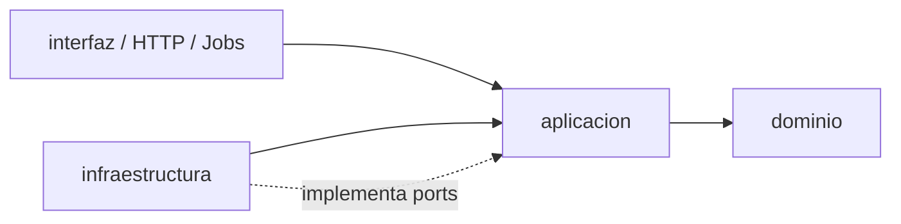

# Backend Operational Manifest - Examen de Ingreso API

Manifiesto operacional prescriptivo y determinista para agentes de Inteligencia Artificial que
operan, compilan, refactorizan o auditan el codigo fuente del backend (`back/`).

---

## 1. Vision Tecnologica y Entorno de Ejecucion
<!-- [ESTANDAR] -->

### Base Tecnologica Estandar
<!-- [ESTANDAR] -->

- **Runtime**: Deno 2.x (v2.9.7 estricto).
  <!-- verifica: back/Dockerfile -->
- **Framework HTTP**: Hono (v4.6.x).
  <!-- verifica: back/deno.json -->
- **Base de Datos**: PostgreSQL 16.
  <!-- verifica: instruccion -->
- **Acceso a Datos**: Drizzle ORM (v0.38.x) + migraciones SQL inmutables (`drizzle-kit`).
  <!-- verifica: scripts/ci/verificar-migraciones.ts -->
- **Modo de Compilacion**: TypeScript estricto (`strict: true`, `noImplicitAny: true`,
  `strictNullChecks: true`).
  <!-- verifica: back/deno.json -->
- **Estructura Transaccional**: UnitOfWork + patron Outbox (ADR-015).
  <!-- verifica: back/tests/arquitectura/dependencias.test.ts -->
- **Concurrencia**: Control optimista Compare-And-Swap (CAS) con columna `version` (ADR-005,
  ADR-016).
  <!-- verifica: instruccion -->

## 2. Comandos Deterministas de Desarrollo y CI
<!-- [ESTANDAR] -->

Ejecutar desde la raiz del backend (`back/`):

### Comandos de Desarrollo, Calidad y Migraciones
<!-- [ESTANDAR] -->

| Proposito                              | Comando Exacto                 |
| -------------------------------------- | ------------------------------ |
| Servidor de desarrollo con recarga     | `deno task dev`                |
| Worker de tareas en segundo plano      | `deno task jobs --daemon`      |
| Verificacion de tipos estatica         | `deno task check`              |
| Formateo de codigo                     | `deno task fmt`                |
| Comprobacion de formato sin mutar      | `deno task fmt:check`          |
| Linter estatico                        | `deno task lint`               |
| Pruebas unitarias, dominio y contrato  | `deno task test`               |
| Pruebas de integracion con Docker      | `deno task test:integracion`   |
| **Pipeline Completo (CI)**             | `deno task ci`                 |
| Aplicar migraciones SQL                | `deno task migrate`            |

> [!IMPORTANT]
> Prohibido asumir exito con pruebas parciales. Tras cualquier modificacion de codigo, se DEBE
> ejecutar `deno task ci` y verificar que concluya con codigo de salida 0.
> <!-- verifica: instruccion -->

> [!TIP]
> Para pruebas unitarias rapidas sin Docker, es recomendable ejecutar `deno test --parallel` para
> acelerar el procesamiento concurrente.

## 3. Limites Arquitectonicos y Guardrails Duros
<!-- [ESTANDAR] -->

El backend se rige estrictamente bajo Clean Architecture:

### Reglas Inviolables de Dependencia
<!-- [ESTANDAR] -->

1. **`dominio/`**:
   <!-- verifica: back/tests/arquitectura/dependencias.test.ts -->
   - Importa unicamente de `dominio/`.
     <!-- verifica: back/tests/arquitectura/dependencias.test.ts -->
   - CERO dependencias de librerias npm o modulos externos.
     <!-- verifica: back/tests/arquitectura/dependencias.test.ts -->
   - Objetos de Valor (VO) inmutables con `Object.freeze` y metodo factory `crear()`.
     <!-- verifica: back/tests/arquitectura/valueObjects.test.ts -->
   - Identificadores unicos mediante UUIDv7 generado en dominio (`generarUuid`).
     <!-- verifica: back/tests/arquitectura/uuid.test.ts -->
2. **`aplicacion/`**:
   <!-- verifica: back/tests/arquitectura/dependencias.test.ts -->
   - Importa exclusivamente de `dominio/`.
     <!-- verifica: back/tests/arquitectura/dependencias.test.ts -->
   - Sin dependencias de Hono, Drizzle o librerias de infraestructura.
     <!-- verifica: back/tests/arquitectura/dependencias.test.ts -->
   - Casos de uso como clases con metodo `ejecutar()`, inyeccion de dependencias via constructor
     usando contratos de `ports/`.
     <!-- verifica: back/tests/arquitectura/usecases.test.ts -->
3. **`infraestructura/`**:
   <!-- verifica: back/tests/arquitectura/dependencias.test.ts -->
   - Implementa los puertos definidos en `aplicacion/ports/`.
     <!-- verifica: back/tests/arquitectura/dependencias.test.ts -->
   - Puede utilizar librerias npm y controladores de base de datos.
     <!-- verifica: back/tests/arquitectura/dependencias.test.ts -->
   - Jamas importa de `interfaz/`.
     <!-- verifica: back/tests/arquitectura/dependencias.test.ts -->
4. **`interfaz/`**:
   <!-- verifica: back/tests/arquitectura/diManual.test.ts -->
   - Compone dependencias en `crearApp.ts` e inicia el servidor en `main.ts`.
     <!-- verifica: back/tests/arquitectura/diManual.test.ts -->
   - Mapeo de errores de dominio a codigos HTTP estandar mediante `mapeoExcepciones.ts`.
     <!-- verifica: instruccion -->

---

## 4. Observabilidad y Trazabilidad (ADR-028)
<!-- [ESTANDAR] -->

- **Puerto y Adaptador**: Todo registro tecnico se realiza por el puerto
  `aplicacion/ports/Logger.ts`. El adaptador `infraestructura/observabilidad/LoggerConsola.ts` emite
  JSON estructurado conforme al vocabulario de OpenTelemetry (`timestamp`, `severity_text`, `body`,
  `trace_id`, `attributes`).
  <!-- verifica: back/tests/arquitectura/logger.test.ts -->
- **Distincion Conceptual**: No confundir con `BitacoraService` (que es auditoria de negocio
  transaccional append-only conforme a ADR-020).
  <!-- verifica: instruccion -->
- **Identificador de Correlacion (`trace_id`)**: Cada peticion recibe un `peticionId` (UUIDv7 sin
  guiones, equivalente a un `trace_id` valido de W3C). Viaja en la cabecera HTTP `X-Peticion-Id` y
  en el cuerpo de errores 500.
  <!-- verifica: instruccion -->
- **Propagacion Asincrona sin Parametro**: Las capas profundas de aplicacion y dominio obtienen el
  identificador del puerto `ContextoEjecucion` respaldado por `AsyncLocalStorage`
  (`ContextoEjecucionAls`), sin pasarlo como argumento en las firmas de metodos.
  <!-- verifica: instruccion -->
- **Constructores y Sanitizacion**: Usar los constructores de `atributosOtel.ts` en lugar de crear
  claves OTel manualmente. Los campos sensibles (contrasenas, tokens, identificadores personales, correos) se enmascaran
  automaticamente mediante `redactar.ts`.
  <!-- verifica: instruccion -->

---

## 5. Reglas Operativas y de Seguridad
<!-- [ESTANDAR] -->

### Reglas Generales de Higiene y Migraciones
<!-- [ESTANDAR] -->

- **Prohibicion total de emojis**: NUNCA utilizar emojis en respuestas, codigo, comentarios, commits
  o documentacion.
  <!-- verifica: scripts/higiene/sin-emojis.test.ts, scripts/hooks/validar-commit.ts, scripts/doc-linter.ps1 -->
- **Secretos y Credenciales**: Todos los secretos viven en `.env` (gitignored). Jamas commitear
  credenciales o cadenas de conexion reales.
  <!-- verifica: .github/workflows/ci.yml#convenciones -->
- **Inmutabilidad de Migraciones**: Toda migracion ya aplicada en
  `src/infraestructura/persistencia/migraciones/` (registrada en `meta/_journal.json`) es
  inmutable. Todo cambio en `esquema.ts` exige generar una nueva migracion con `drizzle-kit generate`.
  <!-- verifica: scripts/ci/verificar-migraciones.ts, back/deno.json#check:migraciones -->
