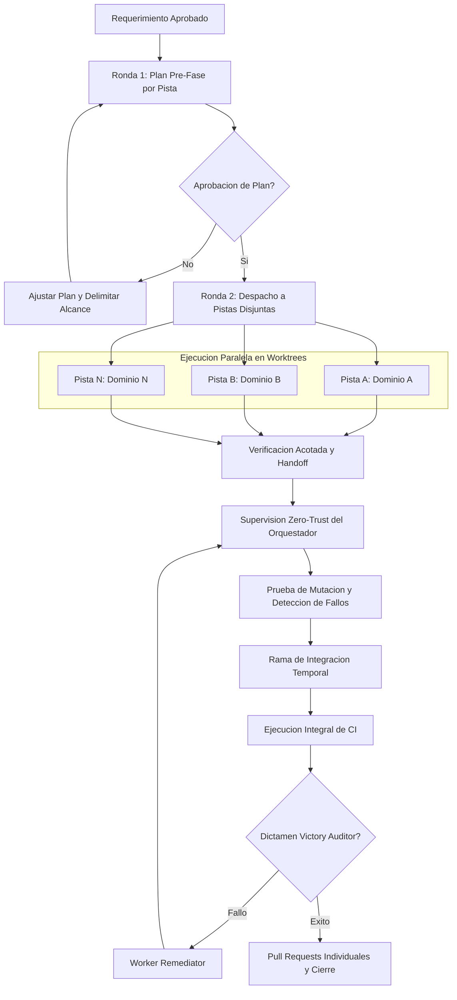

# Como operar el protocolo y flujo de colaboracion multiagente
<!-- [ESTANDAR] -->

Esta guia describe el protocolo operativo estandar para coordinar enjambres y equipos de agentes autonomos de Inteligencia Artificial en tareas complejas de ingenieria de software, refactorizacion masiva o auditoria. Establece las responsabilidades por rol, la taxonomia de artefactos de coordinacion, las compuertas de calidad innegociables y los patrones de aislamiento para ejecucion concurrente sin colisiones.

---

## 1. Principios Cardinales del Protocolo
<!-- [ESTANDAR] -->

1. **Propiedad de Archivos Estrictamente Disjunta**: Cada trabajador o pista posee un subconjunto cerrado de rutas. Queda prohibido modificar archivos ajenos. Si una pista requiere alterar un archivo fuera de su frontera, debe detenerse y reportar `[BLOQUEO_ALCANCE]`.
2. **Compuerta de Plan Pre-Fase Obligatoria (Zero-Code Gate)**: Ningun agente edita codigo o documentacion de produccion sin someter previamente un plan tecnico formal (insumos, archivos a intervenir, justificantes, orden de commits y verificacion) a revision y aprobacion del usuario o del orquestador.
3. **Auditoria Adversarial de Victoria (Zero Shared Context)**: El reclamo de terminacion de los trabajadores nunca se asume veridico por confianza ciega. Un auditor de victoria independiente, ejecutado en un contexto aislado y sin memoria compartida, verifica empiricamente las pruebas, la ausencia de atajos o simulaciones y la estricta integridad del repositorio.
4. **Higiene Absoluta y Cero Emojis**: Prohibicion estricta de pictogramas o emojis en todos los archivos, registros, mensajes de commit o artefactos generados.
5. **Aislamiento de Configuracion Git en Entornos Worktree**: En ejecuciones distribuidas mediante worktrees de Git, la configuracion local (`.git/config`) es compartida entre arboles de trabajo. Toda directiva transitoria debe ejecutarse mediante banderas inline (`git -c clave=valor`) en lugar de mutar la configuracion global del repositorio.

---

## 2. Taxonomia de Roles y Matriz de Responsabilidades
<!-- [ESTANDAR] -->

El protocolo define roles con limites de accion estrictos:

| Rol | Proposito Principal | Lo que DEBE hacer | Lo que TIENE PROHIBIDO hacer |
|---|---|---|---|
| `sentinel` | Guardian de sesion y ciclo de vida global | Monitorear el progreso general, gestionar pausas o reanudaciones, asegurar el aislamiento de contexto y despachar al auditor de victoria final. | Tomar decisiones tecnicas de diseno o implementar cambios de codigo. |
| `orchestrator` | Coordinador y despachador de tareas | Descomponer el alcance en pistas disjuntas, redactar consignas `DISPATCH.md`, supervisar compuertas intermedias y gestionar sucesiones. | Modificar archivos de produccion asignados a los trabajadores. |
| `interviewer` | Clarificacion de requerimientos | Formular preguntas estructuradas al usuario para delimitar requerimientos ambiguos antes del despacho de tareas. | Modificar codigo o redactar implementaciones tecnicas. |
| `explorer` | Reconocimiento y exploracion profunda | Inspeccionar archivos, leer codigo fuente o notas documentales, extraer citas textuales y reportar hallazgos empiricos de solo lectura. | Modificar, borrar o crear archivos fuera de su directorio de metadatos. |
| `worker` | Ejecutor e implementador tecnico | Implementar codigo, refactorizar notas, escribir pruebas automatizadas y ejecutar suites de verificacion dentro de su pista asignada. | Tocar archivos fuera de su columna asignada o reportar exito con pruebas parciales. |
| `qa_reviewer` | Verificador de integracion y calidad | Validar la consistencia entre entregables, ejecutar linters automatizados y emitir reportes formales de aseguramiento de calidad. | Alterar logica de negocio sin justificacion directa derivada de fallos del linter. |
| `challenger` | Evaluador adversarial empirico | Cuestionar hipotesis, buscar activamente discrepancias, evaluar inconsistencias analiticas y poner a prueba los entregables. | Conceder aprobaciones sin haber ejecutado comprobaciones negativas o de limite. |
| `reviewer` | Revisor de fondo, forma y directrices | Evaluar si el entregable satisface los criterios de aceptacion originales, validar la exactitud de citas y el apego a estandares. | Ejecutar mutaciones directas sobre el codigo bajo revision. |
| `auditor` | Inspector forense de integridad | Verificar el respeto estricto a las restricciones operativas (ej. modo solo lectura, ausencia de emojis, trazabilidad de cambios). | Introducir parches o correcciones directamente. |
| `victory_auditor` | Certificador independiente de victoria | Re-ejecutar de forma determinista todas las suites de prueba en contexto limpio, aplicar pruebas de mutacion y emitir el veredicto definitivo. | Compartir contexto con los trabajadores previos o aceptar autodeclaraciones de exito. |

---

## 3. Artefactos de Coordinacion y Protocolo
<!-- [ESTANDAR] -->

La comunicacion inter-agente y la memoria persistente se estructuran en archivos estandarizados:

- **`ORIGINAL_REQUEST.md`**: Registro autoritativo del requerimiento original del usuario, criterios de aceptacion y restricciones innegociables. Permanece inmutable durante el ciclo.
- **`BRIEFING.md`**: Ficha de identidad y contexto persistente de cada agente (arquetipo, identificadores, parent conversation, restricciones activas e indice de artefactos).
- **`DISPATCH.md`**: Orden de operacion formal emitida por el orquestador hacia un rol subordinado, conteniendo la mision puntual, archivos autorizados y directrices de salida.
- **`SCOPE.md`**: Matriz de desglose funcional, tabla de propiedad de archivos disjunta por pista y cronograma de hitos.
- **`progress.md`**: Bitacora granular de progreso mantenida por cada agente durante su ejecucion, incluyendo marcas de tiempo y estado de tareas.
- **`handoff.md`**: Informe formal de entrega emitido al concluir una mision. Contiene resumen de actividades, lista exhaustiva de archivos modificados, comandos de verificacion ejecutados y veredicto.
- **`GATE_STATUS.md`**: Registro formal de votacion colegiada donde revisores, evaluadores adversariales y auditores asientan su voto (`PASS` o `FAIL / REQUEST_CHANGES`).
- **`ESTADO_PAUSA_Y_PLAN_REANUDACION.md`**: Dossier de congelamiento de estado ante interrupciones de sesion, detallando el estado de cada pista, entregables parciales y el protocolo exacto para reanudar.

---

## 4. Modalidades de Ejecucion Multiagente
<!-- [ESTANDAR] -->

El protocolo soporta dos esquemas operativos complementarios:

### 4.1 Enjambre Interno Colaborativo
<!-- [ESTANDAR] -->

Utilizado para tareas complejas dentro de una misma sesion de trabajo estructurada en subdirectorios de metadatos:

1. El `sentinel` inicializa el entorno y registra la peticion en `ORIGINAL_REQUEST.md`.
2. El `orchestrator` descompone el trabajo en `SCOPE.md` y despacha subagentes especializados (`explorer` o `worker`) con consignas `DISPATCH.md`.
3. Los trabajadores ejecutan en paralelo sobre conjuntos de archivos disjuntos y reportan en `handoff.md`.
4. El colegiado de evaluacion (`reviewer`, `challenger`, `auditor`) inspecciona el entregable y emite votos en `GATE_STATUS.md`.
5. Si el gate resulta en `PASS`, el `sentinel` despacha al `victory_auditor` con contexto limpio. Al confirmar la victoria, se formaliza el cierre.

### 4.2 Orquestacion Externa Paralela sobre Worktrees de Git
<!-- [ESTANDAR] -->

Utilizado para proyectos que demandan maxima independencia fisica de archivos y compilacion concurrente:

1. **Aislamiento por Worktree**: Un orquestador externo crea ramas y directorios de trabajo independientes (`git worktree add`) para cada pista de desarrollo, asegurando que ninguna comparta archivos modificables segun la matriz de propiedad.
2. **Ronda 1 (Compuerta de Plan Pre-Fase)**: Cada agente subordinado arranca en modo planificacion y genera un plan tecnico riguroso (insumos leidos, verificacion contra su columna, lista de commits atomicos, comandos de prueba y banderas de riesgo o bloqueo de alcance). El orquestador revisa y aprueba el plan antes de permitir la edicion de archivos.
3. **Ronda 2 (Ejecucion con Verificacion Acotada)**: Cada pista reanuda su sesion y aplica sus cambios ejecutando comprobaciones acotadas (formateo, linter y pruebas unitarias de su area) para evitar colisiones de recursos o saturacion de servicios de contenedores locales.
4. **Supervision Independiente Zero-Trust**: El orquestador no confia en las afirmaciones de los trabajadores. Ejecuta de forma autonoma:
   - Inspeccion de diferencias (`git diff`) contra la tabla de propiedad.
   - Re-ejecucion independiente de las suites de prueba reportadas.
   - Escaneo estatico de convenciones y directrices de higiene.
   - Pruebas de mutacion: inyeccion transitoria de una violacion arquitectonica o documental para verificar que las pruebas fallen efectivamente al detectar la anomalia.
5. **Integracion en Rama Temporal**: Antes de someter cambios a revision final, se consolida una rama efimera de integracion mediante fusiones explicitas (`git merge --no-ff`), donde se ejecuta la suite completa de integracion continua de extremo a extremo.
6. **Entrega Granular**: Validadas todas las pruebas, se emite un Pull Request por cada pista con funcionalidad terminada para la revision y fusion manual por parte del usuario.

---

## 5. Diagrama de Flujo del Protocolo
<!-- [ESTANDAR] -->

---

## 6. Procedimiento ante Interrupciones y Reanudacion
<!-- [ESTANDAR] -->

Cuando una operacion multiagente deba suspenderse temporalmente:

1. El orquestador instruye el cese inmediato de creacion de nuevos subagentes o tareas secundarias.
2. Cada agente activo consolida el estado de sus modificaciones y emite su bitacora actualizada en `progress.md`.
3. Se compila el expediente de pausa en `ESTADO_PAUSA_Y_PLAN_REANUDACION.md`, registrando:
   - Lista de entregables y artefactos generados hasta el momento.
   - Estado de votacion en compuertas de calidad (`GATE_STATUS.md`).
   - Tareas pendientes categorizadas por criticidad y agente asignado.
   - Protocolo paso a paso para reanudar la operacion en el orden determinista requerido.
4. Al reanudar, el orquestador lee el dossier de pausa y reactiva exclusivamente los trabajadores necesarios para completar los hitos incompletos, evitando la re-exploracion redundante del proyecto.

---

## 7. Convencion de Etiquetado y Verificacion de Reglas
<!-- [ESTANDAR] -->

Para asegurar que ninguna directiva de los manifiestos operacionales (`AGENTS.md`) carezca de mecanismo de verificacion o resulte ambigua, toda regla prescriptiva (obligatoria o prohibida) debe acompanarse inmediatamente de una etiqueta de trazabilidad con la misma indentacion del item:

1. **Reglas con mecanismo automatico**:
   Se enlazan a la ruta relativa del archivo de prueba, tarea o verificador:
   `<!-- verifica: ruta/al/archivo.test.ts -->`
   Si concurren varios mecanismos, se listan separados por comas:
   `<!-- verifica: ruta/primera.test.ts, ruta/segunda.ts -->`
   Para aludir a tareas especificas de configuracion o jobs de integracion continua, se utiliza la sintaxis con ancla:
   `<!-- verifica: .github/workflows/ci.yml#job, back/deno.json#tarea -->`

2. **Reglas operacionales no automatizables**:
   Aquellas normas de conducta o juicio humano que no admiten validacion determinista por script se etiquetan como:
   `<!-- verifica: instruccion -->`
   Estas directrices nutren la lista de verificacion de `.github/pull_request_template.md`, demandando confirmacion explicita del ingeniero al someter cambios.

3. **Gobernanza documental en doc-linter**:
   La suite de auditoria `scripts/doc-linter.ps1` valida que:
   - Todo item con palabras clave normativas (`prohibido`, `obligatorio`, `DEBE`, `nunca`, `jamas`, `siempre`, `inviolable`, `inmutable`) contenga su respectiva etiqueta `verifica:`.
   - Cada ruta indicada en una etiqueta exista en el arbol de trabajo.
   - La cantidad de encabezados de nivel dos y tres coincida con el total de marcas `[ESTANDAR]` y de proyecto.

---

## 8. Configuracion Unica de Rutas del Estandar (`estandar.config.ts`)
<!-- [ESTANDAR] -->

Para mantener los mecanismos de prueba y gobernanza agnosticos al proyecto, la raiz del repositorio aloja `estandar.config.ts`. Este archivo exporta un objeto fuertemente tipado (`EstandarConfig`) que centraliza rutas y nombres que los mecanismos de arquitectura, higiene e integracion continua consultan dinamicamente.

Bases de ruta unificadas:
- **Backend (`back`)**: Define `raiz` (ej. `'back'`). Todas las rutas y archivos del backend son estrictamente relativas a dicha raiz (`src/...`), incluyendo `directorioMigraciones`, `archivoEsquema`, `directorioUseCases`, `archivosComposicionDIManual`, `generadorUuid`, `adaptadorLogger` y clases base. Los mecanismos transversales que se ejecutan desde la raiz del repositorio componen la ruta anteponiendo `back.raiz`.
- **Frontend (`front`)**: Define `raiz` (ej. `'front'`). Todas las rutas del frontend son estrictamente relativas a dicha raiz, incluyendo `rutaSrc` de cada aplicacion SPA (ej. `'web/src'` o `'src'`), la capa compartida (`'shared'`) y el indicador de sesion efimera.

Al clonar o adaptar la plantilla a otro proyecto con distribucion distinta (por ejemplo, una unica SPA en `src/` o migraciones en `src/infraestructura/database/migrations`), basta con actualizar `estandar.config.ts` sin necesidad de alterar los tests de arquitectura ni los scripts de verificacion.

