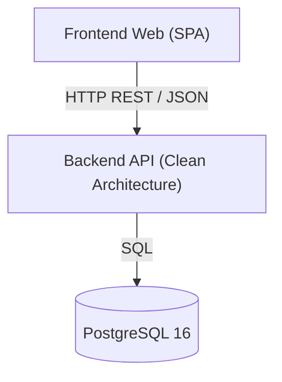

# 05. Vista de Bloques

## 5.1 Caja Blanca del Sistema Completo (Nivel 1)

[Describa la descomposicion del monorepo en sus contenedores y subsistemas principales (`back/`, `front/`, `docs/`).]

| Bloque | Responsabilidad | Ubicacion |
|---|---|---|
| Backend API | Logica de dominio, orquestacion de casos de uso y persistencia | `back/` |
| Frontend Web | Interfaz de usuario reactiva organizada bajo FSD | `front/` |
| Vault Documental | Especificacion viva de arquitectura, casos de uso y ADRs | `docs/` |

## 5.2 Nivel 2: Capas del Backend

[Describa los modulos internos de `back/src/` respetando la regla de dependencias hacia el interior.]

- **`dominio/`**: Entidades, Agregados Raiz, Value Objects inmutables y errores de negocio puros.
- **`aplicacion/`**: Casos de uso (`UseCase`), DTOs de entrada/salida y contratos de puertos (`ports/`).
- **`infraestructura/`**: Repositorios Drizzle, adaptadores de servicios externos, migraciones y telemetria.
- **`interfaz/`**: Controladores Hono, middlewares, mapeo RFC 9457, jobs y composicion DI manual.

## 5.3 Nivel 2: Modulos del Frontend y Modelo de Datos

[Describa las aplicaciones y slices de `front/` y referencie el esquema relacional en `capitulo-05-vista-de-bloques/relacional.dbml`.]
