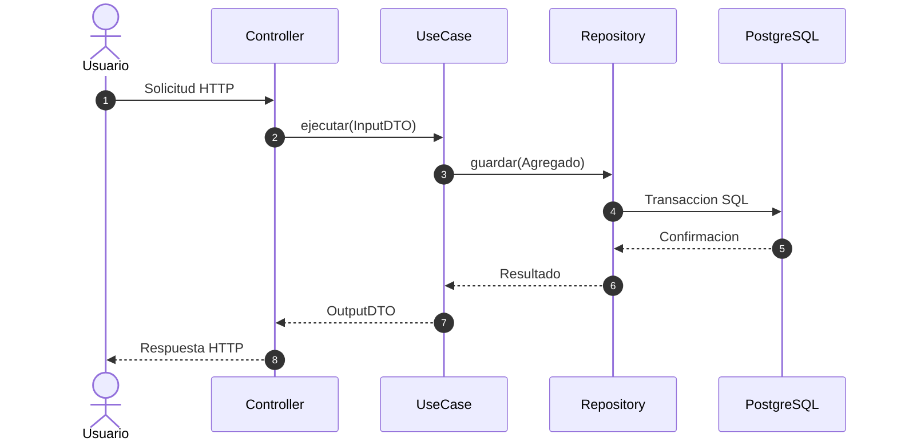

# 06. Vista de Ejecucion

## 6.1 Escenarios de Ejecucion Principales

[Describa como colaboran los bloques de construccion en tiempo de ejecucion para satisfacer los casos de uso criticos del sistema.]

## 6.2 Catalogo de Diagramas de Secuencia (`DS-CU-*`)

[Liste y enlace los diagramas de secuencia detallados ubicados en `docs/arquitectura/diagramas-secuencia/`.]

| ID | Caso de Uso Asociado | Descripcion del Flujo |
|---|---|---|
| [DS-CU-001] | [CU-001] | [Describa el flujo de ejecucion modelado] |
