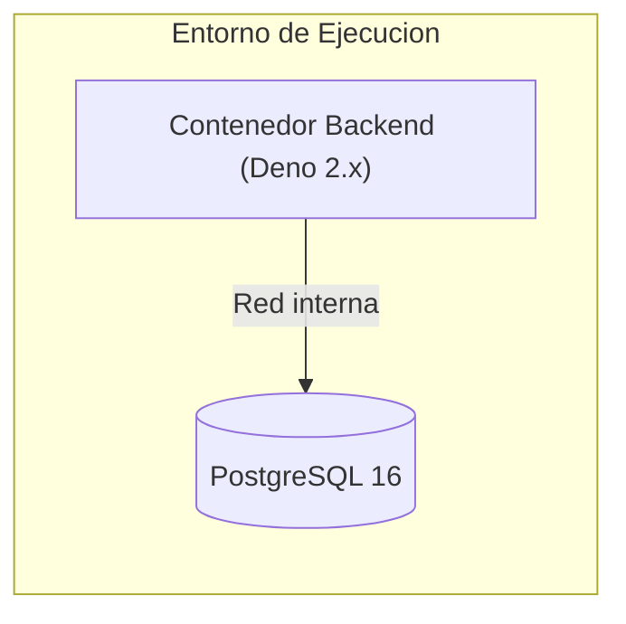

# 07. Vista de Despliegue

## 7.1 Infraestructura y Topologia de Despliegue

[Describa los nodos de ejecucion, contenedores Docker, redes virtuales, balanceadores o servicios administrados donde se despliega el sistema.]

## 7.2 Ambientes y Configuracion

[Describa los ambientes disponibles (desarrollo local, integracion continua, preproduccion, produccion) y los requisitos de recursos y variables de entorno.]

| Ambiente | Proposito | Mecanismo de Provision |
|---|---|---|
| Local / Desarrollo | Ejecucion de servicios y pruebas de integracion con Docker Compose | `docker compose up -d` |
| CI (GitHub Actions) | Validacion estatica, pruebas unitarias, Testcontainers y linter documental | `.github/workflows/ci.yml` |
| Produccion | [Describa el entorno productivo del proyecto] | [Describa el mecanismo de despliegue] |
