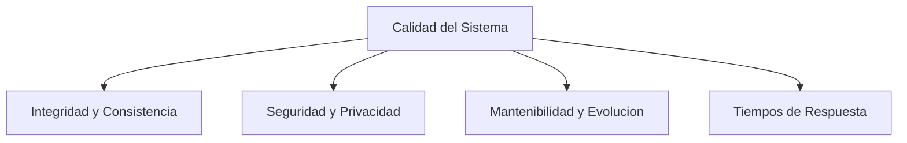

# 10. Requerimientos de Calidad

## 10.1 Arbol de Calidad

[Describa los atributos de calidad clave del sistema (rendimiento, seguridad, fiabilidad, mantenibilidad, accesibilidad WCAG 2.1 AA) y sus criterios de medicion.]

## 10.2 Escenarios de Calidad

[Describa escenarios concretos y verificables bajo la estructura Estimulo -> Entorno -> Respuesta -> Medida.]

| ID | Atributo | Escenario | Metrica / Umbral Esperado |
|---|---|---|---|
| ESC-01 | Mantenibilidad | Se introduce una dependencia prohibida entre capas de dominio e infraestructura. | El pipeline `deno task ci` falla de forma determinista con codigo distinto de cero. |
| ESC-02 | [Atributo] | [Describa el estimulo y contexto del escenario] | [Describa la metrica verificable] |
