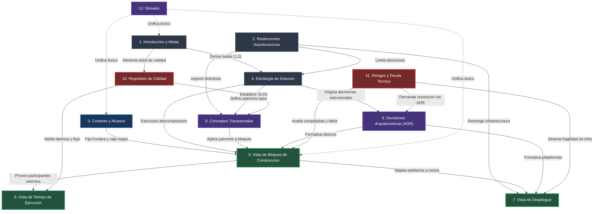
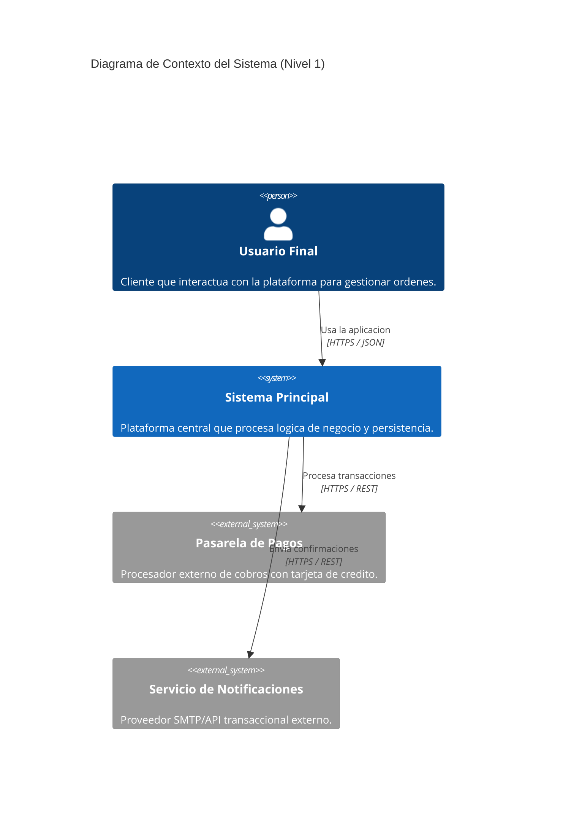
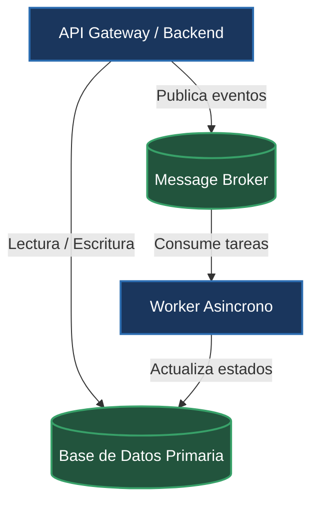
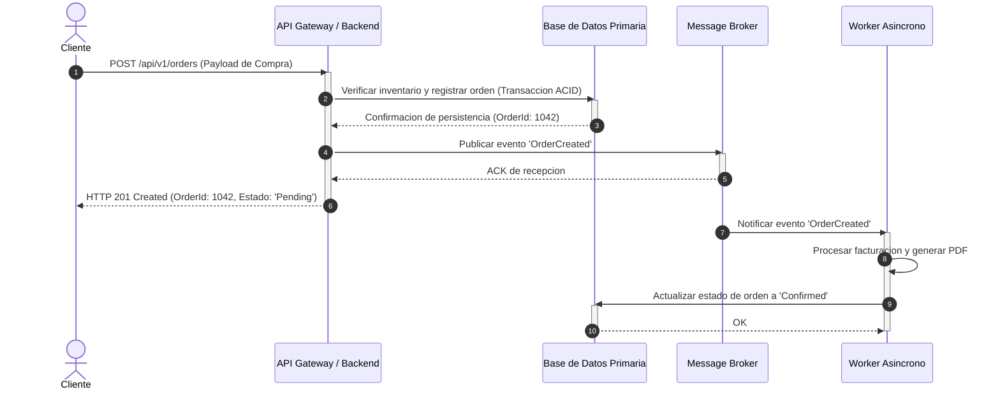
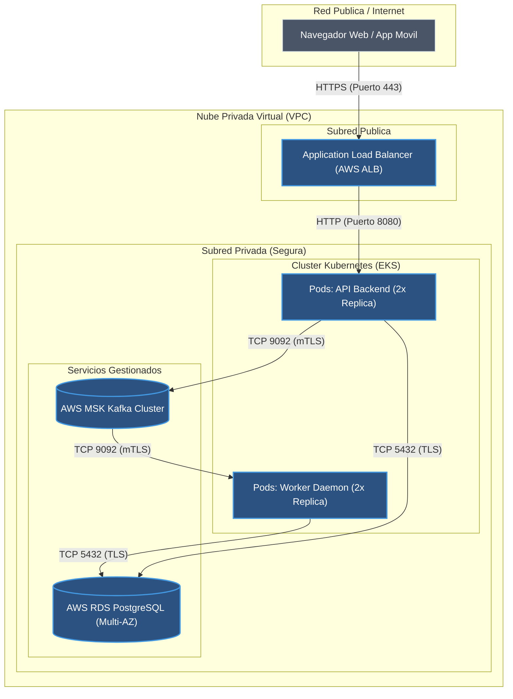
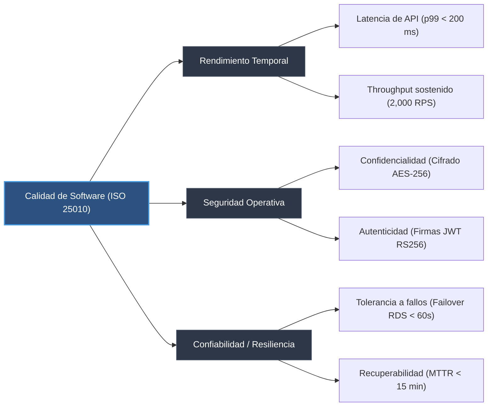
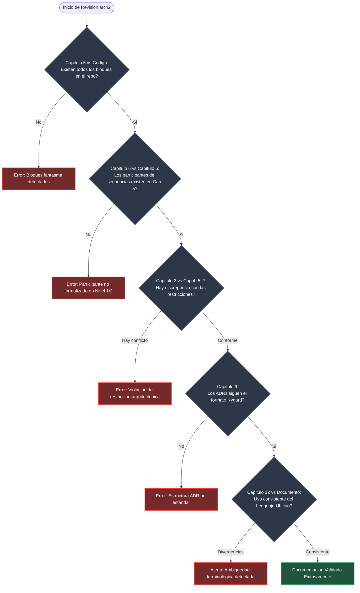

# Guia de Referencia de Capitulos arc42 para Agentes de IA

Esta guia establece las especificaciones operativas, directrices de extraccion automatizada y reglas de validacion cruzada para los 12 capitulos del estandar arc42. El contenido de este documento esta destinado exclusivamente al procesamiento, generacion y auditoria tecnica por parte de agentes de IA dentro del marco de [[arc42-overview]] y [[diataxis-framework]].

---

## 1. Introduccion y Fundamentos Normativos

El marco arc42 materializa el estandar internacional **ISO/IEC/IEEE 42010:2011** (Systems and software engineering - Architecture description), proporcionando una estructura de 12 contenedores logicos invariables. Cada capitulo encapsula un aspecto ortogonal del sistema de software, asegurando separacion de incumbencias (*separation of concerns*), completitud descriptiva y trazabilidad de requerimientos hacia la implementacion.

> [!IMPORTANT]
> Los 12 capitulos de arc42 son invariables en su numeracion, proposito y jerarquia logica. El agente de IA tiene prohibido reordenar, fusionar o renombrar los capitulos. En arquitecturas donde una seccion carezca de aplicabilidad temporal, el agente debe registrar una justificacion explicita de omision bajo el nivel Lean en lugar de suprimir el capitulo.

### Principios de Operacion para el Agente
1. **Verificacion Empirica Contra el Codigo**: Ninguna afirmacion arquitectonica debe sustentarse en suposiciones; el agente debe corroborar cada componente, interfaz y protocolo contra el arbol de codigo fuente, los archivos de configuracion y la infraestructura como codigo (IaC).
2. **Trazabilidad Bidireccional**: Toda decision tecnica (Capitulo 9) y estrategia de diseno (Capitulo 4) debe trazar directamente a una meta de calidad (Capitulo 1.2) o restriccion (Capitulo 2).
3. **Consistencia Estricta de Nomenclatura**: Las entidades y componentes identificados deben conservar un nombre univoco a traves de todos los diagramas y tablas, validado contra el Glosario (Capitulo 12).

---

## 2. Matriz Maestra de Capitulos arc42

| Capitulo | Proposito | Directrices de Extraccion para el Agente | Interdependencias |
| :--- | :--- | :--- | :--- |
| **1. Introduccion y Metas** | Definir el problema de negocio, los objetivos esenciales de la solucion, los 3 a 5 objetivos de calidad prioritarios y los stakeholders principales. | 1. Extraer requisitos esenciales desde especificaciones funcionales y `README.md`.<br>2. Formular de 3 a 5 metas de calidad siguiendo la taxonomia **ISO/IEC 25010** con metrica y umbral cuantificable.<br>3. Construir la tabla de stakeholders identificando roles, expectativas y puntos de contacto. | Fundamenta las decisiones de [[#Capitulo 4: Estrategia de Solucion]] y los escenarios de [[#Capitulo 10: Requisitos de Calidad]]. |
| **2. Restricciones Arquitectonicas** | Registrar toda limitacion tecnica, organizacional, regulatoria o temporal impuesta que reduzca la libertad de diseno del equipo. | 1. Identificar directivas corporativas, licencias de software (`LICENSE`), marcos normativos (GDPR, HIPAA, PCI-DSS) y restricciones de plataforma.<br>2. Ejecutar validacion cruzada: si una restriccion impone un motor de base de datos especifico, auditar Capitulos 4, 5, 7 y 8 para garantizar congruencia absoluta. | Restringe y condiciona las opciones disponibles en Capitulos 4, 5, 7 y 8. |
| **3. Contexto y Alcance** | Delimitar las fronteras del sistema, distinguiendo la caja negra propia de los usuarios externos y sistemas terceros. | 1. Generar un diagrama de contexto en formato Mermaid C4 Nivel 1.<br>2. Separar contextualmente la frontera en dos dimensiones:<br>&nbsp;&nbsp;a) **Contexto de Negocio**: intercambio semantico de datos y eventos de dominio.<br>&nbsp;&nbsp;b) **Contexto Tecnico**: protocolos de transporte, puertos, formatos de serializacion y politicas de autenticacion.<br>3. Restringir elementos del diagrama estrictamente a actores externos y sistemas externos. Prohibido desglosar subsistemas internos en este capitulo. | Define el limite del contenedor raiz que se descompone internamente en [[#Capitulo 5: Vista de Bloques de Construccion]]. |
| **4. Estrategia de Solucion** | Resumir las decisiones fundamentales y patrones de diseno globales que estructuran la arquitectura para satisfacer las metas de calidad. | 1. Mapear cada estrategia de alto nivel contra una meta de calidad del Capitulo 1.2.<br>2. Elaborar una tabla de correspondencia concisa con estructura: `Objetivo de Calidad` &rarr; `Escenario Critico` &rarr; `Enfoque / Patron Arquitectonico` &rarr; `Vinculo a Capitulos 5, 8 o 9`.<br>3. Explicar el racional de seleccion de estilo (monolito modular, microservicios, orientado a eventos, hexagonal). | Vincula directamente con Capitulo 1.2, desglosa hacia Capitulos 5 y 8, y se formaliza en [[#Capitulo 9: Decisiones Arquitectonicas]]. |
| **5. Vista de Bloques de Construccion** | Descomponer estaticamente el sistema en contenedores y componentes jerarquicos utilizando enfoque de caja negra a caja blanca. | 1. **Nivel 1**: Descomponer la caja negra en los contenedores principales del sistema (backend API, worker, frontend, bases de datos).<br>2. **Nivel 2**: Descomponer cada contenedor critico en modulos o componentes internos.<br>3. Construir para cada bloque una tabla con columnas: `Nombre`, `Responsabilidad Principal` (maximo 1 oracion en modo imperativo), `Interfaces Expuestas/Consumidas`, `Dependencias Directas`.<br>4. Inspeccionar el codigo fuente (AST, declaraciones de modulos, paquetes e imports) para garantizar correspondencia exacta con el codigo real. | Provee los participantes estructurales indispensables para [[#Capitulo 6: Vista de Tiempo de Ejecucion]] y los artefactos para [[#Capitulo 7: Vista de Despliegue]]. |
| **6. Vista de Tiempo de Ejecucion** | Describir el comportamiento dinamico, sincronizacion e interaccion temporal entre los bloques de construccion para flujos de valor criticos. | 1. Seleccionar entre 2 y 4 escenarios de ejecucion criticos (ej. inicializacion del sistema, transaccion core de negocio, gestion de fallos catastroficos).<br>2. Generar diagramas de secuencia Mermaid (`sequenceDiagram`).<br>3. Regla obligatoria: cada participante del diagrama DEBE coincidir inequivocamente con un bloque formalizado en el Capitulo 5. | Valida dinamicamente las responsabilidades del Capitulo 5 y modela la realizacion de los escenarios de [[#Capitulo 10: Requisitos de Calidad]]. |
| **7. Vista de Despliegue** | Documentar la infraestructura fisica, virtual o de contenedores donde se instancian y ejecutan los bloques de construccion. | 1. Analizar artefactos de infraestructura como codigo (Terraform, CloudFormation, manifiestos de Kubernetes, Docker Compose, Helm Charts).<br>2. Mapear explicitamente cada bloque de software del Capitulo 5 sobre los nodos de computo, zonas de red, clusteres o servicios gestionados.<br>3. Modelar topologias de red, canales de comunicacion inter-nodo y protocolos de transporte seguro (TLS/mTLS). | Aloja fisicamente los artefactos de software del Capitulo 5, respondiendo a las restricciones del Capitulo 2. |
| **8. Conceptos Transversales** | Detallar las soluciones y directivas arquitectonicas que aplican uniformemente a multiples partes del sistema. | 1. Documentar patrones horizontales recurrentes: autenticacion/autorizacion, observabilidad (logs estructurados, metricas, trazas distribuidas), persistencia, manejo de excepciones y resiliencia (circuit breakers, reintentos).<br>2. Identificar duplicacion de patrones en el codigo base y formalizar el estandar tecnico unificado que todos los modulos deben seguir. | Rige los estandares de codificacion aplicados a los componentes del Capitulo 5 y valida los requisitos del Capitulo 10. |
| **9. Decisiones Arquitectonicas** | Registrar formalmente las decisiones de arquitectura de impacto estructural, costosas de revertir o de alta repercusion sistemica. | 1. Utilizar obligatoriamente el formato **ADR Nygard** (Titulo, Estado, Contexto, Decision, Consecuencias).<br>2. Detectar cambios arquitectonicos en revisiones de codigo (Pull Requests, migraciones de dependencias, refactorizaciones de persistencia) y redactar borradores automaticos de ADR.<br>3. Vincular cada ADR a su respectivo bloque o concepto transversal. | Justifica las elecciones del Capitulo 4, las estructuras del Capitulo 5 y las configuraciones del Capitulo 7. |
| **10. Requisitos de Calidad** | Estructurar y cuantificar las caracteristicas de calidad del sistema mediante un arbol jerarquico y escenarios concretos. | 1. Construir un arbol de calidad jerarquico desglosando atributos de **ISO/IEC 25010**.<br>2. Redactar escenarios de calidad operativos (de uso y de cambio) con estructura: Fuente &rarr; Estimulo &rarr; Artefacto &rarr; Entorno &rarr; Respuesta &rarr; Medida de Respuesta.<br>3. Conectar cada escenario con metricas de observabilidad concretas (p95/p99 de latencia, tasa de error HTTP 5xx, MTTR, saturacion de CPU). | Deriva de las metas del Capitulo 1.2 y audita la efectividad de los patrones en Capitulos 4, 6 y 8. |
| **11. Riesgos y Deuda Tecnica** | Identificar, clasificar y priorizar las vulnerabilidades arquitectonicas, puntos de fallo unicos y deuda tecnica acumulada. | 1. Escanear el codigo fuente detectando: complejidad ciclomatica elevada (> 15), comentarios `TODO`/`FIXME`/`HACK`/`DEPRECATED`, dependencias vulnerables (CVEs conocidos) y desviaciones de diseno.<br>2. Generar una matriz de evaluacion calculando `Severidad = Impacto (1-5) x Probabilidad (1-5)`.<br>3. Proponer contramedidas arquitectonicas mitigadoras con enlaces a tareas de refactorizacion. | Se alimenta del analisis de debilidades de los Capitulos 5, 7 y 8; da origen a ADRs en el [[#Capitulo 9: Decisiones Arquitectonicas]]. |
| **12. Glosario** | Definir de forma rigurosa e inequivoca la terminologia tecnica, acronimos y entidades del Lenguaje Ubicuo del dominio. | 1. Extraer entidades de dominio recurrentes, tipos de datos centrales y modelos agregados del codigo fuente.<br>2. Operar como linter lexico: comparar terminos del codigo contra la documentacion para detectar y alertar divergencias terminologicas (ej. uso alternado de `Customer` y `Client`). | Estandariza el vocabulario utilizado a lo largo de los 11 capitulos precedentes y del codigo fuente. |

---

## 3. Grafo de Dependencias entre Capitulos

El siguiente grafo modela las dependencias estrictas entre los 12 capitulos de arc42. El agente de IA debe utilizar estas rutas de precedencia para planificar la extraccion, actualizar la documentacion ante cambios en el codigo y verificar la consistencia cruzada.



### Reglas de Precedencia Operativa
1. **Invarianza de Participantes en Tiempo de Ejecucion**: Un nodo o actor en el [[#Capitulo 6: Vista de Tiempo de Ejecucion]] no puede existir sin estar definido como bloque formal en el [[#Capitulo 5: Vista de Bloques de Construccion]].
2. **Validacion de Restricciones Negativas**: Si el [[#Capitulo 2: Restricciones Arquitectonicas]] impone una tecnologia `T` (o descarta `X`), el agente debe emitir una alerta de incompatibilidad si el [[#Capitulo 4: Estrategia de Solucion]], [[#Capitulo 5: Vista de Bloques de Construccion]] o [[#Capitulo 7: Vista de Despliegue]] introducen `X`.
3. **Comprobacion de Cobertura de Metas de Calidad**: Cada meta de calidad declarada en el Capitulo 1.2 debe poseer al menos un escenario concreto en el Capitulo 10 y una estrategia de respuesta en el Capitulo 4.

---

## 4. Estandar de Architecture Decision Records (ADR - Formato Nygard)

Toda decision tecnica de impacto estructural en el sistema debe quedar documentada en el Capitulo 9 siguiendo estrictamente el estandar propuesto por Michael Nygard.

> [!IMPORTANT]
> El agente de IA debe supervisar activamente los cambios de dependencias (`package.json`, `pom.xml`, `go.mod`, `Cargo.toml`, etc.), adiciones de esquemas de datos y creacion de modulos para proponer automaticamente un borrador de ADR en estado `Propuesto`.

### Ciclo de Vida del Estado de un ADR
- **Propuesto**: Decision formulada y abierta a evaluacion tecnica; no ejecutada en produccion.
- **Aceptado**: Decision ratificada formalmente; el codigo y la arquitectura deben converger hacia ella.
- **Obsoleto**: Decision historica que ha dejado de tener vigor debido a cambios en el dominio o la tecnologia.
- **Reemplazado por ADR-XXX**: Decision superada por una nueva resolucion tecnica; DEBE contener el enlace wikilink hacia el nuevo registro.

### Plantilla Obligatoria Nygard

```markdown
# ADR-[NUMERO]: [TITULO EN TIEMPO IMPERATIVO Y VERBO ACTIVO]

## Estado
[Propuesto | Aceptado | Obsoleto | Reemplazado por [[ADR-XXX]]]

## Contexto
[Explicar neutralmente las fuerzas tecnicas, funcionales, organizacionales o temporales en tension.
No redactar opiniones ni sesgos. Describir el problema concreto, el estado actual de la base de
codigo y que factor desencadena la necesidad de decidir.]

## Decision
[Enunciar la accion seleccionada en presente indicativo de forma afirmativa y contundente.
Especificar la solucion adoptada, la tecnologia o el patron de diseno elegido, delimitando
el alcance exacto de aplicacion.]

## Consecuencias
[Detallar las repercusiones derivadas de la adopcion de la decision. Obligatorio balancear
aspectos positivos y negativos.]

### Positivas
- [Beneficio medible o simplificacion tecnica obtenida]
- [Mejora demostrable en una meta de calidad especifica de ISO 25010]

### Negativas
- [Complejidad accidental introducida, costo operativo o sobrecarga de mantenimiento]
- [Restricciones adicionales impuestas al equipo de desarrollo]

### Neutras
- [Cambios operativos que no constituyen beneficio ni desventaja intrinseca, pero alteran el flujo]
- [Capacitaciones requeridas o convenciones de nomenclatura adoptadas]
```

### Ejemplo Practico de Referencia

```markdown
# ADR-003: Implementar Outbox Pattern para Publicacion Transaccional de Eventos

## Estado
Aceptado

## Contexto
El servicio de ordenes (`OrderService`) debe persistir el estado de la compra en PostgreSQL y notificar simultaneamente al bus de eventos Apache Kafka para que los servicios de facturacion y despacho inicien sus operaciones. La escritura dual directa entre la base de datos relacional y el cluster Kafka expone al sistema a fallos de consistencia eventual cuando la base de datos confirma pero el broker falla, o viceversa, dejando ordenes huerfanas sin evento emitido.

## Decision
Implementamos el patron Transactional Outbox. Toda operacion de negocio que genere eventos de dominio debe insertar el evento en una tabla dedicada `outbox_events` dentro de la misma transaccion ACID de PostgreSQL. Un proceso independiente (Debezium Change Data Capture) lee el Write-Ahead Log (WAL) de PostgreSQL y retransmite los registros hacia los topicos correspondientes de Kafka con garantia de entrega *at-least-once*.

## Consecuencias

### Positivas
- Garantiza consistencia transaccional absoluta entre la persistencia de negocio y la publicacion de eventos sin requerir transacciones distribuidas (2PC / XA).
- Elimina el riesgo de perdida de eventos ante caidas temporales del broker de mensajeria.

### Negativas
- Incrementa la latencia de entrega del evento en aproximadamente 150-300 ms mientras el conector CDC procesa el log.
- Requiere el despliegue, monitoreo y mantenimiento del cluster Debezium Connect como nuevo componente en la vista de despliegue.

### Neutras
- Los consumidores de Kafka deben implementar logica de deduplicacion idempotente, ya que la semantica de publicacion es *at-least-once*.
```

---

## 5. Niveles de Profundidad Arquitectonica (Lean vs Essential vs Thorough)

El agente de IA debe operar por defecto bajo el nivel **Essential**. La transicion a nivel **Lean** o **Thorough** esta sujeta a los criterios descritos a continuacion.

> [!NOTE]
> - **Lean**: Aplicable a prototipos, herramientas internas de baja criticidad o repositorios en fase exploratoria inicial.
> - **Essential (Predeterminado)**: Aplicable a sistemas estandar de produccion, servicios corporativos y aplicaciones de soporte operativo.
> - **Thorough**: Obligatorio para sistemas de mision critica, infraestructura financiera, plataformas con alta concurrencia (> 50k RPS) o arquitecturas sujetas a certificacion formal (ISO 27001, SOC 2, HIPAA).

| Capitulo | Nivel Lean | Nivel Essential (Default) | Nivel Thorough |
| :--- | :--- | :--- | :--- |
| **1. Introduccion y Metas** | 1 parrafo de objetivo general; 2 metas cualitativas; lista simple de stakeholders. | Resumen formal del sistema; 3 a 5 metas de calidad cuantitativas con metricas ISO 25010; tabla detallada de stakeholders con expectativas. | Contexto extendido con analisis de impacto de negocio; desglose completo de stakeholders primarios, secundarios y terciarios; metas de calidad vinculadas a acuerdos de nivel de servicio (SLA). |
| **2. Restricciones** | Lista en vinetas de 3 a 5 restricciones tecnicas u organizacionales obvias. | Clasificacion estructurada en: Restricciones Tecnicas, Organizacionales, Regulatorias y Temporales con justificacion de impacto. | Matriz formal de restricciones con analisis de riesgos legales, licencias transitivas de codigo abierto, mandatos de cumplimiento y ventana de vigencia. |
| **3. Contexto y Alcance** | Diagrama de contexto basico Mermaid sin desglose tecnico. | Diagrama Mermaid C4 Nivel 1; tablas independientes para Contexto de Negocio (payloads, entidades) y Contexto Tecnico (protocolos, autenticacion). | Diagrama C4 Nivel 1; especificacion tecnica exhaustiva de contratos (OpenAPI, Protobuf, AsyncAPI), limites de tasa (*rate limits*) y acuerdos de privacidad de datos. |
| **4. Estrategia de Solucion** | Declaracion del patron arquitectonico general (ej. 'Monolito en Django'). | Tabla de correspondencia: Meta de Calidad &rarr; Escenario &rarr; Patron Tecnico &rarr; Vinculo a Capitulos 5/8/9; racional de seleccion de tecnologias core. | Documento de analisis formal de alternativas evaluadas (Trade-off Analysis), evaluacion multidimensional de costos de nube y modelado de capacidad de escalado. |
| **5. Bloques de Construccion** | Nivel 1: Diagrama de contenedores y tabla de nombres con responsabilidades breves. | Nivel 1 y Nivel 2: Descomposicion de contenedores y componentes internos; tablas estructuradas con Responsabilidad, Interfaces Expuestas/Consumidas y Dependencias verificadas contra codigo. | Descomposicion multinivel hasta Nivel 3 (clases/paquetes clave); diagramas de empaquetado; trazabilidad contra el arbol completo de directorios del repositorio. |
| **6. Tiempo de Ejecucion** | 1 diagrama de secuencia Mermaid para el caso de uso principal. | 2 a 4 diagramas de secuencia Mermaid cubriendo el flujo nominal core, inicializacion y el escenario principal de fallo o degradacion. | Catalogo exhaustivo de secuencias que incluye: flujo nominal, fallos en cascada, degradacion elegante (*circuit breaking*), reintentos con backoff y escenarios de recuperacion ante desastres. |
| **7. Despliegue** | 1 diagrama simple que represente servidor, base de datos y clientes. | Mapeo estructurado de artefactos sobre infraestructura (IaC extraida de Docker/K8s/Terraform); topologia de red con separacion de zonas publicas y privadas. | Diagrama multi-region / multi-zona; esquemas detallados de balanceo de carga, ingress, mTLS, subredes, politicas de seguridad de red (NetworkPolicies) y dimensionamiento de computo/memoria. |
| **8. Conceptos Transversales** | Mencion breve de autenticacion y logging en parrafos simples. | Secciones estructuradas para: Seguridad (AuthN/AuthZ), Observabilidad (Logs, Metricas, Trazas), Persistencia, Manejo Global de Errores y Concurrencia. | Especificacion tecnica exhaustiva con snippets normativos, politicas de retencion de datos, directivas de cifrado en reposo/transito, gobernanza de secretos y esquemas de resiliencia. |
| **9. Decisiones (ADRs)** | Registro informal de decisiones en notas breves o lista simple. | Catalogo formal de ADRs en formato Nygard almacenados individualmente; estados rastreados y clasificados en la documentacion. | Repositorio completo de ADRs con analisis de opciones descartadas, matriz cuantitativa de trade-offs, arbol de consecuencias sistemicas y auditorias de cumplimiento semestrales. |
| **10. Requisitos de Calidad** | Lista de 3 deseos cualitativos (ej. 'el sistema debe ser rapido'). | Arbol de calidad ISO 25010; tabla de 5 a 8 escenarios de calidad medibles cuantificados con estimulos, respuestas y metricas de observabilidad. | Arbol de calidad exhaustivo con escenarios de uso, cambio y contingencia; correlacion matematica con paneles de telemetria y SLOs/SLIs con presupuestos de error (*error budgets*). |
| **11. Riesgos y Deuda** | Lista en vinetas de deudas conocidas y advertencias. | Matriz de riesgos clasificados por `Impacto x Probabilidad`; reporte de deuda tecnica escaneada (complejidad ciclomatica, TODOs, dependencias desactualizadas) con contramedidas. | Modelo probabilistico de riesgos (Failure Mode and Effects Analysis - FMEA); estimacion de costos financieros de remediacion; planificacion de sprints tecnicos para mitigacion de deuda. |
| **12. Glosario** | Tabla basica de acronimos y jerga interna. | Tabla formal de terminos de negocio, entidades del dominio y acronimos; verificacion cruzada contra el codigo para erradicar ambiguedad. | Ontologia formal del dominio; mapeo estricto del Lenguaje Ubicuo (DDD) asociando terminos a Bounded Contexts y clases del modelo de datos; reglas lexicas de linter automatizadas. |

---

## 6. Plantillas Markdown (Nivel Essential)

El agente de IA debe utilizar el siguiente esqueleto integral para inicializar o auditar la documentacion arquitectonica de un repositorio.

````markdown
# Documentacion de Arquitectura de Software (arc42) - [Nombre del Sistema]

## 1. Introduccion y Metas

### 1.1 Requisitos Esenciales y Problema de Negocio
<!-- Directiva para el Agente: Sintetizar en maximo 3 parrafos el proposito central del sistema, el problema operativo que resuelve y los limites de responsabilidad funcional directa. Extraer desde especificaciones funcionales o README raiz. -->

### 1.2 Metas de Calidad (ISO 25010)
<!-- Directiva para el Agente: Extraer y cuantificar de 3 a 5 metas de calidad criticas. Toda meta debe poseer una metrica y un criterio de aceptacion medible. Prohibido incluir atributos vagos como 'rapido' o 'escalable'. -->

| Prioridad | Atributo de Calidad | Meta Cuantificable | Racional de Negocio |
| :---: | :--- | :--- | :--- |
| 1 | Rendimiento / Latencia | Tiempo de respuesta p99 < 200 ms en endpoints de lectura publica bajo carga de 2,000 RPS. | Garantizar experiencia de usuario optima y retencion en catalogo. |
| 2 | Disponibilidad | Disponibilidad operativa del 99.95% en horario laboral (9:00 a 19:00 UTC). | Evitar penalizaciones por incumplimiento de contratos empresariales. |
| 3 | Mantenibilidad | Cobertura de pruebas unitarias/integracion >= 80% y complejidad ciclomatica por funcion < 12. | Reducir el tiempo de incorporacion de nuevos ingenieros y evitar regresiones. |

### 1.3 Partes Interesadas (Stakeholders)

| Rol / Grupo | Expectativas Principales | Puntos de Contacto e Interes |
| :--- | :--- | :--- |
| Usuarios Finales | Operacion fluida, interfaz responsiva y disponibilidad continua. | Interfaz web y movil. |
| Equipo de Infraestructura / SRE | Observabilidad completa, despliegues sin tiempo de inactividad (*zero-downtime*) y consumo predecible de recursos. | Metricas Prometheus, logs centralizados y manifiestos IaC. |
| Oficial de Seguridad / CISO | Cumplimiento normativo, cifrado de datos sensibles en reposo/transito y segregacion de accesos. | Auditorias de seguridad, reportes de vulnerabilidades y politicas IAM. |

---

## 2. Restricciones Arquitectonicas

### 2.1 Restricciones Tecnicas
<!-- Directiva para el Agente: Auditar dependencias y archivos de compilacion para listar lenguajes, frameworks, motores de persistencia y protocolos mandatorios. -->

- **Lenguaje y Entorno de Ejecucion**: [Ej. Node.js v20 LTS / TypeScript v5.3 / Go 1.22]
- **Persistencia Primaria**: [Ej. PostgreSQL 16 con extension PostGIS]
- **Compatibilidad de Clientes**: [Ej. Soporte para navegadores basados en Chromium >= v110, Safari >= v16]

### 2.2 Restricciones Organizacionales y Operativas
- **Control de Versiones y Flujo**: Git utilizando flujo GitHub Trunk-Based con revisiones obligatorias por pares.
- **Canal de Despliegue**: Despliegues automatizados exclusivamente a traves de GitHub Actions hacia entornos inmutables.
- **Presupuesto de Infraestructura**: Limite de computo en nube fijado segun directiva corporativa anual.

### 2.3 Restricciones Legales y Regulatorias
- **Proteccion de Datos Personales**: Cumplimiento estricto de RGPD (UE) y leyes locales de privacidad; anonimizacion obligatoria de PII en logs.
- **Licenciamiento**: Prohibicion explicita de uso de bibliotecas bajo licencias virales (GPLv3 / AGPL) dentro del codigo comercial distribuido.

---

## 3. Contexto y Alcance

### 3.1 Diagrama de Contexto del Sistema



### 3.2 Contexto de Negocio
<!-- Directiva para el Agente: Listar los intercambios de informacion desde la perspectiva funcional. Que entra y que sale del sistema en terminos de entidades de dominio. -->

| Canal / Flujo | Emisor | Receptor | Entidades e Informacion Intercambiada |
| :--- | :--- | :--- | :--- |
| Gestion de Ordenes | Usuario Final | Sistema Principal | Solicitud de creacion de orden, seleccion de productos, direccion de entrega. |
| Procesamiento de Cobro | Sistema Principal | Pasarela de Pagos | Monto total, token de tokenizacion segura, identificador de transaccion. |
| Notificacion de Estado | Sistema Principal | Proveedor Email | Destinatario, plantilla de correo, metadatos del pedido confirmado. |

### 3.3 Contexto Tecnico
<!-- Directiva para el Agente: Especificar protocolos, puertos, formatos de datos y mecanismos de autenticacion para cada canal del diagrama de contexto. -->

| Interfaz Tecnica | Protocolo de Transporte | Formato de Carga | Politica de Autenticacion / Seguridad |
| :--- | :--- | :--- | :--- |
| API Externa (Clientes) | HTTPS / TCP 443 | JSON (UTF-8) | OAuth 2.0 / Bearer Tokens JWT |
| Integracion Pagos | HTTPS / TCP 443 | JSON (REST v2) | API Key en encabezado `Authorization` + Firma HMAC |
| Despacho Notificaciones | HTTPS / TCP 443 | JSON | Basic Auth sobre TLS 1.3 |

---

## 4. Estrategia de Solucion

<!-- Directiva para el Agente: Resumir los pilares de diseno tecnico que resuelven directamente las metas de calidad del Capitulo 1.2 y las restricciones del Capitulo 2. -->

| Objetivo de Calidad | Escenario Critico | Enfoque / Patron de Solucion | Referencia a Detalles |
| :--- | :--- | :--- | :--- |
| Latencia p99 < 200 ms | Consulta de productos de alta demanda durante eventos especiales. | Implementacion de cache en memoria multi-nivel con Redis y politicas de invalidacion por eventos. | [[#Capitulo 5: Vista de Bloques de Construccion]], [[ADR-004]] |
| Disponibilidad 99.95% | Caida no planificada de una instancia de la base de datos primaria. | Cluster de base de datos con replicacion sincrona, conmutacion por error automatica (*failover*) y poolers de conexiones. | [[#Capitulo 7: Vista de Despliegue]] |
| Mantenibilidad / Desacoplamiento | Incorporacion de nuevos canales de pago sin alterar el flujo de checkout. | Arquitectura Hexagonal (Puertos y Adaptadores) segregando logica pura de librerias externas. | [[#Capitulo 5: Vista de Bloques de Construccion]], [[#Capitulo 8: Conceptos Transversales]] |

---

## 5. Vista de Bloques de Construccion

### 5.1 Nivel 1: Descomposicion del Sistema Principal (Caja Blanca)



#### Bloques de Construccion del Nivel 1

| Bloque | Responsabilidad Principal | Interfaces Expuestas / Consumidas | Dependencias |
| :--- | :--- | :--- | :--- |
| **API Gateway / Backend** | Gestionar peticiones HTTP de usuarios, autenticar llamadas y coordinar transacciones sincronas. | Expone: REST API (JSON).<br>Consume: SQL sobre TCP 5432, Kafka protocol. | Base de Datos Primaria, Message Broker. |
| **Worker Asincrono** | Ejecutar tareas de computo diferido, generacion de reportes y envio de notificaciones. | Expone: Metricas Prometheus en `/metrics`.<br>Consume: Colas del broker. | Message Broker, Base de Datos Primaria. |
| **Base de Datos Primaria** | Custodiar el estado transaccional persistente del dominio con integridad referencial. | Expone: Conexion PostgreSQL (puerto 5432). | Almacenamiento en bloque persistente. |
| **Message Broker** | Desacoplar la comunicacion asincrona entre el backend y los trabajadores. | Expone: AMQP o Kafka Protocol (puerto 9092). | Red privada del cluster. |

### 5.2 Nivel 2: Descomposicion Interna de [Contenedor Principal]
<!-- Directiva para el Agente: Seleccionar el contenedor con mayor volumen de codigo o criticidad y descomponer sus modulos/paquetes internos. Verificar nombres contra la estructura real de carpetas. -->

| Componente Interno | Responsabilidad Principal | Interfaces | Dependencias de Paquetes |
| :--- | :--- | :--- | :--- |
| `OrdersModule` | Orquestar el ciclo de vida de compras, validacion de inventario y estado. | `OrdersService`, `OrdersController` | `DbModule`, `EventBusModule` |
| `AuthModule` | Validar credenciales, verificar firmas JWT y proveer guardias de rutas. | `JwtStrategy`, `AuthGuard` | `UsersModule` |
| `PaymentsModule` | Traducir ordenes de cobro hacia los adaptadores de pasarelas externas. | `PaymentPort`, `StripeAdapter` | `OrdersModule`, HTTP Client |

---

## 6. Vista de Tiempo de Ejecucion

### 6.1 Escenario de Ejecucion Critico: [Nombre del Flujo Principal]



> [!IMPORTANT]
> Todos los participantes en el diagrama superior (`API`, `DB`, `Broker`, `Worker`) deben coincidir literalmente con los componentes formalizados en el Capitulo 5. Prohibido introducir entidades que no formen parte de la descomposicion estatica.

---

## 7. Vista de Despliegue

### 7.1 Diagrama de Infraestructura y Topologia de Red



### 7.2 Mapeo de Artefactos de Software a Nodos de Infraestructura

| Nodo de Infraestructura | Especificacion Tecnica | Artefacto de Software Desplegado | Configuracion y Escalado |
| :--- | :--- | :--- | :--- |
| **ALB (Load Balancer)** | Ingress AWS ALB administrado con terminacion TLS 1.3. | Reglas de enrutamiento de trafico y certificados ACM. | Multi-AZ, balanceo round-robin con chequeo de salud en `/healthz`. |
| **Cluster Kubernetes (EKS)** | Nodos m6i.large (2 vCPU, 8 GB RAM) administrados en subred privada. | Imagenes Docker: `backend-api:v1.4.2`, `worker-daemon:v1.4.2`. | HPA configurado: min 2, max 10 pods basado en consumo de CPU (> 70%). |
| **AWS RDS PostgreSQL** | Instancia db.r6g.xlarge, motor PostgreSQL 16.2 con Multi-AZ activo. | Esquema relacional, indices y almacenamiento de datos de negocio. | Failover automatico, snapshots automaticos diarios, retencion de 30 dias. |

---

## 8. Conceptos Transversales

### 8.1 Seguridad (Autenticacion y Autorizacion)
- **Autenticacion**: Validacion de tokens JWT firmados con clave asimetrica RS256. El agente debe verificar que las llaves privadas nunca esten en codigo y se inyecten via gestor de secretos.
- **Autorizacion**: Control de acceso basado en roles (RBAC) con guardias declarativos a nivel de controlador o metodo de servicio.
- **Proteccion de Datos**: Cifrado AES-256 en reposo para columnas PII y forzado de TLS 1.3 en todas las comunicaciones en transito.

### 8.2 Observabilidad y Telemetria
- **Logs Estructurados**: Emision estricta en formato JSON hacia `stdout` conteniendo: `timestamp`, `level`, `traceId`, `spanId`, `message` y `context`. Prohibido el uso de llamadas genericas `console.log` o `print` desestructuradas.
- **Trazabilidad Distribuida**: Propagacion obligatoria de encabezados W3C Trace Context (`traceparent`) a traves de llamadas HTTP y mensajes de eventos.
- **Metricas Operativas**: Exposicion de metricas RED (Rate, Errors, Duration) bajo el formato estandar de Prometheus en el endpoint `/metrics`.

### 8.3 Manejo Global de Excepciones y Resiliencia
- **Filtro de Excepciones Centralizado**: Todas las excepciones no controladas deben capturarse mediante un middleware global que devuelva respuestas RFC 7807 (Problem Details for HTTP APIs) sin exponer trazas internas de error (*stack traces*) al exterior.
- **Politicas de Resiliencia**: Comunicacion HTTP hacia sistemas externos protegida con timeouts estrictos (max. 3 segundos), reintentos con descarte exponencial (*exponential backoff*) y circuito de corte (*circuit breaker*).

---

## 9. Decisiones Arquitectonicas (ADR)

<!-- Directiva para el Agente: Mantener un indice ordenado de todas las decisiones estructurales documentadas bajo el formato Nygard. El agente debe inspeccionar el directorio 'docs/adr/' o crearlo si no existe. -->

| Identificador | Titulo de la Decision | Estado | Fecha de Adopcion | Enlace al Registro |
| :---: | :--- | :---: | :---: | :--- |
| ADR-001 | Seleccion de PostgreSQL como Motor Primario de Persistencia | Aceptado | 2026-01-10 | [[ADR-001]] |
| ADR-002 | Adopcion de Arquitectura Hexagonal para Desacoplamiento de Negocio | Aceptado | 2026-02-15 | [[ADR-002]] |
| ADR-003 | Implementar Outbox Pattern para Publicacion Transaccional de Eventos | Aceptado | 2026-03-01 | [[ADR-003]] |

---

## 10. Requisitos de Calidad

### 10.1 Arbol de Calidad (Taxonomia ISO 25010)



### 10.2 Escenarios de Calidad Operativos

| ID | Atributo ISO | Estimulo | Entorno | Respuesta Esperada | Medida Cuantitativa |
| :---: | :--- | :--- | :--- | :--- | :--- |
| **Q-01** | Rendimiento | 2,500 usuarios concurrentes solicitan catalogo de productos. | Sistema en operacion nominal con cache activa. | Entrega de payloads sin degradacion ni saturacion de conexiones. | Latencia p99 <= 180 ms; tasa de error HTTP 5xx = 0%. |
| **Q-02** | Resiliencia | La instancia primaria de base de datos pierde conectividad de red. | Carga nominal de 800 RPS en horario de produccion. | El balanceador conmuta a la replica pasiva sin perdida transaccional. | Interrupcion de servicio <= 45 segundos; 0 transacciones confirmadas perdidas. |
| **Q-03** | Mantenibilidad | Se agrega un nuevo metodo de autenticacion corporativa (SAML 2.0). | Fase de desarrollo y prueba en entorno de staging. | El nuevo adaptador se integra sin modificar las reglas de negocio del core. | Tiempo de implementacion <= 3 dias/persona; 0 lineas alteradas en modulo core. |

---

## 11. Riesgos y Deuda Tecnica

### 11.1 Matriz de Evaluacion de Riesgos Arquitectonicos

| ID | Riesgo Detectado | Impacto (1-5) | Probabilidad (1-5) | Severidad (I x P) | Estrategia de Mitigacion / Contramedida |
| :---: | :--- | :---: | :---: | :---: | :--- |
| **R-01** | Punto unico de fallo (SPOF) en el broker de mensajeria al operar con nodo unico en desarrollo. | 4 | 3 | **12** | Migrar a un cluster gestionado multi-nodo antes de la fase de despliegue a produccion. |
| **R-02** | Dependencia critica desactualizada en modulo de autenticacion con vulnerabilidad CVE media. | 4 | 2 | **8** | Actualizar la biblioteca a la version de parche estable y correr tests de regresion en CI. |
| **R-03** | Falta de limites de tasa (*rate limiting*) en endpoints de consulta masiva. | 3 | 4 | **12** | Desplegar middleware de token bucket en el Ingress Controller con limite de 100 req/min por IP. |

### 11.2 Registro de Deuda Tecnica en el Codigo
<!-- Directiva para el Agente: Escanear el codigo fuente y listar puntos criticos de refactorizacion detectados empiricamente. -->

| Ubicacion en Codigo | Naturaleza de la Deuda | Complejidad / Defecto | Tarea Tecnica Vinculada |
| :--- | :--- | :--- | :--- |
| `src/orders/orders.service.ts:142` | Funcion con exceso de bifurcaciones logicas. | Complejidad ciclomatica = 22. | Extraer maquina de estados para simplificar transiciones de orden. |
| `src/legacy/export.utils.ts:45` | Comentario `// FIXME: memory leak when exporting > 10k rows`. | Fuga potencial de memoria en streaming. | Reemplazar carga completa en memoria por flujo de lectura `ReadableStream`. |

---

## 12. Glosario

| Termino | Definicion de Dominio / Negocio | Sinonimos Validos | Terminos Prohibidos / Desaconsejados |
| :--- | :--- | :--- | :--- |
| **Orden (Order)** | Registro formal que agrupa la intencion de compra de un usuario, sus items y el estado de cobro. | Pedido, Compra | *Carrito* (el carrito es efimero; la orden es inmutable). |
| **Cliente (Customer)** | Entidad de negocio que posee una cuenta autenticada y realiza compras en la plataforma. | Usuario, Comprador | *Consumer* (reservado para receptores de eventos Kafka). |
| **SKU (Stock Keeping Unit)** | Identificador alfanumerico unico para cada variante fisica de producto en inventario. | Codigo de Producto | *ID de Item* (demasiado ambiguo dentro del modelo de datos). |
| **Outbox** | Tabla transaccional intermedia utilizada para desacoplar la emision de eventos de negocio. | Event Table | *Queue* (no es una cola; es una tabla relacional). |
````

---

## 7. Protocolo de Auditoria y Verificacion Cruzada para el Agente

Cuando el agente de IA ejecute tareas de generacion, revision o actualizacion sobre la documentacion arc42, debe aplicar el siguiente procedimiento de validacion:



> [!WARNING]
> La presencia de "bloques fantasma" (componentes documentados en el Capitulo 5 o 6 que no tienen correspondencia en los directorios o archivos del repositorio) constituye una falla critica de documentacion. El agente debe removerlos o senalizarlos como elementos propuestos en un ADR no ejecutado.

### Reglas Booleanas de Validacion Automatizada
1. **Regla de Participantes en Diagramas de Secuencia**:
   $$\forall p \in \text{Participantes}(\text{Capitulo 6}) \implies p \in \text{Bloques}(\text{Capitulo 5})$$
2. **Regla de Trazabilidad de Metas de Calidad**:
   $$\forall m \in \text{Metas}(\text{Capitulo 1.2}) \implies \exists e \in \text{Escenarios}(\text{Capitulo 10}) \land \exists s \in \text{Estrategias}(\text{Capitulo 4})$$
3. **Regla de Mapeo de Artefactos de Despliegue**:
   $$\forall a \in \text{Artefactos}(\text{Capitulo 5, Nivel 1}) \implies \exists n \in \text{Nodos}(\text{Capitulo 7})$$
4. **Regla de Formato ADR Nygard**:
   $$\text{ADR} = \{\text{Titulo}, \text{Estado}, \text{Contexto}, \text{Decision}, \text{Consecuencias}\} \quad \text{donde Consecuencias} = \{\text{Positivas}, \text{Negativas}, \text{Neutras}\}$$
