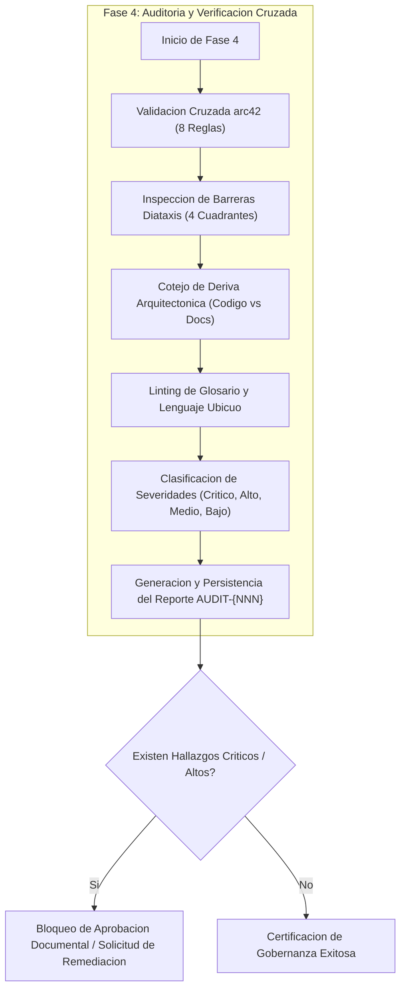
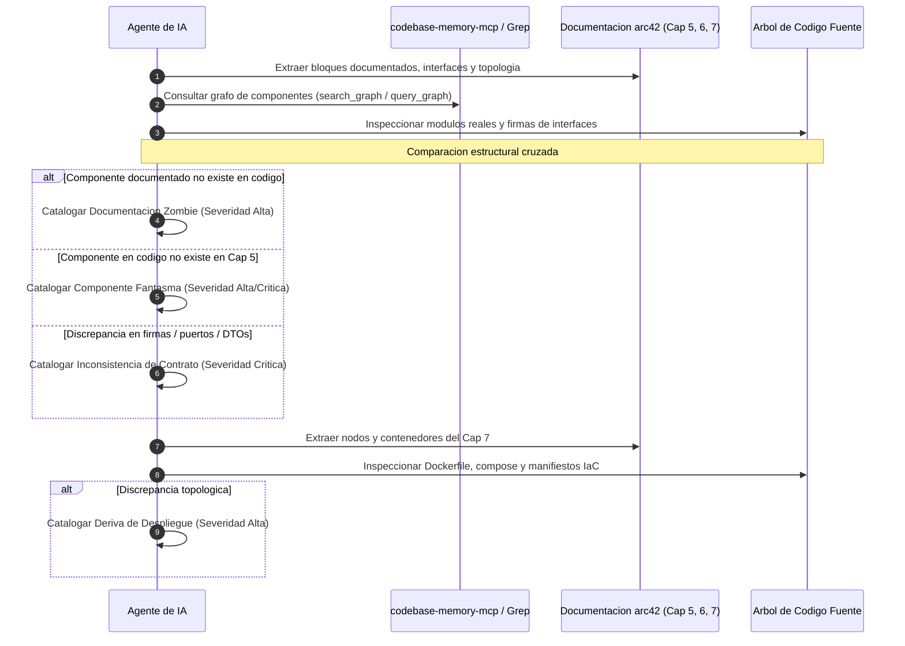
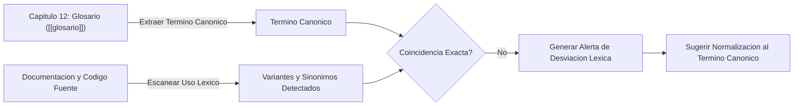

# Checklist de Auditoria Documental y Gobernanza (arc42 & Diataxis)

Guia tecnica de verificacion algoritmica y control de calidad documental para el agente de IA. Define las reglas de consistencia cruzada, la preservacion de barreras epistemologicas Diataxis, la mitigacion de deriva arquitectonica y el linting terminologico del lenguaje ubicuo.

---

## 1. Proposito

Este modulo de referencia formaliza las validaciones sistematicas que el agente de IA **DEBE** ejecutar de manera obligatoria durante la **Fase 4 (Auditoria y Verificacion Cruzada)** del ciclo de vida de gobernanza documental.

El proposito central de esta fase es certificar que la base de conocimiento tecnico del proyecto actue como una fuente viva y fidedigna de la verdad, garantizando:

1. **Integridad referencial interna**: Ningun capitulo de arc42 debe contradecir, omitir o desalinearse de los compromisos adquiridos en otros capitulos del estandar.
2. **Pureza epistemologica Diataxis**: Los documentos deben respetar estrictamente los limites de su cuadrante asignado, evitando mezclas cognitivas perjudiciales para los consumidores de la documentacion.
3. **Sincronizacion bidireccional (Codigo vs Documentacion)**: Erradicacion sistematica de componentes fantasma y documentacion zombie mediante el cotejo contra el grafo de codigo real (`codebase-memory-mcp` o busquedas de simbolos).
4. **Coherencia terminologica (Lenguaje Ubicuo)**: Apego absoluto a las definiciones del glosario formal ([[glosario]]), mitigando la ambiguedad conceptual.
5. **Persistencia y trazabilidad de hallazgos**: Registro inmutable de cada sesion de auditoria en el vault mediante notas formales en `docs/auditorias/AUDIT-{NNN}.md` creadas con herramientas MCP de Obsidian.



> [!IMPORTANT]
> El agente de IA no debe asumir que una documentacion esta al dia por el simple hecho de que no existan errores de sintaxis Markdown. Toda validacion de Fase 4 exige lectura activa y verificacion de aserciones logicas contra el codigo fuente y las notas del vault.

---

## 2. Validaciones de Consistencia entre Capitulos arc42

El agente de IA **DEBE** evaluar la matriz de consistencia estructural entre los 12 capitulos canonicos de arc42. La siguiente tabla especifica las 8 reglas de validacion cruzada obligatorias, su condicion de exito y la severidad asignada a su incumplimiento:

| Regla ID | Capitulo Origen | Capitulo Destino | Expresion / Condicion de Validacion | Severidad |
| :--- | :--- | :--- | :--- | :--- |
| **V-ARC-01** | [[capitulo-05-vista-de-bloques]] | [[capitulo-03-contexto-y-alcance]] | Todo bloque de construccion de nivel 1 o 2 que interactue con un actor externo o sistema tercero DEBE estar explicitamente listado en el diagrama de contexto y en la tabla de interfaces externas. | Critico |
| **V-ARC-02** | [[capitulo-06-vista-de-ejecucion]] | [[capitulo-05-vista-de-bloques]] | Todo participante o linea de vida en diagramas de secuencia (`DS-CU-*`) DEBE corresponder a un bloque estructural previamente declarado en el catalogo de componentes. | Alto |
| **V-ARC-03** | [[capitulo-04-estrategia-solucion]] | [[capitulo-01-introduccion-y-metas]] | Toda decision fundamental o patron arquitectonico enunciado en la estrategia DEBE vincularse explicitamente mediante wikilink a al menos una meta de calidad declarada en la seccion 1.2 (`[[capitulo-01-introduccion-y-metas#1.2 Metas de Calidad]]`). | Alto |
| **V-ARC-04** | [[capitulo-05-vista-de-bloques]] | [[capitulo-08-conceptos-transversales]] | Todo concepto transversal referenciado en la descripcion de un bloque (autenticacion, observabilidad, manejo de transacciones, cache) DEBE contar con una seccion detallada y operativa en el capitulo 8. | Medio |
| **V-ARC-05** | [[capitulo-07-vista-de-despliegue]] | [[capitulo-05-vista-de-bloques]] | Todo artefacto, contenedor o proceso asignado a un nodo de infraestructura DEBE corresponder a un componente o bloque descrito en el capitulo 5. | Alto |
| **V-ARC-06** | [[capitulo-02-restricciones]] | [[capitulo-04-estrategia-solucion]] / [[capitulo-07-vista-de-despliegue]] | Toda restriccion tecnica, organizativa o legal del capitulo 2 DEBE ser explicitamente respetada por las decisiones de diseno del capitulo 4 y la topologia del capitulo 7 sin contradicciones. | Critico |
| **V-ARC-07** | Documentacion General | [[glosario]] | Todo termino tecnico de dominio, acronimo o entidad sustantiva utilizada en el texto arquitectonico DEBE tener una entrada canonica en el capitulo 12. | Medio |
| **V-ARC-08** | [[capitulo-09-decisiones]] | Registro de ADRs (`docs/adr/`) | Todo ADR referenciado DEBE existir como archivo independiente en `docs/adr/` y presentar un estado de ciclo de vida valido: `Propuesto`, `Aceptado`, `Obsoleto` o `Reemplazado`. | Alto |

### Directivas de Inspeccion para el Agente

#### V-ARC-01: Verificacion de Frontera de Contexto
1. Extraer del capitulo 5 todos los bloques de construccion que posean dependencias salientes hacia APIs externas, bases de datos no gestionadas o pasarelas de pago.
2. Leer [[capitulo-03-contexto-y-alcance]].
3. Comprobar que cada sistema externo figure en la tabla de contexto tecnico y de negocio. Si el bloque consume un servicio externo no listado en el contexto, registrar hallazgo Critico.

#### V-ARC-02: Verificacion de Participantes en Escenarios Runtime
1. Extraer los nombres de las entidades y lineas de vida de todos los diagramas de secuencia Mermaid en [[capitulo-06-vista-de-ejecucion]] y notas `diagramas-secuencia/DS-CU-*.md`.
2. Verificar la correspondencia exacta (1:1) contra la lista de bloques de [[capitulo-05-vista-de-bloques]].
3. Si un participante representa un controlador, servicio o worker que no figura en la vista de bloques, emitir hallazgo de severidad Alta.

#### V-ARC-03: Alineacion de Estrategia con Metas de Calidad
1. Leer las decisiones clave descritas en [[capitulo-04-estrategia-solucion]].
2. Identificar la justificacion de cada decision: debe referenciar directamente los atributos de calidad (escalabilidad, latencia, disponibilidad, seguridad) definidos en [[capitulo-01-introduccion-y-metas#1.2 Metas de Calidad]].
3. Si una estrategia sustantiva carece de correlacion con las metas de negocio o atributos de calidad, marcar como hallazgo de severidad Alta.

#### V-ARC-04: Cobertura de Conceptos Transversales
1. Localizar menciones a politicas transversales en el capitulo 5 (ejemplo: cifrado en reposo, auditoria de transacciones, rate-limiting, tracing distribuido).
2. Verificar la existencia de la subseccion correspondiente dentro de [[capitulo-08-conceptos-transversales]].
3. Si el bloque asume un comportamiento transversal no normado en el capitulo 8, catalogar como severidad Media.

#### V-ARC-05: Paridad de Artefactos de Despliegue
1. Examinar los nodos y artefactos de despliegue del diagrama de topologia en [[capitulo-07-vista-de-despliegue]].
2. Mapear cada unidad ejecutable (binario, contenedor Docker, worker, frontend SPA) con su definicion de bloque en el capitulo 5.
3. Si un contenedor se encuentra en despliegue pero no existe como bloque arquitectonico, catalogar como componente no modelado (Alto).

#### V-ARC-06: Verificacion de Cumplimiento de Restricciones
1. Compilar la lista de restricciones tecnicas y regulatorias de [[capitulo-02-restricciones]] (ejemplo: PostgreSQL version minima 15, compatibilidad WCAG 2.1 AA, prohibicion de cookies no esenciales sin consentimiento previo, hosting exclusivo en servidores soberanos).
2. Auditar las tecnologias elegidas en el capitulo 4 y los servicios de nube en el capitulo 7.
3. Cualquier desviacion o incompatibilidad tecnologica respecto a las restricciones declaradas se considerara un hallazgo Critico.

#### V-ARC-07: Exhaustividad del Glosario
1. Evaluar el texto arquitectonico identificando nombres de dominio, entidades de base de datos y conceptos tecnicos de negocio.
2. Comprobar su inclusion en el archivo [[glosario]].
3. Si un termino nuclear carece de definicion, emitir hallazgo Medio.

#### V-ARC-08: Integridad y Estado de ADRs
1. Leer el inventario de decisiones arquitectonicas en [[capitulo-09-decisiones]].
2. Verificar contra los archivos fisicos en `docs/adr/`.
3. Validar que el frontmatter YAML de cada ADR posea `estado: Propuesto | Aceptado | Obsoleto | Reemplazado`.
4. Si un ADR referenciado posee un estado inexistente (ejemplo: "En discusion", "Pendiente") o carece de archivo fisico en el vault, emitir hallazgo Alto.

> [!WARNING]
> La omision de relaciones causales entre la estrategia de solucion ([[capitulo-04-estrategia-solucion]]) y las metas de calidad ([[capitulo-01-introduccion-y-metas]]) debilita la fundamentacion del diseno del sistema. El agente debe exigir trazabilidad explicita mediante enlaces directos a las secciones correspondientes.

---

## 3. Verificacion de Barreras Diataxis

El framework Diataxis divide la documentacion tecnica en cuatro cuadrantes ortogonales basados en dos ejes cardinales:
- **Eje horizontal (Intencion)**: Orientado a la adquisicion de habilidades practicas vs orientado al conocimiento teorico/conceptual.
- **Eje vertical (Modo de uso)**: En servicio del trabajo/tarea inmediata vs en servicio del estudio/comprension reflexiva.

```
                   PRACTICO (Accion)
                         ^
                         |
        TUTORIALES       |     GUIAS DE USO
      (Orientado al      |   (Orientado a tareas,
       aprendizaje)      |    usuario competente)
                         |
  <----------------------+---------------------->
  ESTUDIO                |                 TRABAJO
                         |
       EXPLICACION       |      REFERENCIA
      (Orientado a la    |   (Orientado a informacion,
       comprension)      |     consulta tecnica)
                         |
                         v
                   TEORICO (Conocimiento)
```

El agente de IA **DEBE** evaluar el contenido de cada documento segun su cuadrante declarado o inferido, comprobando la ausencia estricta de transgresiones cruzadas mediante la siguiente lista de verificacion:

### Reglas Negativas por Cuadrante

```
+-----------------------------------------------------------------------------+
|                    MATRIZ DE BARRERAS DIATAXIS                              |
+-----------------+-----------------------------------------------------------+
| Cuadrante       | Prohibiciones Estrictas (El documento NO debe contener)   |
+-----------------+-----------------------------------------------------------+
| 1. Tutorial     | - Tablas exhaustivas de referencia API o parametros CLI.  |
|                 | - Multiples alternativas o bifurcaciones de decision.     |
|                 | - Disquisiciones teoricas abstractas o justificaciones.   |
+-----------------+-----------------------------------------------------------+
| 2. Guia de Uso  | - Ejercicios formativos para principiantes.               |
|    (How-to)     | - Explicaciones extensas sobre la teoria del sistema.     |
|                 | - Catalogos completos de opciones de configuracion.       |
+-----------------+-----------------------------------------------------------+
| 3. Referencia   | - Narrativa pedagogica, opiniones personales o adjetivos. |
|                 | - Instrucciones secuenciales paso a paso ("haga clic...").|
|                 | - Justificaciones arquitectonicas historicas.             |
+-----------------+-----------------------------------------------------------+
| 4. Explicacion  | - Comandos de consola ejecutables o snippets instructivos.|
|                 | - Guias secuenciales de resolucion de problemas.          |
|                 | - Tablas de parametros crudos sin analisis conceptual.    |
+-----------------+-----------------------------------------------------------+
```

### Heuristicas de Deteccion para el Agente

#### A. Tutoriales (`guia/tutoriales/`)
- **Objetivo**: Guiar al principiante hacia un logro visible y reproducible, construyendo confianza inicial.
- **Violacion tipo 1: Inyeccion de Referencia**: Si el texto contiene tablas con mas de 5 filas de parametros de configuracion o especificaciones completas de esquemas JSON, el agente debe exigir su extraccion hacia un documento de referencia en `guia/referencia/`.
- **Violacion tipo 2: Disyuntivas y Caminos Alternativos**: Frases como *"Puede utilizar Redis o bien Memcached"*, *"Si prefiere usar Docker, ejecute X; si prefiere binario local, ejecute Y"*. El tutorial debe mantener un unico camino lineal y determinista.
- **Severidad de transgresion**: Medio.

#### B. Guias de Uso / How-To (`guia/casos-de-uso/`, `guia/tareas/`)
- **Objetivo**: Ayudar a un usuario competente a resolver una tarea especifica o caso de uso real en su flujo de trabajo.
- **Violacion tipo 1: Inclusion de Lecciones Basicas**: Si el documento gasta espacio explicando conceptos elementales como que es HTTP o como instalar el entorno basico de desarrollo.
- **Violacion tipo 2: Excursiones Teoricas**: Secciones extensas de analisis arquitectonico que no contribuyen directamente a la consecucion del objetivo practico. Deben refactorizarse con wikilinks hacia `arquitectura/`.
- **Severidad de transgresion**: Medio.

#### C. Referencia (`guia/referencia/`)
- **Objetivo**: Servir como catalogo factico, austero, exhaustivo e imparcial para la consulta inmediata de informacion tecnica.
- **Violacion tipo 1: Tono Narrativo o Juicios de Valor**: Oraciones con expresiones como *"Esta magnifica funcion permite agilizar el rendimiento"*, *"Recomendamos encarecidamente esta opcion por ser mas elegante"*. Debe sustituirse por lenguaje descriptivo objetivo y factico.
- **Violacion tipo 2: Tutoriales Encubiertos**: Secciones con listas numeradas de pasos procedurales que ensenan a realizar una operacion completa.
- **Severidad de transgresion**: Medio.

#### D. Explicacion (`arquitectura/`, `guia/explicacion/`)
- **Objetivo**: Ofrecer comprension profunda, perspectiva global, contexto historico, trade-offs y fundamentos teoricos.
- **Violacion tipo 1: Presencia de Pasos Instructivos**: Instrucciones del tipo *"Paso 1: Abra el archivo config.json; Paso 2: Pegue el siguiente bloque"*.
- **Violacion tipo 2: Comandos de Ejecucion**: Bloques de codigo bash con comandos operacionales para levantar servidores o migrar bases de datos. Deben ser reubicados a guias practicas de despliegue o administracion.
- **Severidad de transgresion**: Medio.

---

## 4. Deteccion de Deriva Arquitectonica (Codigo vs Documentacion)

El agente de IA **DEBE** ejecutar el procedimiento automatizado de deteccion de desincronizacion entre la base documental y el codigo fuente del proyecto.



### Procedimiento Algoritmico Paso a Paso

#### Paso 1: Mapeo de Bloques de Construccion vs Modulos del Grafo
1. Parsear el archivo [[capitulo-05-vista-de-bloques]] y notas asociadas en `capitulo-05-vista-de-bloques/` para extraer el conjunto de entidades documentadas:
   $$\mathcal{B}_{\text{doc}} = \{b_1, b_2, \dots, b_n\}$$
2. Invocar la herramienta `search_graph` o `query_graph` del servidor `codebase-memory-mcp` para listar los modulos de negocio, servicios y controladores reconocidos en el repositorio:
   $$\mathcal{M}_{\text{code}} = \{m_1, m_2, \dots, m_k\}$$
3. Calcular la discrepancia simetrica de conjuntos para detectar divergencias estructurales.

#### Paso 2: Verificacion de Contratos e Interfaces
1. Para cada bloque documentado con especificacion de interfaces publicas, extraer:
   - Rutas de endpoints HTTP y verbos (ejemplo: `POST /api/v1/postulaciones`).
   - Esquemas de solicitud y respuesta (DTOs, esquemas Zod o clases de transferencia).
   - Nombres de metodos y tipos de parametros en capas de servicio.
2. Localizar el archivo de codigo fuente correspondiente usando `grep_search` o `get_code_snippet`.
3. Comparar las firmas reales contra la documentacion.
4. Si la documentacion describe parametros inexistentes en el codigo o ignora parametros requeridos obligatorios, marcar como **Critico**.

#### Paso 3: Deteccion de Componentes Fantasma (*Phantom Components*)
- **Definicion**: Clases, servicios, microservicios, lambdas o controladores presentes en el codigo fuente que realizan tareas arquitectonicamente relevantes pero no se encuentran representados en el capitulo 5.
- **Accion del Agente**:
  - Filtrar componentes de infraestructura o utilitarios triviales.
  - Identificar servicios de dominio y modulos de negocio huerfanos de documentacion:
    $$\mathcal{C}_{\text{fantasma}} = \mathcal{M}_{\text{code}} \setminus \mathcal{B}_{\text{doc}}$$
  - Clasificar cada elemento segun su criticidad de negocio (Alto si expone endpoints o procesa transacciones nucleares; Medio si es un servicio de soporte interno).

#### Paso 4: Deteccion de Documentacion Zombie (*Zombie Documentation*)
- **Definicion**: Bloques, metodos, componentes o flujos descritos en arc42 que corresponden a funcionalidades retiradas, refactorizadas o renombradas en el codigo fuente.
- **Accion del Agente**:
  - Identificar elementos documentados que no cuentan con correspondencia en el AST ni en las busquedas textuales del repositorio:
    $$\mathcal{D}_{\text{zombie}} = \mathcal{B}_{\text{doc}} \setminus \mathcal{M}_{\text{code}}$$
  - Toda documentacion zombie genera confusion inmediata en los desarrolladores y riesgo operativo. Catalogar como hallazgo **Alto**.

#### Paso 5: Cotejo de la Topologia de Despliegue vs Manifiestos IaC
1. Leer los nodos, puertos, volumenes y variables de entorno documentados en [[capitulo-07-vista-de-despliegue]].
2. Inspeccionar los manifiestos de infraestructura en el repositorio:
   - Manifiestos Docker: `Dockerfile`, `docker-compose.yml`, `compose.yaml`.
   - Manifiestos Kubernetes / Helm: `k8s/*.yaml`, `charts/**/values.yaml`.
   - Infraestructura como Codigo: `terraform/*.tf`, scripts de aprovisionamiento.
3. Verificar paridad en:
   - Versiones de imagenes base (ejemplo: Node.js 20 vs 22; PostgreSQL 15 vs 16).
   - Puertos de exposicion publica e interconexion interna de redes.
   - Mecanismos de persistencia y volumenes montados.
4. En caso de discrepancias entre los puertos o topologias declaradas y los manifiestos reales, registrar hallazgo de severidad **Alta**.

---

## 5. Linting del Glosario y Lenguaje Ubicuo

El lenguaje ubicuo (Ubiquitous Language) es la base de la coherencia conceptual del software. Todo termino tecnico y entidad del dominio debe tener una denominacion unica y uniforme en la documentacion, los diagramas y el codigo fuente.



### Procedimiento de Ejecucion del Agente

#### Paso 1: Extraccion del Lexico Canonico
1. Leer el archivo [[glosario]] (o capitulo 12 de arc42).
2. Estructurar el diccionario canonico del dominio conteniendo:
   - Termino Canonico oficial.
   - Definicion formal.
   - Sinonimos comunes expresamente prohibidos o alias secundarios permitidos.
   - Ambito de aplicacion (Frontend, Backend, Base de Datos, Modelo de Dominio).

#### Paso 2: Escaneo de Sinonimos y Variantes Lexicas en Documentacion y Codigo
1. Ejecutar busquedas con `grep_search` a traves de los directorios `docs/`, `src/`, `features/`, `api/`.
2. Detectar el uso de terminos divergentes para referirse a la misma entidad conceptual.

Ejemplo ilustrativo de tabla de equivalencias a monitorear:

| Termino Canonico ([[glosario]]) | Variantes Prohibidas / No Canonicas | Contexto de Regla de Negocio | Severidad |
| :--- | :--- | :--- | :--- |
| **Usuario** | Cliente, Cuenta, Operador, Perfil | Sujeto principal autenticado en la plataforma. | Medio |
| **Organizacion** | Empresa, Entidad, Tenant, Compania | Entidad juridica asociada a suscripciones y contratos. | Medio |
| **Expediente Digital** | Legajo, Carpeta, Documentacion, Paquete | Conjunto unificado de documentos adjuntos validados. | Medio |
| **Suscripcion Activa** | Plan Vigente, Membresia, Contrato | Instrumento normativo para acceso a servicios del sistema. | Alto |
| **Evaluacion** | Diagnostico, Test, Examen, Medicion | Instrumento aplicado para registrar metricas de desempeno. | Medio |

#### Paso 3: Emision de Alertas y Acciones de Normalizacion
1. Si un documento utiliza un sinonimo en lugar del termino canonico, el agente debe registrar la ubicacion exacta (archivo y rango de lineas).
2. Proponer la sustitucion directa por el termino oficial para preservar la pureza del modelo semantico.
3. Si un concepto esencial no existe en el glosario pero se utiliza reiteradamente en el codigo, instruir la creacion del termino en [[glosario]].

---

## 6. Formato de Reporte de Auditoria

El agente de IA **DEBE** generar el reporte final utilizando estrictamente la siguiente plantilla estandarizada. 

> [!IMPORTANT]
> El reporte generado DEBE persistirse obligatoriamente en el vault de Obsidian mediante la herramienta `write_note` en la ruta:
> `docs/auditorias/AUDIT-{NNN}.md` (o `auditorias/AUDIT-{NNN}.md` de acuerdo a la estructura interna del vault).
> El identificador `{NNN}` debe ser secuencial de tres digitos, calculado examinando las notas de auditoria preexistentes para asignar el entero consecutivo.

### Plantilla de Reporte Estandarizada

````markdown
---
id: AUDIT-{NNN}
titulo: "{titulo}"
tipo: auditoria
estado: completada
fecha: {fecha-ISO}
autor: agente-ia
modo: {incremental|completa}
commits_analizados: ["{hash1}", "{hash2}"]
tags: [auditoria, documentacion, arc42, diataxis]
---

# Resumen Ejecutivo

| Severidad | Cantidad |
|:---|:---|
| Critico | X |
| Alto | X |
| Medio | X |
| Bajo | X |

## Hallazgos por Dimension

### Consistencia arc42

| # | Severidad | Elemento Doc | Elemento Codigo | Descripcion | Accion Sugerida |
|:---|:---|:---|:---|:---|:---|

### Barreras Diataxis

| # | Severidad | Documento | Cuadrante Esperado | Transgresion Detectada | Accion Sugerida |
|:---|:---|:---|:---|:---|:---|

### Deriva Arquitectonica

| # | Severidad | Componente | Estado | Descripcion | Accion Sugerida |
|:---|:---|:---|:---|:---|:---|

### Glosario y Lenguaje Ubicuo

| # | Severidad | Termino Canonico | Variante Encontrada | Ubicacion | Accion Sugerida |
|:---|:---|:---|:---|:---|:---|

## Metricas Globales

- Cobertura arc42: X/12 capitulos con contenido
- Cobertura Diataxis: X/4 cuadrantes con contenido
- ADRs registrados: X
- Ultima sincronizacion: {fecha}
- Componentes fantasma: X
- Documentacion zombie: X
````

### Reglas de Llenado para el Agente

1. **id**: Formato `AUDIT-{NNN}` donde `{NNN}` es un correlativo entero de 3 digitos con ceros a la izquierda (ejemplo: `AUDIT-025`).
2. **titulo**: Breve, conciso y en espanol tecnico formal, describiendo el alcance de la inspeccion.
3. **fecha**: Fecha ISO 8601 estricta (`AAAA-MM-DD`).
4. **modo**: Declarar `incremental` si se evaluo un conjunto delimitado de commits o archivos modificados recientemente; `completa` si se audito la totalidad de la documentacion y el codigo base.
5. **commits_analizados**: Lista de hashes Git inspeccionados durante el ciclo de verificacion.
6. **Tablas de Hallazgos**: Todas las columnas son de llenado obligatorio. Si una dimension no arrojo desviaciones, escribir una fila indicando *"Sin hallazgos en esta dimension"*.
7. **Accion Sugerida**: Debe ser una directiva tecnica precisa y accionable (ejemplo: *"Actualizar firma del endpoint en [[capitulo-05-vista-de-bloques#5.2]] para incluir el campo `usuarioId: string`"*).

---

## 7. Severidades

El agente de IA **DEBE** categorizar cada hallazgo detectado aplicando la siguiente taxonomia y criterios objetivos:

| Nivel de Severidad | Criterio de Activacion | Impacto en la Gobernanza Documental | Ejemplos Tipicos |
| :--- | :--- | :--- | :--- |
| **Critico** | La informacion documentada es **FALSA**, contradictoria o induce a fallos operativos directos al interactuar con el codigo. | **Bloqueo Inmediato**: Impide la aprobacion del PR o la certificacion del release. Exige correccion prioritaria antes de desplegar. | - API documentada con parametros inexistentes o tipos incorrectos en el codigo.<br>- Contradiccion directa de una restriccion de seguridad o privacidad de datos del capitulo 2.<br>- Diagrama de contexto que omite una base de datos externa de terceros con datos sensibles. |
| **Alto** | Falta de documentacion sobre un componente nuclear del sistema o persistencia de especificaciones sobre elementos eliminados. | **Accion Prioritaria**: Debe resolverse en el sprint en curso o en la siguiente iteracion de documentacion. | - Componente fantasma que orquesta procesos de negocio sin mencion en el capitulo 5.<br>- Documentacion zombie de microservicios o tablas SQL que ya no existen en el repositorio.<br>- Manifiesto IaC desplegando contenedores y puertos ausentes en la topologia del capitulo 7. |
| **Medio** | Desviaciones de pureza metodologica o inconsistencias terminologicas que degradan la experiencia cognitiva del usuario. | **Remediacion Programada**: Se subsana durante las tareas de mantenimiento y refactorizacion tecnica regular. | - Violacion de barreras Diataxis (ejemplo: tutorial con explicaciones teoricas extensas o tablas de referencia saturadas).<br>- Uso reiterado de sinonimos informales en lugar de los terminos canonicos del glosario.<br>- Concepto transversal referenciado en un bloque sin definicion detallada en el capitulo 8. |
| **Bajo** | Errores menores de presentacion, estilo, enlaces rotos no criticos, vacios en ejemplos complementarios o formato imperfecto. | **Deuda Tecnica Menor**: Subsanacion oportuna sin impacto funcional directo. | - Seccion o subcapitulo con encabezado valido pero texto incompleto o marcado como TODO.<br>- Ausencia de ejemplos de payload ilustrativos en llamadas exitosas de API.<br>- Formato de tabla o indentacion de codigo Mermaid mejorable. |

> [!CAUTION]
> Calificar un hallazgo como **Bajo** cuando induce al desarrollador a errores de integracion en codigo constituye una falla de auditoria. Si la discrepancia provoca que una llamada a una funcion o API falle en tiempo de ejecucion, el agente DEBE categorizarla obligatoriamente como **Critica**.
