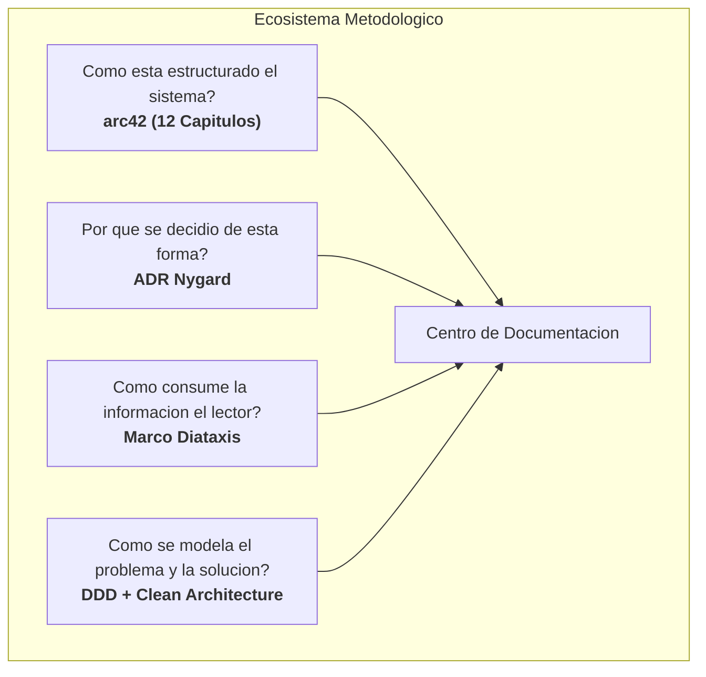
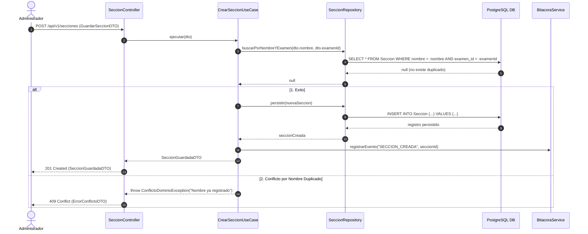
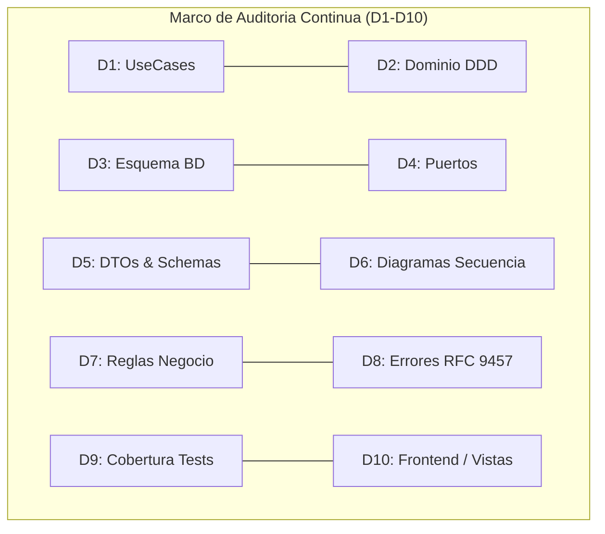

# GUIA MAESTRA DE DOCUMENTACION TECNICA DE SOFTWARE Y ARQUITECTURA
**Estandar de Ingenieria: arc42, Diataxis, ADR (Nygard), Domain-Driven Design (DDD), Clean Architecture y Auditoria Continua (D1-D10)**

---

## 1. Filosofia: La Documentacion como Grafo Vivo de Conocimiento

Una documentacion tecnica de clase empresarial no es un archivador estatico de textos en prosa ni un conjunto de diagramas desactualizados tras el primer despliegue. Es un **Grafo Vivo de Conocimiento** (*Living Knowledge Graph*) con trazabilidad bidireccional estricta:

$$\text{Requerimiento / Proceso} \longleftrightarrow \text{Caso de Uso (CU)} \longleftrightarrow \text{Diagrama de Secuencia (DS)} \longleftrightarrow \text{Codigo Fuente (UseCase / DTO / Port)} \longleftrightarrow \text{Base de Datos}$$

### Principios Fundamentales
1. **Verdad Unica y Canonica**: Todo concepto tecnico o de negocio posee una unica fuente de verdad documental con enlaces bidireccionales hacia sus consumidores.
2. **Inmutabilidad Decisional**: Las decisiones no se editan retroactivamente; se registran como registros historicos de arquitectura (ADRs) y se reemplazan mediante supersesion formal.
3. **Desacoplamiento Cognitivo**: La documentacion se segmenta segun la necesidad del lector (aprender, operar, consultar especificaciones o entender la arquitectura).
4. **Auditoria Continua (Sincronizacion Codigo <-> Documentacion)**: La documentacion se valida contra el codigo fuente mediante auditorias periodicas estructuradas en dimensiones de conformidad.

---

## 2. Los Cuatro Pilares Metodologicos



### 2.1. Marco arc42: Arquitectura en 12 Secciones Canonicas
Estandar internacional ([arc42.org](https://arc42.org/)) para comunicar la arquitectura de sistemas intensivos en software:

* **Capitulo 01 - Introduccion y Metas**: Requerimientos clave de alto nivel, matriz de partes interesadas (*stakeholders*) con sus expectativas y metas primarias de calidad (rendimiento, seguridad, disponibilidad).
* **Capitulo 02 - Restricciones de Arquitectura**: Limites innegociables organizacionales, regulatorios (ej. leyes de proteccion de datos personales, normativas gubernamentales), de hardware, presupuesto o stack tecnologico obligatorio.
* **Capitulo 03 - Contexto y Alcance**: Delimitacion clara de las fronteras del sistema. Diagramas de contexto del negocio y de contexto tecnico identificando todos los sistemas externos, protocolos (HTTP REST, SMTP, etc.) y formatos de intercambio (JSON, PDF).
* **Capitulo 04 - Estrategia de Solucion**: Decisiones fundamentales de diseno que guian la implementacion: adopcion de Clean Architecture / Hexagonal Architecture en backend, Feature-Sliced Design (FSD) en frontend, estrategias de particionado y concurrencia.
* **Capitulo 05 - Vista de Bloques**: Estructura estatica del sistema organizada en capas y niveles de abstraccion:
  * *Nivel 1 (Cajas Negras / Cajas Blancas)*: Descomposicion del sistema en subsistemas (Backend API, Frontend SPA, Base de Datos, Servicios Externos).
  * *Nivel 2 (Modelo de Dominio DDD Tactico)*: Catalogo de Agregados, Entidades Raiz, Miembros Internos, Value Objects y Servicios de Dominio.
  * *Nivel 3 (Persistencia y Datos)*: Esquema relacional formal en DBML y PostgreSQL DDL.
  * *Nivel 4 (Capa de Aplicacion)*: Catalogo de UseCases, Interfaces de Puertos (*Ports*) y Vocabulario Canonico de Excepciones.
* **Capitulo 06 - Vista de Ejecucion**: Escenarios dinamicos en tiempo de ejecucion. Maquinas de estado finito para entidades complejas, gestion de transacciones atomicas y flujos de concurrencia optimista (CAS).
* **Capitulo 07 - Vista de Despliegue**: Topologia de infraestructura: contenedores Docker, redes bridge/overlay, orquestacion, balanceadores de carga, proxies inversos y roles de base de datos con privilegios minimos asignados.
* **Capitulo 08 - Conceptos Transversales**: Patrones transversales a toda la base de codigo:
  * *Seguridad*: Hashing de contrasenas (Argon2id), tokens de sesion (JWT HS256/RS256), rate limiting, control de acceso basado en roles (RBAC).
  * *Transaccionalidad*: Patron Unit of Work y Transactional Outbox para mensajeria asincrona consistente.
  * *Observabilidad*: Logging estructurado, correlacion de peticiones mediante cabeceras HTTP (`X-Request-Id`) y metricas OpenTelemetry.
  * *Paginacion y Filtrado*: Convencion uniforme para consultas de lectura masiva.
* **Capitulo 09 - Decisiones de Arquitectura**: Enlace e inventario cruzado de todos los ADRs vigentes y supersedidos.
* **Capitulo 10 - Requerimientos de Calidad**: Arbol de calidad ISO/IEC 25010 con escenarios concretos y medibles (estimulo, fuente, entorno, respuesta y medida).
* **Capitulo 11 - Riesgos y Deuda Tecnica**: Matriz de riesgos tecnicos identificados clasificados por probabilidad e impacto, junto con sus estrategias de mitigacion.
* **Capitulo 12 - Glosario**: Lenguaje ubicuo del dominio.

---

### 2.2. Marco Diataxis: Usabilidad Cognitiva de la Documentacion
Divide la documentacion en cuatro cuadrantes segun su proposito ([diataxis.fr](https://diataxis.fr/)):

| Cuadrante | Orientacion | Proposito | Ejemplo en el Proyecto |
|---|---|---|---|
| **Tutoriales** | Orientado al Aprendizaje | Llevar a un desarrollador novato desde cero hasta su primer resultado exitoso mediante pasos guiados. | `guia/tutoriales/primer-inicio-entorno-local.md` |
| **How-To Guides** | Orientado a la Tarea | Instrucciones paso a paso para resolver un problema especifico o realizar una operacion habitual. | `guia/how-to/configurar-servidor-smtp.md` |
| **Referencia** | Orientado a la Informacion | Especificaciones tecnicas rigurosas, exactas y sin ambiguedad (CUs, APIs, DTOs, esquemas). | `guia/referencia/casos-de-uso/CU-011.md` |
| **Explicacion** | Orientado a la Comprension | Analisis de conceptos teoricos de fondo, alternativas y justificacion de por que el sistema funciona asi. | `guia/explicacion/algoritmo-calificacion-psicometrica.md` |

---

### 2.3. Decisiones de Arquitectura - Formato Michael Nygard (ADR)
Cada decision tecnica relevante (cambio de base de datos, estrategia de autenticacion, libreria critica, patron de concurrencia) debe registrarse formalmente.

#### Reglas de los ADRs:
1. **Inmutabilidad**: Un ADR una vez aprobado **jamas** se modifica ni se borra. Si el negocio o la tecnologia cambian, se redacta un nuevo ADR que **superseda** al anterior mediante enlace explicito.
2. **Segmentacion**: Mantener los ADRs organizados por contexto (ej. `adr/` para Backend/Arquitectura general y `adr/frontend/` para UI/Cliente).
3. **Estructura Estandar**:
   * **Titulo**: Numero secuencial de 3 digitos y descripcion breve en kebab-case (`ADR-001-patron-upsert-respuestas.md`).
   * **Estado**: `Propuesto`, `Aprobado`, `Rechazado`, o `Supersedido por [[ADR-0XX]]`.
   * **Contexto**: Explicacion de las fuerzas en tension, problema tecnico o requisito de negocio.
   * **Decision**: La solucion tecnica adoptada con suficiente detalle para guiar la implementacion.
   * **Consecuencias**: Desglose honesto de lo positivo (beneficios), lo negativo (complejidad anadida, dependencias) y lo neutral.

---

### 2.4. DDD Tactico y Clean Architecture
* **Entidades y Agregados**: El nucleo del negocio es agnostico a la infraestructura (sin dependencias a bases de datos, frameworks HTTP o librerias externas).
* **Agregado Raiz (Aggregate Root)**: Es la unica puerta de entrada para modificar su cluster de entidades y hacer cumplir las invariantes de negocio.
* **Capa de Aplicacion**: Compuesta por **Casos de Uso** orquestadores puros y contratos de interfaces (**Puertos / Ports**).
* **Capa de Infraestructura**: Adaptadores concretos que implementan los puertos (repositorios SQL con Drizzle/Prisma/TypeORM, servicios de envio de correos, emisores de tokens).

---

## 3. Catalogo Exhaustivo de Componentes Documentales: Que debe llevar cada seccion

### 3.1. Fichas de Actores (`docs/arquitectura/actores/`)
Documenta cada rol que interactua con el sistema para dar contexto de seguridad y UX.

* **Frontmatter YAML**: `id`, `nombre`, `modulo`, `tags: [actor/<nombre>]`.
* **Proposito y Responsabilidades**: Rol dentro de la organizacion.
* **Canal de Acceso y Autenticacion**: Tipo de credenciales (usuario/contrasena, token unico de acceso temporal, enlace con token en query params).
* **Alcance de Permisos (RBAC)**: Lista de modulos a los que tiene acceso permitido y restringido.

---

### 3.2. Macroprocesos de Negocio (`docs/arquitectura/procesos/PB-NNN.md`)
Representa flujos de negocio completos que involucran multiples casos de uso.

* **Ficha Tecnica del Proceso**:
  * **Actor Principal**: Rol lider.
  * **Modulo Arquitectonico**: Contexto delimitado.
  * **Disparador (*Trigger*)**: Evento inicial de negocio que inicia el proceso.
  * **Entradas (*Inputs*)**: Informacion requerida.
  * **Salidas (*Outputs*)**: Resultado garantizado de negocio.
* **Reglas de Negocio Asociadas**: Enlaces wikilink `[[RN-...]]`.
* **Secuencia Narrativa**: Pasos ordenados en lenguaje no tecnico.
* **Casos de Uso Vinculados**: Enlaces wikilink `[[CU-...]]`.

---

### 3.3. Casos de Uso (`docs/guia/referencia/casos-de-uso/CU-NNN.md`)
Es la especificacion funcional detallada de cada interaccion.

#### Estructura Obligatoria:
1. **Frontmatter YAML Estructurado**:
   ```yaml
   ---
   actor_principal: Administrador
   aliases: [CU-011, Gestionar secciones]
   complejidad: Media
   estado: Implementado # [Borrador | En Revision | Implementado | Deprecado]
   id: CU-011
   modulo: Creacion de Examen
   tablas_afectadas: [Seccion, Examen, Clave_Respuesta, BitacoraAuditoria]
   tags: [modulo/creacion-examen, actor/administrador]
   titulo: Gestionar secciones
   ---
   ```
2. **Descripcion e Informacion General**:
   * Resumen del caso de uso.
   * Callout de informacion general: Actor, Modulo, Reglas de Negocio relacionadas, Casos de Uso previos (prerrequisitos) y Casos de Uso siguientes.
3. **Precondiciones**: Estado garantizado del sistema y del usuario antes de la ejecucion (ej. "Usuario autenticado con rol Administrador", "Examen en estatus borrador").
4. **Flujo Principal (*Happy Path*)**: Secuencia numerada de pasos detallando la interaccion entre actor y sistema, identificando los endpoints y acciones de validacion.
5. **Flujos Alternativos y Excepciones**:
   * Variantes identificadas como `A1: Modificacion...`, `A2: Baja logica...`.
   * Condiciones de error con codigo HTTP esperado (ej. `A3: Nombre duplicado (409 Conflict)`).
6. **Postcondiciones**: Estado garantizado del sistema tras la finalizacion exitosa (registros creados/actualizados, bitacoras registradas).
7. **Contrato de Persistencia (Acciones en BD)**: Tablas exactas afectadas y tipos de operacion DML (`INSERT`, `UPDATE`, `DELETE logico`).
8. **Enlace a Diagrama de Secuencia**: Wikilink hacia `[[DS-CU-NNN-...]]`.

---

### 3.4. Diagramas de Secuencia Tecnicos (`docs/arquitectura/diagramas-secuencia/DS-CU-NNN.md`)
Representa el diseno tecnico exacto en Clean Architecture para un caso de uso.

#### Estructura Obligatoria:
1. **Frontmatter YAML**: `id`, `caso_de_uso` (wikilink al CU), `modulo`, `actor_principal`, `tablas_afectadas`, `tags`.
2. **Resumen del Contrato Tecnico**:
   * **Endpoints**: Metodo HTTP y ruta (`POST /api/v1/secciones`).
   * **Controller**: Nombre de la clase controladora (`SeccionController`).
   * **Use Case**: Nombre del caso de uso orquestador (`CrearSeccionUseCase`).
   * **Repositories / Ports**: Interfaces consumidas (`SeccionRepository`, `ExamenRepository`).
   * **Tablas BD**: Tablas involucradas.
3. **Diagrama Mermaid (`sequenceDiagram`)**:
   * `autonumber` habilitado.
   * Swimlanes ordenadas por capas arquitectonicas:
     `Actor` $\rightarrow$ `Controller` $\rightarrow$ `UseCase` $\rightarrow$ `Repository/Port` $\rightarrow$ `PostgreSQL DB` $\rightarrow$ `BitacoraService`.
   * Bloques `alt / else` para documentar la bifurcacion del flujo exitoso y los errores controlados (400, 401, 403, 404, 409, 500).



---

### 3.5. Reglas de Negocio (`docs/arquitectura/reglas/RN-XNN.md`)
Politicas, invariantes y restricciones del negocio que el software debe garantizar.

#### Estructura Obligatoria:
1. **Taxonomia de Prefijos**:
   * `RN-A*`: Agenda, cupos y capacidad horaria.
   * `RN-E*`: Estructura de pruebas, temporizadores y reactivos.
   * `RN-I*`: Identidad, jerarquia de instituciones e historiales.
   * `RN-S*`: Seguridad, autenticacion, rate limit y bloqueo de IPs/cuentas.
   * `RN-C*`: Convenios y validacion de requisitos de aspirantes.
   * `RN-F*`: Frontend, sincronizacion de estado, validacion Zod y accesibilidad.
2. **Definicion y Alcance**: Resumen de alto nivel del objetivo de la regla.
3. **Criterios de Aceptacion y Restricciones**:
   * Especificacion inequivoca de la regla.
   * Cada criterio debe terminar con un **ancla de bloque Obsidian** (`^identificador`) para permitir citar ese criterio exacto desde pruebas unitarias, codigo o reportes de auditoria:
     ```markdown
     - **Limite de tiempo global**: Si el aspirante no concluye el examen dentro del limite establecido, el sistema cerrara automaticamente la prueba y persistira el puntaje acumulado. ^limite-tiempo-examen
     ```
4. **Impacto Modular**: Modulos y servicios de dominio donde aplica la regla.
5. **Casos de Uso Impactados**: Lista de enlaces wikilinks `[[CU-...]]`.

---

### 3.6. Catalogo Canonico de DTOs y Contratos de Datos (`docs/arquitectura/dto/CATALOGO-DTO.md`)
Garantiza el desacoplamiento de capas y previene incompatibilidades de tipo entre frontend y backend.

#### Estructura Obligatoria:
1. **Matriz de Reconciliacion de Nombres**:
   * Tabla CU por CU comparando:
     `CU` | `Input DTO (Diagrama Secuencia)` | `Input DTO (Codigo Canonico)` | `Coincide?` | `Output DTO (DS)` | `Output DTO (Canonico)` | `Coincide?`
2. **Vocabulario Canonico de Excepciones (RFC 9457 Problem Details)**:
   * Cada excepcion debe estar tipada con su DTO de error y su codigo de respuesta HTTP:
     * `ConflictoDeConcurrenciaException` $\rightarrow$ `ErrorConcurrenciaDTO` (HTTP 409)
     * `ErrorAutenticacionException` $\rightarrow$ `ErrorAutenticacionDTO` (HTTP 401)
     * `CuentaBloqueadaException` $\rightarrow$ `ErrorBloqueoDTO` (HTTP 423)
     * `TiempoExcedidoException` $\rightarrow$ `ErrorExpiracionDTO` (HTTP 400/410)
     * `ReglaNegocioException` $\rightarrow$ `ErrorValidacionDTO` (HTTP 400)
     * `RecursoNoEncontradoException` $\rightarrow$ `ErrorNoEncontradoDTO` (HTTP 404)
     * `AccesoNoAutorizadoException` $\rightarrow$ `ErrorAccesoDTO` (HTTP 403)
     * `ErrorInfraestructuraException` $\rightarrow$ `ErrorServidorDTO` (HTTP 500)
3. **Contratos Estandar de Paginacion**:
   * Esquema generico para listados de lectura desacoplados de agregados transaccionales:
     ```ts
     export interface ParametrosPaginacion {
       limite?: number; // 1 a 100, default: 20
       offset?: number; // >= 0, default: 0
     }

     export interface ResultadoPaginado<T> {
       datos: T[];
       total: number;
       limite: number;
       offset: number;
     }
     ```
4. **Inventario Fisico Reconciliado**: Lista clasificada de todos los archivos DTO presentes en el codigo fuente.

---

### 3.7. Persistencia y Modelo Relacional (`docs/arquitectura/capitulo-05-vista-de-bloques/`)
* **Codigo DBML Nativo (`relacional.dbml`)**: Representa la estructura de base de datos relacional para PostgreSQL en sintaxis DBML nativa:
  * Declaracion de Enums tipados.
  * Declaracion de Tablas con campos, tipos (`uuid`, `varchar`, `timestamp with time zone`, `jsonb`), restricciones (`not null`, `unique`, `default`), y llaves foraneas explicitas (`ref: > Tabla.id`).
  * Indices simples, compuestos y unicos documentados.
* **Concurrencia Optimista (CAS)**:
  * Toda tabla que represente un agregado transicionable debe contener una columna `version integer not null default 1`.
  * Toda actualizacion de estado valida `WHERE id = :id AND version = :version_leida`, incrementando `version = version + 1`.
* **Tablas Inmutables (*Append-Only*)**:
  * Tablas como `Bitacora_Auditoria` o `Historico_Transiciones` prohiben `UPDATE` y `DELETE` a nivel de permisos de base de datos (rol con privilegio minimo).
* **Exportacion Visual Interactiva**: Archivo vectorial `relacional.svg` generado a partir del DBML para navegacion rapida.

---

### 3.8. Glosario de Lenguaje Ubicuo (`docs/glosario.md`)
Elimina la ambiguedad linguistica entre el cliente/negocio y los ingenieros de software.

#### Estructura Obligatoria:
Cada termino debe documentarse con:
* **Termino**: Nombre canonico.
* **Clasificacion**: Agregado Raiz, Entidad Compuesta, Value Object, Servicio de Dominio o Concepto de Negocio.
* **Definicion**: Explicacion precisa y sin ambiguedad en el contexto del sistema.
* **Contexto / Modulo**: Bounded Context al que pertenece.
* **Trazabilidad y Referencias**: Enlaces wikilink hacia su modelo de dominio, reglas de negocio relacionadas y casos de uso.

---

## 4. Estructura de Directorios Estandar para Nuevos Proyectos

Al iniciar un nuevo proyecto, inicializa la carpeta `docs/` con esta jerarquia:

```text
docs/
+-- .obsidian/                     # Ajustes del vault (Dataview, Templater, DBML ERD)
+-- _plantillas/                   # Plantillas maestras de notas
|   +-- PLANTILLA-ADR.md
|   +-- PLANTILLA-Actor.md
|   +-- PLANTILLA-CU.md
|   +-- PLANTILLA-DS-CU.md
|   +-- PLANTILLA-RN.md
+-- adr/                           # Registros de Decisiones de Arquitectura (Backend)
|   +-- ADR-000-historico-decisiones.md
|   +-- ADR-001-stack-tecnologico.md
|   +-- frontend/                  # Registros especificos de Arquitectura Frontend
|       +-- ADR-F001-stack-frontend.md
+-- arquitectura/                  # arc42 estructurado en 12 secciones
|   +-- capitulo-01-introduccion-y-metas.md
|   +-- capitulo-02-restricciones.md
|   +-- capitulo-03-contexto-y-alcance.md
|   +-- capitulo-04-estrategia-solucion.md
|   +-- capitulo-05-vista-de-bloques/
|   |   +-- capa-de-aplicacion/
|   |   |   +-- catalogo-de-usecases.md
|   |   |   +-- ports-de-persistencia.md
|   |   |   +-- vocabulario-de-errores.md
|   |   +-- modelo-de-dominio.md   # Modelo tactico DDD
|   |   +-- modelo-relacional.md   # Documentacion de persistencia
|   |   +-- Modelo_Dominio.drawio  # Archivo editable vectorial
|   |   +-- relacional.dbml        # Esquema DBML formal
|   |   +-- relacional.svg         # Esquema renderizado
|   +-- capitulo-06-vista-de-ejecucion.md
|   +-- capitulo-07-vista-de-despliegue.md
|   +-- capitulo-08-conceptos-transversales.md
|   +-- capitulo-09-decisiones.md
|   +-- capitulo-10-requerimientos-de-calidad.md
|   +-- capitulo-11-riesgos-y-deuda-tecnica.md
|   +-- actores/                   # Fichas individuales de actores
|   +-- diagramas-secuencia/       # DS-CU-* (Diagramas Mermaid por caso de uso)
|   +-- dto/                       # CATALOGO-DTO.md (Inventario reconciliado)
|   +-- procesos/                  # Macroprocesos PB-*
|   +-- reglas/                    # Reglas de negocio RN-*
+-- auditorias/                    # Reportes formales de sincronizacion (AUDIT-NNN)
+-- guia/                          # Marco Diataxis
|   +-- explicacion/
|   +-- how-to/
|   +-- referencia/
|   |   +-- casos-de-uso/          # CU-NNN (Casos de uso del sistema)
|   |   +-- inicio.md              # MOC (Map of Content) de referencia
|   +-- tutoriales/
+-- AGENTS.md                      # Manifiesto de gobernanza para LLMs y equipo
+-- glosario.md                    # Glosario unificado de lenguaje ubicuo
+-- README.md                      # Vista de entrada principal para GitHub/GitLab
+-- ROADMAP-V1.md                  # Hitos de entrega e historico de versiones
+-- TODO.md                        # Tablero dinamico de pendientes con Dataview
```

---

## 5. Gobernanza, Nomenclatura y Reglas de Redaccion

1. **Convenciones de Enlaces de Obsidian**:
   * Enlaces internos mediante Wikilinks: `[[NombreNota]]` o `[[NombreNota#Seccion]]`.
   * Texto visible personalizado: `[[NombreNota|Texto a Mostrar]]`.
   * Incrustacion de recursos graficos o notas: `![[diagrama.svg]]`.
   * Callouts oficiales GFM: `> [!NOTE]`, `> [!TIP]`, `> [!IMPORTANT]`, `> [!WARNING]`, `> [!CAUTION]`.
2. **Flujo de Trabajo Git para Documentacion**:
   * Las modificaciones documentales se desarrollan en ramas dedicadas: `docs/<descripcion-kebab-case>` (ej. `docs/cu-011-secciones`).
   * Commits bajo el estandar **Conventional Commits**:
     * `docs(arquitectura): agregar capitulo 05 vista de bloques`
     * `docs(cu): redactar CU-011 y diagrama DS-CU-011`
     * `adr(backend): aprobar ADR-005 sobre concurrencia CAS`
     * `docs(auditoria): publicar AUDIT-004 de sincronizacion`
   * Prohibicion absoluta de commits directos a `main`. Todo cambio documental entra por Pull Request.
3. **Politica de Cero Emojis**:
   * Queda estrictamente prohibido el uso de emojis en nombres de archivo, encabezados, tablas, notas tecnicas, mensajes de commit o pull requests. Se mantiene una redaccion formal y profesional de ingenieria.

---

## 6. Sistema de Evaluacion y Control de Calidad: Marco de Auditoria (D1-D10)

Para asegurar que la documentacion no sufra degradacion (*documentation drift*), se ejecutan auditorias periodicas (completas o incrementales) evaluando **10 Dimensiones de Sincronizacion Codigo <-> Documentacion**:



### 6.1. Definicion de las 10 Dimensiones

#### D1: Catalogo de Use Cases <-> UseCases en Codigo
* **Evaluacion**: Comparar el inventario en `catalogo-de-usecases.md` contra los archivos `*UseCase.ts` existentes en el proyecto.
* **Criterio de Calidad**:
  * *Verde*: 100% de coincidencia exacta.
  * *Alerta / Defecto*: UseCases implementados en codigo no documentados, o UseCases en documentacion sin archivo en codigo.

#### D2: Modelo de Dominio <-> Entidades, Agregados y Servicios
* **Evaluacion**: Comparar las entidades descritas en `modelo-de-dominio.md` contra los archivos en `dominio/entidades/`, `dominio/agregados/` y `dominio/servicios/`.
* **Criterio de Calidad**:
  * Todos los metodos mutadores de invariantes en las entidades raiz deben estar reflejados en la documentacion tactica.
  * Todos los servicios de dominio en codigo deben constar en la documentacion con sus agregados dependientes.

#### D3: Modelo Relacional <-> Esquema del ORM / Base de Datos
* **Evaluacion**: Comparar el archivo `relacional.dbml` contra el archivo canonico de esquema en codigo (`esquema.ts` / migraciones SQL).
* **Criterio de Calidad**:
  * Coincidencia estricta en el numero de tablas, nombres de columnas, tipos de datos, enums y restricciones de unicidad / claves foraneas.

#### D4: Puertos de Persistencia <-> Interfaces en Codigo
* **Evaluacion**: Comparar `ports-de-persistencia.md` contra los contratos en `aplicacion/ports/`.
* **Criterio de Calidad**:
  * Todo repositorio inyectado a un UseCase debe tener su puerto formalmente registrado en la documentacion.

#### D5: Catalogo de DTOs <-> Tipos y Validadores en Codigo
* **Evaluacion**: Comparar `CATALOGO-DTO.md` contra los schemas Zod / interfaces TypeScript en `aplicacion/dtos/`.
* **Criterio de Calidad**:
  * Cero discrepancias en nombres de DTO de entrada y salida entre el diagrama de secuencia, el caso de uso y el codigo.

#### D6: Diagramas de Secuencia <-> Metodos en Controllers y UseCases
* **Evaluacion**: Inspeccionar aleatoriamente o exhaustivamente los archivos `DS-CU-*.md` y contrastar el orden de invocacion contra el codigo de los Controllers y UseCases.
* **Criterio de Calidad**:
  * Los codigos de retorno HTTP documentados (200, 201, 400, 404, 409) deben ser identicos a los disparados por el codigo ante los mismos escenarios.

#### D7: Reglas de Negocio <-> Logica de Negocio y Pruebas Unitarias
* **Evaluacion**: Para cada `RN-XNN`, verificar que su criterio de aceptacion (`^ancla`) este implementado mediante un validador en dominio y que exista una prueba unitaria que cite el identificador de la regla.
* **Criterio de Calidad**:
  * Ninguna regla de negocio activa puede carecer de una comprobacion programatica en codigo.

#### D8: Vocabulario de Errores <-> Jerarquia de Excepciones
* **Evaluacion**: Contrastar `vocabulario-de-errores.md` contra las clases de error en codigo y el interceptor global HTTP.
* **Criterio de Calidad**:
  * Cada excepcion del dominio debe implementar la estructura estandar RFC 9457 Problem Details (`status`, `title`, `type`, `detail`).

#### D9: Pruebas Automatizadas <-> Cobertura de Escenarios de Casos de Uso
* **Evaluacion**: Verificar que para cada flujo principal (*Happy Path*) y flujo alternativo documentado en los CUs, exista al menos una prueba automatizada (integracion o E2E) que cubra el camino.
* **Criterio de Calidad**:
  * Trazabilidad completa entre el escenario del caso de uso y el archivo de test.

#### D10: Vistas de Frontend <-> Componentes Implementados
* **Evaluacion**: Contrastar el inventario de interfaces con las rutas y vistas implementadas en el cliente web/movil.
* **Criterio de Calidad**:
  * No deben existir pantallas desarrolladas que no respondan a un Caso de Uso documentado.

---

### 6.2. Lista de Verificacion (Definition of Done) para Aprobar una Seccion o Nota

Antes de marcar una nota o seccion documental como `Aprobado` o `Implementado`, debe superar la siguiente lista de verificacion:

- [ ] **Frontmatter Completo**: Cabecera YAML valida con `id`, `titulo`, `modulo`, `estado`, `tags` y `aliases`.
- [ ] **Sin Enlaces Rotos**: Todos los enlaces wikilink (`[[...]]`) apuntan a notas existentes en el vault (cero enlaces huerfanos).
- [ ] **Contrato Tecnico Preciso**: Si es un CU, especifica endpoints exactos, DTOs de entrada y salida y tablas afectadas.
- [ ] **Ramas de Error Documentadas**: Si es un diagrama o CU, documenta al menos 2 flujos alternativos o de error con sus codigos HTTP.
- [ ] **Anclas de Bloque**: Las restricciones de negocio poseen anclas (`^id`) para trazabilidad.
- [ ] **Cero Emojis**: Cumplimiento del estandar formal de estilo.
- [ ] **Sincronizado con Codigo**: Certificado mediante la dimension D correspondiente de la matriz de auditoria.

---

### 6.3. Reporte de Auditoria Oficial
El reporte formal de auditoria se genera conforme a la plantilla canonica en `skills/docs-governance-mastery/resources/templates/PLANTILLA-AUDIT.md`, registrando estado (`Aprobado` / `Rechazado`), commits analizados, desglose por dimension D1-D10 y metricas globales de conformidad.

---

## 7. Indice de Plantillas Maestras Oficiales

Las especificaciones detalladas de cada artefacto residen en plantillas individuales en `skills/docs-governance-mastery/resources/templates/`:

| Artefacto | Plantilla Canonica | Proposito |
| :--- | :--- | :--- |
| **Caso de Uso** | `PLANTILLA-CU.md` | Formato bimodal: Secciones 1-5 puramente funcionales; Seccion 6 tecnica con matriz de campos Zod. |
| **Historia de Usuario** | `PLANTILLA-HU.md` | Documento consolidado con criterios Gherkin y anclas `^hu-xxx`. |
| **Diagrama de Secuencia** | `PLANTILLA-DS-CU.md` | Diagrama Mermaid con capas Clean Architecture y caminos alternativos. |
| **Regla de Negocio** | `PLANTILLA-RN.md` | Restriccion de negocio pura con anclas de bloque `^ancla` (sin SQL/HTTP). |
| **Directriz de Software** | `PLANTILLA-DIR.md` | Convenciones tecnicas de ingenieria (`DIR-FRONT-*`, `DIR-BACK-*`). |
| **ADR** | `PLANTILLA-ADR.md` | Formato Nygard con Resumen Ejecutivo superior para negocio y direccion. |
| **Ficha de Actor** | `PLANTILLA-Actor.md` | Proposito institucional y flujo cotidiano previo a matriz RBAC. |
| **Onboarding** | `PLANTILLA-ONBOARDING.md` | 3 itinerarios de incorporacion por rol (Negocio, Frontend, Backend). |
| **Auditoria D1-D10** | `PLANTILLA-AUDIT.md` | Informe independiente de conformidad entre codigo y documentacion. |

