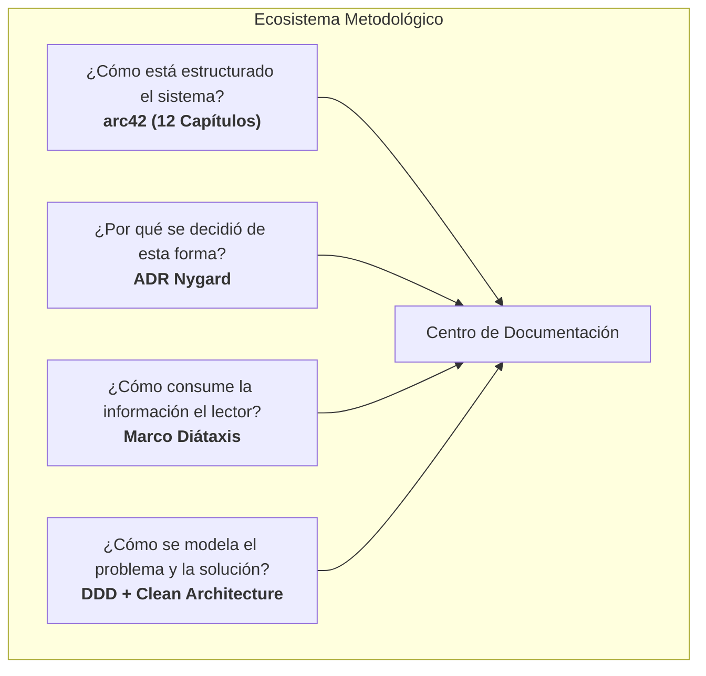
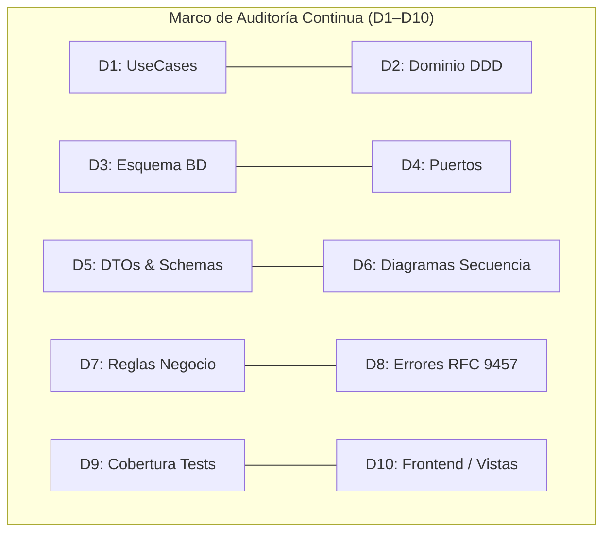

# GUÍA MAESTRA DE DOCUMENTACIÓN TÉCNICA DE SOFTWARE Y ARQUITECTURA
**Estándar de Ingeniería: arc42, Diátaxis, ADR (Nygard), Domain-Driven Design (DDD), Clean Architecture y Auditoría Continua (D1–D10)**

---

## 1. Filosofía: La Documentación como Grafo Vivo de Conocimiento

Una documentación técnica de clase empresarial no es un archivador estático de textos en prosa ni un conjunto de diagramas desactualizados tras el primer despliegue. Es un **Grafo Vivo de Conocimiento** (*Living Knowledge Graph*) con trazabilidad bidireccional estricta:

$$\text{Requerimiento / Proceso} \longleftrightarrow \text{Caso de Uso (CU)} \longleftrightarrow \text{Diagrama de Secuencia (DS)} \longleftrightarrow \text{Código Fuente (UseCase / DTO / Port)} \longleftrightarrow \text{Base de Datos}$$

### Principios Fundamentales
1. **Verdad Única y Canónica**: Todo concepto técnico o de negocio posee una única fuente de verdad documental con enlaces bidireccionales hacia sus consumidores.
2. **Inmutabilidad Decisional**: Las decisiones no se editan retroactivamente; se registran como registros históricos de arquitectura (ADRs) y se reemplazan mediante supersesión formal.
3. **Desacoplamiento Cognitivo**: La documentación se segmenta según la necesidad del lector (aprender, operar, consultar especificaciones o entender la arquitectura).
4. **Auditoría Continua (Sincronización Código ↔ Documentación)**: La documentación se valida contra el código fuente mediante auditorías periódicas estructuradas en dimensiones de conformidad.

---

## 2. Los Cuatro Pilares Metodológicos



### 2.1. Marco arc42: Arquitectura en 12 Secciones Canónicas
Estándar internacional ([arc42.org](https://arc42.org/)) para comunicar la arquitectura de sistemas intensivos en software:

* **Capítulo 01 — Introducción y Metas**: Requerimientos clave de alto nivel, matriz de partes interesadas (*stakeholders*) con sus expectativas y metas primarias de calidad (rendimiento, seguridad, disponibilidad).
* **Capítulo 02 — Restricciones de Arquitectura**: Límites innegociables organizacionales, regulatorios (ej. leyes de protección de datos personales, normativas gubernamentales), de hardware, presupuesto o stack tecnológico obligatorio.
* **Capítulo 03 — Contexto y Alcance**: Delimitación clara de las fronteras del sistema. Diagramas de contexto del negocio y de contexto técnico identificando todos los sistemas externos, protocolos (HTTP REST, SMTP, etc.) y formatos de intercambio (JSON, PDF).
* **Capítulo 04 — Estrategia de Solución**: Decisiones fundamentales de diseño que guían la implementación: adopción de Clean Architecture / Hexagonal Architecture en backend, Feature-Sliced Design (FSD) en frontend, estrategias de particionado y concurrencia.
* **Capítulo 05 — Vista de Bloques**: Estructura estática del sistema organizada en capas y niveles de abstracción:
  * *Nivel 1 (Cajas Negras / Cajas Blancas)*: Descomposición del sistema en subsistemas (Backend API, Frontend SPA, Base de Datos, Servicios Externos).
  * *Nivel 2 (Modelo de Dominio DDD Táctico)*: Catálogo de Agregados, Entidades Raíz, Miembros Internos, Value Objects y Servicios de Dominio.
  * *Nivel 3 (Persistencia y Datos)*: Esquema relacional formal en DBML y PostgreSQL DDL.
  * *Nivel 4 (Capa de Aplicación)*: Catálogo de UseCases, Interfaces de Puertos (*Ports*) y Vocabulario Canónico de Excepciones.
* **Capítulo 06 — Vista de Ejecución**: Escenarios dinámicos en tiempo de ejecución. Máquinas de estado finito para entidades complejas, gestión de transacciones atómicas y flujos de concurrencia optimista (CAS).
* **Capítulo 07 — Vista de Despliegue**: Topología de infraestructura: contenedores Docker, redes bridge/overlay, orquestación, balanceadores de carga, proxies inversos y roles de base de datos con privilegios mínimos asignados.
* **Capítulo 08 — Conceptos Transversales**: Patrones transversales a toda la base de código:
  * *Seguridad*: Hashing de contraseñas (Argon2id), tokens de sesión (JWT HS256/RS256), rate limiting, control de acceso basado en roles (RBAC).
  * *Transaccionalidad*: Patrón Unit of Work y Transactional Outbox para mensajería asíncrona consistente.
  * *Observabilidad*: Logging estructurado, correlación de peticiones mediante cabeceras HTTP (`X-Request-Id`) y métricas OpenTelemetry.
  * *Paginación y Filtrado*: Convención uniforme para consultas de lectura masiva.
* **Capítulo 09 — Decisiones de Arquitectura**: Enlace e inventario cruzado de todos los ADRs vigentes y supersedidos.
* **Capítulo 10 — Requerimientos de Calidad**: Árbol de calidad ISO/IEC 25010 con escenarios concretos y medibles (estímulo, fuente, entorno, respuesta y medida).
* **Capítulo 11 — Riesgos y Deuda Técnica**: Matriz de riesgos técnicos identificados clasificados por probabilidad e impacto, junto con sus estrategias de mitigación.
* **Capítulo 12 — Glosario**: Lenguaje ubicuo del dominio.

---

### 2.2. Marco Diátaxis: Usabilidad Cognitiva de la Documentación
Divide la documentación en cuatro cuadrantes según su propósito ([diataxis.fr](https://diataxis.fr/)):

| Cuadrante | Orientación | Propósito | Ejemplo en el Proyecto |
|---|---|---|---|
| **Tutoriales** | Orientado al Aprendizaje | Llevar a un desarrollador novato desde cero hasta su primer resultado exitoso mediante pasos guiados. | `guia/tutoriales/primer-inicio-entorno-local.md` |
| **How-To Guides** | Orientado a la Tarea | Instrucciones paso a paso para resolver un problema específico o realizar una operación habitual. | `guia/how-to/configurar-servidor-smtp.md` |
| **Referencia** | Orientado a la Información | Especificaciones técnicas rigurosas, exactas y sin ambigüedad (CUs, APIs, DTOs, esquemas). | `guia/referencia/casos-de-uso/CU-011.md` |
| **Explicación** | Orientado a la Comprensión | Análisis de conceptos teóricos de fondo, alternativas y justificación de por qué el sistema funciona así. | `guia/explicacion/algoritmo-calificacion-psicometrica.md` |

---

### 2.3. Decisiones de Arquitectura — Formato Michael Nygard (ADR)
Cada decisión técnica relevante (cambio de base de datos, estrategia de autenticación, librería crítica, patrón de concurrencia) debe registrarse formalmente.

#### Reglas de los ADRs:
1. **Inmutabilidad**: Un ADR una vez aprobado **jamás** se modifica ni se borra. Si el negocio o la tecnología cambian, se redacta un nuevo ADR que **superseda** al anterior mediante enlace explícito.
2. **Segmentación**: Mantener los ADRs organizados por contexto (ej. `adr/` para Backend/Arquitectura general y `adr/frontend/` para UI/Cliente).
3. **Estructura Estándar**:
   * **Título**: Número secuencial de 3 dígitos y descripción breve en kebab-case (`ADR-001-patron-upsert-respuestas.md`).
   * **Estado**: `Propuesto`, `Aprobado`, `Rechazado`, o `Supersedido por [[ADR-0XX]]`.
   * **Contexto**: Explicación de las fuerzas en tensión, problema técnico o requisito de negocio.
   * **Decisión**: La solución técnica adoptada con suficiente detalle para guiar la implementación.
   * **Consecuencias**: Desglose honesto de lo positivo (beneficios), lo negativo (complejidad añadida, dependencias) y lo neutral.

---

### 2.4. DDD Táctico y Clean Architecture
* **Entidades y Agregados**: El núcleo del negocio es agnóstico a la infraestructura (sin dependencias a bases de datos, frameworks HTTP o librerías externas).
* **Agregado Raíz (Aggregate Root)**: Es la única puerta de entrada para modificar su clúster de entidades y hacer cumplir las invariantes de negocio.
* **Capa de Aplicación**: Compuesta por **Casos de Uso** orquestadores puros y contratos de interfaces (**Puertos / Ports**).
* **Capa de Infraestructura**: Adaptadores concretos que implementan los puertos (repositorios SQL con Drizzle/Prisma/TypeORM, servicios de envío de correos, emisores de tokens).

---

## 3. Catálogo Exhaustivo de Componentes Documentales: Qué debe llevar cada sección

### 3.1. Fichas de Actores (`docs/arquitectura/actores/`)
Documenta cada rol que interactúa con el sistema para dar contexto de seguridad y UX.

* **Frontmatter YAML**: `id`, `nombre`, `modulo`, `tags: [actor/<nombre>]`.
* **Propósito y Responsabilidades**: Rol dentro de la organización.
* **Canal de Acceso y Autenticación**: Tipo de credenciales (usuario/contraseña, token único de acceso temporal, enlace con token en query params).
* **Alcance de Permisos (RBAC)**: Lista de módulos a los que tiene acceso permitido y restringido.

---

### 3.2. Macroprocesos de Negocio (`docs/arquitectura/procesos/PB-NNN.md`)
Representa flujos de negocio completos que involucran múltiples casos de uso.

* **Ficha Técnica del Proceso**:
  * **Actor Principal**: Rol líder.
  * **Módulo Arquitectónico**: Contexto delimitado.
  * **Disparador (*Trigger*)**: Evento inicial de negocio que inicia el proceso.
  * **Entradas (*Inputs*)**: Información requerida.
  * **Salidas (*Outputs*)**: Resultado garantizado de negocio.
* **Reglas de Negocio Asociadas**: Enlaces wikilink `[[RN-...]]`.
* **Secuencia Narrativa**: Pasos ordenados en lenguaje no técnico.
* **Casos de Uso Vinculados**: Enlaces wikilink `[[CU-...]]`.

---

### 3.3. Casos de Uso (`docs/guia/referencia/casos-de-uso/CU-NNN.md`)
Es la especificación funcional detallada de cada interacción.

#### Estructura Obligatoria:
1. **Frontmatter YAML Estructurado**:
   ```yaml
   ---
   actor_principal: Administrador
   aliases: [CU-011, Gestionar secciones]
   complejidad: Media
   estado: Implementado # [Borrador | En Revision | Implementado | Deprecado]
   id: CU-011
   modulo: Creación de Examen
   tablas_afectadas: [Seccion, Examen, Clave_Respuesta, BitacoraAuditoria]
   tags: [modulo/creacion-examen, actor/administrador]
   titulo: Gestionar secciones
   ---
   ```
2. **Descripción e Información General**:
   * Resumen del caso de uso.
   * Callout de información general: Actor, Módulo, Reglas de Negocio relacionadas, Casos de Uso previos (prerrequisitos) y Casos de Uso siguientes.
3. **Precondiciones**: Estado garantizado del sistema y del usuario antes de la ejecución (ej. "Usuario autenticado con rol Administrador", "Examen en estatus borrador").
4. **Flujo Principal (*Happy Path*)**: Secuencia numerada de pasos detallando la interacción entre actor y sistema, identificando los endpoints y acciones de validación.
5. **Flujos Alternativos y Excepciones**:
   * Variantes identificadas como `A1: Modificación...`, `A2: Baja lógica...`.
   * Condiciones de error con código HTTP esperado (ej. `A3: Nombre duplicado (409 Conflict)`).
6. **Postcondiciones**: Estado garantizado del sistema tras la finalización exitosa (registros creados/actualizados, bitácoras registradas).
7. **Contrato de Persistencia (Acciones en BD)**: Tablas exactas afectadas y tipos de operación DML (`INSERT`, `UPDATE`, `DELETE lógico`).
8. **Enlace a Diagrama de Secuencia**: Wikilink hacia `[[DS-CU-NNN-...]]`.

---

### 3.4. Diagramas de Secuencia Técnicos (`docs/arquitectura/diagramas-secuencia/DS-CU-NNN.md`)
Representa el diseño técnico exacto en Clean Architecture para un caso de uso.

#### Estructura Obligatoria:
1. **Frontmatter YAML**: `id`, `caso_de_uso` (wikilink al CU), `modulo`, `actor_principal`, `tablas_afectadas`, `tags`.
2. **Resumen del Contrato Técnico**:
   * **Endpoints**: Método HTTP y ruta (`POST /api/v1/secciones`).
   * **Controller**: Nombre de la clase controladora (`SeccionController`).
   * **Use Case**: Nombre del caso de uso orquestador (`CrearSeccionUseCase`).
   * **Repositories / Ports**: Interfaces consumidas (`SeccionRepository`, `ExamenRepository`).
   * **Tablas BD**: Tablas involucradas.
3. **Diagrama Mermaid (`sequenceDiagram`)**:
   * `autonumber` habilitado.
   * Swimlanes ordenadas por capas arquitectónicas:
     `Actor` $\rightarrow$ `Controller` $\rightarrow$ `UseCase` $\rightarrow$ `Repository/Port` $\rightarrow$ `PostgreSQL DB` $\rightarrow$ `BitacoraService`.
   * Bloques `alt / else` para documentar la bifurcación del flujo exitoso y los errores controlados (400, 401, 403, 404, 409, 500).


---

### 3.5. Reglas de Negocio (`docs/arquitectura/reglas/RN-XNN.md`)
Políticas, invariantes y restricciones del negocio que el software debe garantizar.

#### Estructura Obligatoria:
1. **Taxonomía de Prefijos**:
   * `RN-A*`: Agenda, cupos y capacidad horaria.
   * `RN-E*`: Estructura de pruebas, temporizadores y reactivos.
   * `RN-I*`: Identidad, jerarquía de instituciones e historiales.
   * `RN-S*`: Seguridad, autenticación, rate limit y bloqueo de IPs/cuentas.
   * `RN-C*`: Convenios y validación de requisitos de aspirantes.
   * `RN-F*`: Frontend, sincronización de estado, validación Zod y accesibilidad.
2. **Definición y Alcance**: Resumen de alto nivel del objetivo de la regla.
3. **Criterios de Aceptación y Restricciones**:
   * Especificación inequívoca de la regla.
   * Cada criterio debe terminar con un **ancla de bloque Obsidian** (`^identificador`) para permitir citar ese criterio exacto desde pruebas unitarias, código o reportes de auditoría:
     ```markdown
     - **Límite de tiempo global**: Si el aspirante no concluye el examen dentro del límite establecido, el sistema cerrará automáticamente la prueba y persistirá el puntaje acumulado. ^limite-tiempo-examen
     ```
4. **Impacto Modular**: Módulos y servicios de dominio donde aplica la regla.
5. **Casos de Uso Impactados**: Lista de enlaces wikilinks `[[CU-...]]`.

---

### 3.6. Catálogo Canónico de DTOs y Contratos de Datos (`docs/arquitectura/dto/CATALOGO-DTO.md`)
Garantiza el desacoplamiento de capas y previene incompatibilidades de tipo entre frontend y backend.

#### Estructura Obligatoria:
1. **Matriz de Reconciliación de Nombres**:
   * Tabla CU por CU comparando:
     `CU` | `Input DTO (Diagrama Secuencia)` | `Input DTO (Código Canónico)` | `¿Coincide?` | `Output DTO (DS)` | `Output DTO (Canónico)` | `¿Coincide?`
2. **Vocabulario Canónico de Excepciones (RFC 9457 Problem Details)**:
   * Cada excepción debe estar tipada con su DTO de error y su código de respuesta HTTP:
     * `ConflictoDeConcurrenciaException` $\rightarrow$ `ErrorConcurrenciaDTO` (HTTP 409)
     * `ErrorAutenticacionException` $\rightarrow$ `ErrorAutenticacionDTO` (HTTP 401)
     * `CuentaBloqueadaException` $\rightarrow$ `ErrorBloqueoDTO` (HTTP 423)
     * `TiempoExcedidoException` $\rightarrow$ `ErrorExpiracionDTO` (HTTP 400/410)
     * `ReglaNegocioException` $\rightarrow$ `ErrorValidacionDTO` (HTTP 400)
     * `RecursoNoEncontradoException` $\rightarrow$ `ErrorNoEncontradoDTO` (HTTP 404)
     * `AccesoNoAutorizadoException` $\rightarrow$ `ErrorAccesoDTO` (HTTP 403)
     * `ErrorInfraestructuraException` $\rightarrow$ `ErrorServidorDTO` (HTTP 500)
3. **Contratos Estándar de Paginación**:
   * Esquema genérico para listados de lectura desacoplados de agregados transaccionales:
     ```ts
     export interface ParametrosPaginacion {
       limite?: number; // 1 a 100, default: 20
       offset?: number; // >= 0, default: 0
     }

     export interface ResultadoPaginado<T> {
       datos: T[];
       total: number;
       limite: number;
       offset: number;
     }
     ```
4. **Inventario Físico Reconciliado**: Lista clasificada de todos los archivos DTO presentes en el código fuente.

---

### 3.7. Persistencia y Modelo Relacional (`docs/arquitectura/capitulo-05-vista-de-bloques/`)
* **Código DBML Nativo (`relacional.dbml`)**: Representa la estructura de base de datos relacional para PostgreSQL en sintaxis DBML nativa:
  * Declaración de Enums tipados.
  * Declaración de Tablas con campos, tipos (`uuid`, `varchar`, `timestamp with time zone`, `jsonb`), restricciones (`not null`, `unique`, `default`), y llaves foráneas explícitas (`ref: > Tabla.id`).
  * Índices simples, compuestos y únicos documentados.
* **Concurrencia Optimista (CAS)**:
  * Toda tabla que represente un agregado transicionable debe contener una columna `version integer not null default 1`.
  * Toda actualización de estado valida `WHERE id = :id AND version = :version_leida`, incrementando `version = version + 1`.
* **Tablas Inmutables (*Append-Only*)**:
  * Tablas como `Bitacora_Auditoria` o `Historico_Transiciones` prohíben `UPDATE` y `DELETE` a nivel de permisos de base de datos (rol con privilegio mínimo).
* **Exportación Visual Interactiva**: Archivo vectorial `relacional.svg` generado a partir del DBML para navegación rápida.

---

### 3.8. Glosario de Lenguaje Ubicuo (`docs/glosario.md`)
Elimina la ambigüedad lingüística entre el cliente/negocio y los ingenieros de software.

#### Estructura Obligatoria:
Cada término debe documentarse con:
* **Término**: Nombre canónico.
* **Clasificación**: Agregado Raíz, Entidad Compuesta, Value Object, Servicio de Dominio o Concepto de Negocio.
* **Definición**: Explicación precisa y sin ambigüedad en el contexto del sistema.
* **Contexto / Módulo**: Bounded Context al que pertenece.
* **Trazabilidad y Referencias**: Enlaces wikilink hacia su modelo de dominio, reglas de negocio relacionadas y casos de uso.

---

## 4. Estructura de Directorios Estándar para Nuevos Proyectos

Al iniciar un nuevo proyecto, inicializa la carpeta `docs/` con esta jerarquía:

```text
docs/
├── .obsidian/                     # Ajustes del vault (Dataview, Templater, DBML ERD)
├── _plantillas/                   # Plantillas maestras de notas
│   ├── PLANTILLA-ADR.md
│   ├── PLANTILLA-Actor.md
│   ├── PLANTILLA-CU.md
│   ├── PLANTILLA-DS-CU.md
│   └── PLANTILLA-RN.md
├── adr/                           # Registros de Decisiones de Arquitectura (Backend)
│   ├── ADR-000-historico-decisiones.md
│   ├── ADR-001-stack-tecnologico.md
│   └── frontend/                  # Registros específicos de Arquitectura Frontend
│       └── ADR-F001-stack-frontend.md
├── arquitectura/                  # arc42 estructurado en 12 secciones
│   ├── capitulo-01-introduccion-y-metas.md
│   ├── capitulo-02-restricciones.md
│   ├── capitulo-03-contexto-y-alcance.md
│   ├── capitulo-04-estrategia-solucion.md
│   ├── capitulo-05-vista-de-bloques/
│   │   ├── capa-de-aplicacion/
│   │   │   ├── catalogo-de-usecases.md
│   │   │   ├── ports-de-persistencia.md
│   │   │   └── vocabulario-de-errores.md
│   │   ├── modelo-de-dominio.md   # Modelo táctico DDD
│   │   ├── modelo-relacional.md   # Documentación de persistencia
│   │   ├── Modelo_Dominio.drawio  # Archivo editable vectorial
│   │   ├── relacional.dbml        # Esquema DBML formal
│   │   └── relacional.svg         # Esquema renderizado
│   ├── capitulo-06-vista-de-ejecucion.md
│   ├── capitulo-07-vista-de-despliegue.md
│   ├── capitulo-08-conceptos-transversales.md
│   ├── capitulo-09-decisiones.md
│   ├── capitulo-10-requerimientos-de-calidad.md
│   ├── capitulo-11-riesgos-y-deuda-tecnica.md
│   ├── actores/                   # Fichas individuales de actores
│   ├── diagramas-secuencia/       # DS-CU-* (Diagramas Mermaid por caso de uso)
│   ├── dto/                       # CATALOGO-DTO.md (Inventario reconciliado)
│   ├── procesos/                  # Macroprocesos PB-*
│   └── reglas/                    # Reglas de negocio RN-*
├── auditorias/                    # Reportes formales de sincronización (AUDIT-NNN)
├── guia/                          # Marco Diátaxis
│   ├── explicacion/
│   ├── how-to/
│   ├── referencia/
│   │   ├── casos-de-uso/          # CU-NNN (Casos de uso del sistema)
│   │   └── inicio.md              # MOC (Map of Content) de referencia
│   └── tutoriales/
├── AGENTS.md                      # Manifiesto de gobernanza para LLMs y equipo
├── glosario.md                    # Glosario unificado de lenguaje ubicuo
├── README.md                      # Vista de entrada principal para GitHub/GitLab
├── ROADMAP-V1.md                  # Hitos de entrega e histórico de versiones
└── TODO.md                        # Tablero dinámico de pendientes con Dataview
```

---

## 5. Gobernanza, Nomenclatura y Reglas de Redacción

1. **Convenciones de Enlaces de Obsidian**:
   * Enlaces internos mediante Wikilinks: `[[NombreNota]]` o `[[NombreNota#Sección]]`.
   * Texto visible personalizado: `[[NombreNota|Texto a Mostrar]]`.
   * Incrustación de recursos gráficos o notas: `![[diagrama.svg]]`.
   * Callouts oficiales GFM: `> [!NOTE]`, `> [!TIP]`, `> [!IMPORTANT]`, `> [!WARNING]`, `> [!CAUTION]`.
2. **Flujo de Trabajo Git para Documentación**:
   * Las modificaciones documentales se desarrollan en ramas dedicadas: `docs/<descripcion-kebab-case>` (ej. `docs/cu-011-secciones`).
   * Commits bajo el estándar **Conventional Commits**:
     * `docs(arquitectura): agregar capítulo 05 vista de bloques`
     * `docs(cu): redactar CU-011 y diagrama DS-CU-011`
     * `adr(backend): aprobar ADR-005 sobre concurrencia CAS`
     * `docs(auditoria): publicar AUDIT-004 de sincronización`
   * Prohibición absoluta de commits directos a `main`. Todo cambio documental entra por Pull Request.
3. **Política de Cero Emojis**:
   * Queda estrictamente prohibido el uso de emojis en nombres de archivo, encabezados, tablas, notas técnicas, mensajes de commit o pull requests. Se mantiene una redacción formal y profesional de ingeniería.

---

## 6. Sistema de Evaluación y Control de Calidad: Marco de Auditoría (D1–D10)

Para asegurar que la documentación no sufra degradación (*documentation drift*), se ejecutan auditorías periódicas (completas o incrementales) evaluando **10 Dimensiones de Sincronización Código ↔ Documentación**:



### 6.1. Definición de las 10 Dimensiones

#### D1: Catálogo de Use Cases ↔ UseCases en Código
* **Evaluación**: Comparar el inventario en `catalogo-de-usecases.md` contra los archivos `*UseCase.ts` existentes en el proyecto.
* **Criterio de Calidad**:
  * *Verde*: 100% de coincidencia exacta.
  * *Alerta / Defecto*: UseCases implementados en código no documentados, o UseCases en documentación sin archivo en código.

#### D2: Modelo de Dominio ↔ Entidades, Agregados y Servicios
* **Evaluación**: Comparar las entidades descritas en `modelo-de-dominio.md` contra los archivos en `dominio/entidades/`, `dominio/agregados/` y `dominio/servicios/`.
* **Criterio de Calidad**:
  * Todos los métodos mutadores de invariantes en las entidades raíz deben estar reflejados en la documentación táctica.
  * Todos los servicios de dominio en código deben constar en la documentación con sus agregados dependientes.

#### D3: Modelo Relacional ↔ Esquema del ORM / Base de Datos
* **Evaluación**: Comparar el archivo `relacional.dbml` contra el archivo canónico de esquema en código (`esquema.ts` / migraciones SQL).
* **Criterio de Calidad**:
  * Coincidencia estricta en el número de tablas, nombres de columnas, tipos de datos, enums y restricciones de unicidad / claves foráneas.

#### D4: Puertos de Persistencia ↔ Interfaces en Código
* **Evaluación**: Comparar `ports-de-persistencia.md` contra los contratos en `aplicacion/ports/`.
* **Criterio de Calidad**:
  * Todo repositorio inyectado a un UseCase debe tener su puerto formalmente registrado en la documentación.

#### D5: Catálogo de DTOs ↔ Tipos y Validadores en Código
* **Evaluación**: Comparar `CATALOGO-DTO.md` contra los schemas Zod / interfaces TypeScript en `aplicacion/dtos/`.
* **Criterio de Calidad**:
  * Cero discrepancias en nombres de DTO de entrada y salida entre el diagrama de secuencia, el caso de uso y el código.

#### D6: Diagramas de Secuencia ↔ Métodos en Controllers y UseCases
* **Evaluación**: Inspeccionar aleatoriamente o exhaustivamente los archivos `DS-CU-*.md` y contrastar el orden de invocación contra el código de los Controllers y UseCases.
* **Criterio de Calidad**:
  * Los códigos de retorno HTTP documentados (200, 201, 400, 404, 409) deben ser idénticos a los disparados por el código ante los mismos escenarios.

#### D7: Reglas de Negocio ↔ Lógica de Negocio y Pruebas Unitarias
* **Evaluación**: Para cada `RN-XNN`, verificar que su criterio de aceptación (`^ancla`) esté implementado mediante un validador en dominio y que exista una prueba unitaria que cite el identificador de la regla.
* **Criterio de Calidad**:
  * Ninguna regla de negocio activa puede carecer de una comprobación programática en código.

#### D8: Vocabulario de Errores ↔ Jerarquía de Excepciones
* **Evaluación**: Contrastar `vocabulario-de-errores.md` contra las clases de error en código y el interceptor global HTTP.
* **Criterio de Calidad**:
  * Cada excepción del dominio debe implementar la estructura estándar RFC 9457 Problem Details (`status`, `title`, `type`, `detail`).

#### D9: Pruebas Automatizadas ↔ Cobertura de Escenarios de Casos de Uso
* **Evaluación**: Verificar que para cada flujo principal (*Happy Path*) y flujo alternativo documentado en los CUs, exista al menos una prueba automatizada (integración o E2E) que cubra el camino.
* **Criterio de Calidad**:
  * Trazabilidad completa entre el escenario del caso de uso y el archivo de test.

#### D10: Vistas de Frontend ↔ Componentes Implementados
* **Evaluación**: Contrastar el inventario de interfaces con las rutas y vistas implementadas en el cliente web/móvil.
* **Criterio de Calidad**:
  * No deben existir pantallas desarrolladas que no respondan a un Caso de Uso documentado.

---

### 6.2. Lista de Verificación (Definition of Done) para Aprobar una Sección o Nota

Antes de marcar una nota o sección documental como `Aprobado` o `Implementado`, debe superar la siguiente lista de verificación:

- [ ] **Frontmatter Completo**: Cabecera YAML válida con `id`, `titulo`, `modulo`, `estado`, `tags` y `aliases`.
- [ ] **Sin Enlaces Rotos**: Todos los enlaces wikilink (`[[...]]`) apuntan a notas existentes en el vault (cero enlaces huérfanos).
- [ ] **Contrato Técnico Preciso**: Si es un CU, especifica endpoints exactos, DTOs de entrada y salida y tablas afectadas.
- [ ] **Ramas de Error Documentadas**: Si es un diagrama o CU, documenta al menos 2 flujos alternativos o de error con sus códigos HTTP.
- [ ] **Anclas de Bloque**: Las restricciones de negocio poseen anclas (`^id`) para trazabilidad.
- [ ] **Cero Emojis**: Cumplimiento del estándar formal de estilo.
- [ ] **Sincronizado con Código**: Certificado mediante la dimensión D correspondiente de la matriz de auditoría.

---

### 6.3. Plantilla Oficial de Reporte de Auditoría (`docs/auditorias/AUDIT-NNN.md`)

```markdown
---
id: AUDIT-001
titulo: "Auditoría de Sincronización Código ↔ Documentación"
tipo: auditoria
estado: Aprobado
fecha: 2026-10-27T09:00:00-06:00
autor: auditor-arquitectura
modo: completa # [completa | incremental]
commits_analizados:
  back: "commit-hash"
  front: "commit-hash"
  docs: "commit-hash"
tags:
  - auditoria
  - sincronizacion/codigo-docs
---

# AUDIT-001 — Sincronización Código ↔ Documentación

> [!info] Resumen Ejecutivo
> Modo: Completa
> Dimensiones auditadas: D1 a D10
> Archivos analizados: > 100 de código, > 50 de documentación
>
> **Hallazgos:**
> - Críticos: 0
> - Altos: 1
> - Medios: 2
> - Bajos: 0

---

## Detalle por Dimensión

### Dimensión D1 — Catálogo de Use Cases ↔ Código
| # | Severidad | Elemento Doc | Elemento Código | Descripción | Acción Sugerida |
|---|-----------|-------------|-----------------|-------------|-----------------|
| 1 | Medio     | catalogo-de-usecases.md | back/src/... | 2 UseCases nuevos en código no documentados | Agregar fichas al catálogo |

### Dimensión D3 — Modelo Relacional ↔ Esquema BD
| # | Severidad | Elemento Doc | Elemento Código | Descripción | Acción Sugerida |
|---|-----------|-------------|-----------------|-------------|-----------------|
| 1 | Alto      | relacional.dbml | esquema.ts | Nueva tabla 'Sesion' ausente en diagrama DBML | Actualizar relacional.dbml y SVG |

---

## Métricas Globales
| Indicador | Valor |
|---|---|
| Total hallazgos | 3 |
| Críticos sin resolver | 0 |
| % Sincronización global | 94% |
| Dimensiones conformes | 8 / 10 |
```

---

## 7. Plantillas Listas para Usar (Copiar y Pegar)

### 7.1. Plantilla de Caso de Uso (`PLANTILLA-CU.md`)

```markdown
---
actor_principal: Administrador
aliases:
  - CU-001
  - Nombre del Caso de Uso
complejidad: Media # [Baja | Media-Baja | Media | Media-Alta | Alta | Muy Alta]
estado: Borrador # [Borrador | En Revision | Implementado | Deprecado]
id: CU-001
modulo: Nombre del Modulo
tablas_afectadas:
  - Nombre_Tabla
tags:
  - modulo/nombre-modulo
  - actor/administrador
titulo: Nombre del Caso de Uso
---
# CU-001: Nombre del Caso de Uso

## Descripción
Resumen del objetivo de la interacción entre el actor y el sistema.

> [!info] Información General
> - **Actor Principal**: Administrador
> - **Módulo**: Nombre del Módulo (`modulo/nombre-modulo`)
> - **Reglas de Negocio Relacionadas**: [[RN-X01-nombre-regla|RN-X01]]
> - **Casos de Uso Previos**: [[CU-000-caso-previo|CU-000]]
> - **Casos de Uso Siguientes**: [[CU-002-caso-siguiente|CU-002]]

---

## Precondiciones
> [!check] Estado Previo Requerido
> 1. El usuario debe encontrarse autenticado con rol válido.
> 2. Debe existir la entidad contenedora en estado activo.

---

## Flujo Principal (Happy Path)
1. El **Actor** solicita la operación enviando la información requerida (`POST /api/v1/recurso`).
2. El **Sistema** recupera la información de contexto y valida permisos.
3. El **Sistema** comprueba las invariantes de negocio y que no existan duplicados.
4. El **Sistema** persiste la información en la tabla correspondiente.
5. El **Sistema** registra la acción en la bitácora de auditoría.
6. El **Sistema** responde confirmando el éxito con código `201 Created` y los datos persistidos.

---

## Flujos Alternativos y Excepciones

- **A1: Actualización de registro existente**
  1. El **Actor** solicita modificar un registro existente (`PATCH /api/v1/recurso/:id`).
  2. El **Sistema** valida la versión para concurrencia optimista (CAS).
  3. El **Sistema** actualiza los campos, registra auditoría y devuelve `200 OK`.

- **A2: Recurso no encontrado**
  1. Si en el paso 2 el identificador no existe en base de datos, el **Sistema** responde `404 Not Found` (`ErrorNoEncontradoDTO`).

- **A3: Conflicto por duplicidad**
  1. Si en el paso 3 los datos violan una restricción de unicidad, el **Sistema** cancela la persistencia y responde `409 Conflict` (`ErrorConflictoDTO`).

---

## Postcondiciones
> [!success] Estado Garantizado tras la Ejecución
> - Registro persistido o actualizado en la base de datos con nueva versión CAS.
> - Registro inmutable emitido en la tabla de bitácora de auditoría.

---

## Contrato de Persistencia (Acciones en BD)
> [!db] Impacto en Base de Datos
> - `Nombre_Tabla`: INSERT del nuevo registro con estatus 'activo'.
> - `Bitacora_Auditoria`: INSERT del evento 'RECURSO_CREADO'.

---

## Diagramas de Secuencia
> [!architecture] Diagrama de Secuencia Detallado
> Para consultar el contrato técnico y la interacción entre capas Clean Architecture, véase [[DS-CU-001-nombre-caso-de-uso|DS-CU-001]].
```

---

### 7.2. Plantilla de Diagrama de Secuencia (`PLANTILLA-DS-CU.md`)

```markdown
---
actor_principal: Administrador
caso_de_uso: "[[CU-001-nombre-caso-de-uso|CU-001 Nombre del Caso de Uso]]"
id: DS-CU-001
modulo: Nombre del Modulo
tablas_afectadas:
  - Nombre_Tabla
  - Bitacora_Auditoria
tags:
  - diagrama-secuencia
  - arquitectura
  - modulo/nombre-modulo
---

# DS-CU-001: Nombre del Caso de Uso

## Resumen del Contrato Técnico
- **Endpoint**: `POST /api/v1/recurso`
- **Controller**: `RecursoController`
- **Use Case**: `CrearRecursoUseCase`
- **Repository / Ports**: `RecursoRepository`, `BitacoraService`
- **Tablas BD**: `Nombre_Tabla`, `Bitacora_Auditoria`

## Diagrama de Secuencia Detallado (Clean Architecture)

```mermaid
sequenceDiagram
    autonumber
    actor Actor as Administrador
    participant Ctrl as RecursoController
    participant UC as CrearRecursoUseCase
    participant Repo as RecursoRepository
    participant DB as PostgreSQL DB
    participant Audit as BitacoraService

    Actor->>Ctrl: POST /api/v1/recurso (GuardarRecursoDTO)
    Ctrl->>UC: ejecutar(dto)

    UC->>Repo: obtenerPorIdentificador(dto.codigo)
    Repo->>DB: SELECT * FROM Nombre_Tabla WHERE codigo = :codigo
    DB-->>Repo: null (no existe)
    Repo-->>UC: null

    alt 1. Éxito
        UC->>Repo: guardar(nuevoRecurso)
        Repo->>DB: INSERT INTO Nombre_Tabla (...) VALUES (...)
        DB-->>Repo: registro persistido
        Repo-->>UC: recursoCreado
        UC->>Audit: registrar("RECURSO_CREADO", recursoCreado.id)
        UC-->>Ctrl: RecursoGuardadoDTO
        Ctrl-->>Actor: 201 Created (RecursoGuardadoDTO)
    else 2. Conflicto por Duplicidad
        UC-->>Ctrl: throw ConflictoDominioException("Código duplicado")
        Ctrl-->>Actor: 409 Conflict (ErrorConflictoDTO)
    end
```
```

---

### 7.3. Plantilla de Regla de Negocio (`PLANTILLA-RN.md`)

```markdown
---
aliases:
  - RN-E01
  - Nombre de la Regla
categoria: Evaluacion y Examen # [Agenda | Evaluacion | Identidad | Seguridad | Convenio | Frontend]
id: RN-E01
nombre: Nombre de la Regla
tags:
  - regla-negocio/evaluacion
---

# RN-E01: Nombre de la Regla

## Definición y Alcance
Descripción general del principio o política de negocio que esta regla formaliza.

---

## Criterios de Aceptación y Restricciones
- **Condición obligatoria**: Descripción exacta y verificable de la restricción que el software debe hacer cumplir. ^criterio-principal
- **Manejo de excepción**: Acción que el sistema debe ejecutar si la regla se viola. ^criterio-violacion

---

## Impacto en Módulos del Sistema
- **Módulo Afectado**: Nombre del módulo (`modulo/nombre-modulo`) — capa de dominio y validadores de aplicación.

---

## Casos de Uso Impactados
- [[CU-001-nombre-caso-de-uso|CU-001]]
- [[CU-002-otro-caso|CU-002]]

---

## Tareas Pendientes
> [!note] Tareas Vinculadas
```dataview
TASK
WHERE contains(text, this.file.name) OR contains(file.outlinks, this.file.link)
WHERE !completed
```
```

---

### 7.4. Plantilla de Registro de Decisión de Arquitectura (`PLANTILLA-ADR.md`)

```markdown
---
aliases:
  - ADR-001
estado: Propuesto # [Propuesto | Aprobado | Rechazado | Supersedido]
fecha: 2026-10-27
id: ADR-001
tags:
  - adr
  - arquitectura/persistencia
titulo: "Patrón de Persistencia y Concurrencia Optimista"
---

# ADR-001: Patrón de Persistencia y Concurrencia Optimista

## Estado
Aprobado

## Contexto
El sistema atiende operaciones concurrentes donde múltiples usuarios pueden intentar modificar el mismo registro simultáneamente. Se requiere una estrategia que prevenga pérdidas de actualización (*lost updates*) sin bloquear la base de datos de manera pesimista.

## Decisión
Se adopta el patrón de **Concurrencia Optimista mediante CAS (Compare-And-Swap)** para todos los agregados mutables:
1. Se añade una columna `version integer not null default 1` a las tablas transaccionales.
2. Cada operación de escritura valida que la versión en base de datos coincida con la leída por el cliente.
3. Si la versión difiere, se rechaza la transacción lanzando `ConflictoDeConcurrenciaException` (HTTP 409).

## Consecuencias

### Positivas
- Alto rendimiento y ausencia de bloqueos de tablas o filas en la base de datos.
- Consistencia estricta garantizada en entornos distribuidos.

### Negativas / Compromisos
- Los clientes deben implementar lógica de reintento ante respuestas HTTP 409.
- Toda consulta de modificación requiere enviar la versión leída en el DTO de entrada.
```

---

### 7.5. Plantilla de Ficha de Actor (`PLANTILLA-Actor.md`)

```markdown
---
aliases:
  - Administrador
id: ACT-001
modulo: Identidad y Seguridad
nombre: Administrador
tags:
  - actor/administrador
---

# Actor: Administrador

## Definición del Rol
Usuario interno con privilegios elevados encargado del diseño de pruebas, supervisión del catálogo organizacional y dictaminación de resultados.

---

## Credenciales y Acceso
- **Canal de Ingreso**: Portal Web de Gestión.
- **Mecanismo de Autenticación**: Nombre de usuario / correo electrónico institucional y contraseña con hashing Argon2id.
- **Sesión**: Token JWT en almacenamiento seguro y validación de sesión contra tabla `Sesion_Administrativa`.

---

## Matriz de Responsabilidades y Casos de Uso
| Caso de Uso | Descripción de la Operación | Nivel de Acceso |
|---|---|---|
| [[CU-010-gestionar-preguntas\|CU-010]] | Crear, editar y desactivar reactivos de examen | Total |
| [[CU-011-gestionar-secciones\|CU-011]] | Estructurar secciones temáticas de pruebas | Total |
| [[CU-019-generar-oficio-de-resultados\|CU-019]] | Emitir oficio de resultados dictaminados | Lectura / Emisión |
