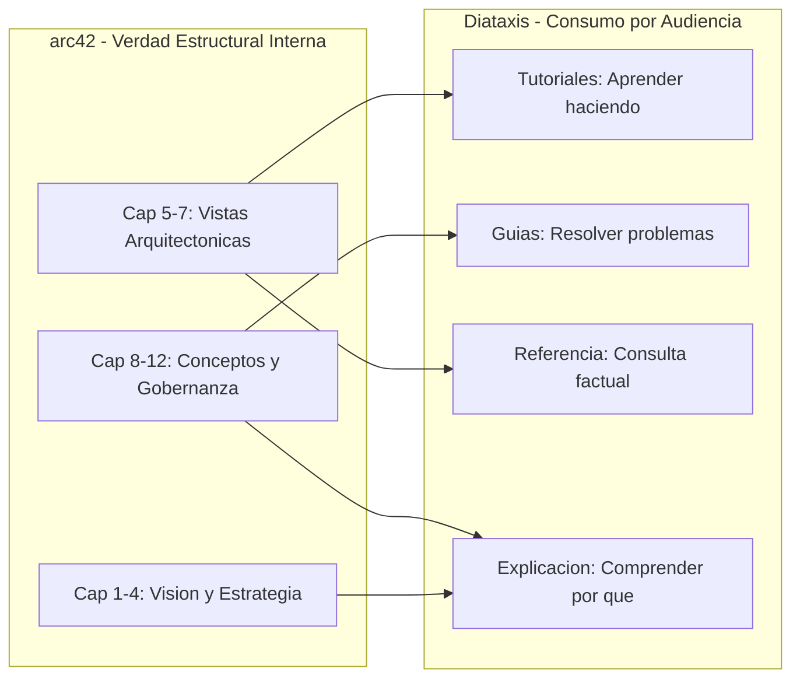

# Principios Fundamentales (detalle)

Contenido movido desde SKILL.md (progressive disclosure). Lectura: solo cuando se requiera el detalle de principios, vault MCP o ADRs.

## Principios Fundamentales

### Modelo Dual: arc42 + Diataxis



- **arc42** es el sistema de registro de la verdad arquitectonica del proyecto
  (para arquitectos e ingenieros internos).
- **Diataxis** rige el consumo interactivo del conocimiento (para usuarios,
  operadores y desarrolladores consumidores).
- La documentacion NO es un texto monolitico; es una coleccion de vistas
  interconectadas clasificadas por proposito cognitivo.

### Nivel de Profundidad por Defecto

El agente opera en nivel **Essential** (~10-15 paginas por proyecto):

| Nivel | Paginas | Uso |
|:------|:--------|:----|
| Lean | 3-5 | Proyectos pequenos, prototipos, POCs |
| **Essential** | **10-15** | **Default. Proyectos medianos y grandes** |
| Thorough | 30+ | Sistemas criticos, regulados, certificaciones |

### Idioma

Toda documentacion generada DEBE redactarse en **espanol**.

### Diagramas como Codigo

Para representar visualmente bloques de construccion, contextos, despliegues y
flujos de ejecucion:

> [!IMPORTANT]
> **Usar exclusivamente Mermaid para arquitectura y flujos, y DBML para esquemas relacionales de base de datos.**
> - Diagramas C4, secuencias y maquinas de estado se incrustan en bloques `mermaid`.
> - El modelo relacional de datos (tablas, PK/FK, indices, relaciones) dentro de `docs/arquitectura/04-modelo-de-datos-y-contratos.md` se redacta obligatoriamente en bloques ```` ```dbml ````, 100% compatibles para copiar/pegar en `dbdiagram.io` y visualizables nativamente en Obsidian mediante el plugin de la comunidad **`DBML Visualizer`**.

### Inicializacion Dinamica del Vault y Servidor MCP de Obsidian (Fase 1)

El servidor MCP de Obsidian (`@bitbonsai/mcpvault@latest`) **no** se preconfigura con una ruta estatica ciega. Se inicializa dinamicamente cuando comienza la Fase 1 (`product-architect`) y el agente necesita empezar a redactar los documentos:

1. El agente pregunta al usuario el **nombre clave del proyecto** (`<nombre-proyecto>`), proponiendo como ubicacion estandar la carpeta de documentos del usuario:
   - Windows: `C:/Users/<usuario>/Documents/<nombre-proyecto>/docs` (`Mis documentos/<nombre-proyecto>/docs`)
   - macOS / Linux: `$HOME/Documents/<nombre-proyecto>/docs`
2. Una vez confirmada la ruta, el agente crea fisicamente la carpeta maestra del proyecto, el subdirectorio `docs/` con sus carpetas base (`explicacion/`, `especificaciones/`, `criterios/`, `referencia/`) y registra el servidor MCP:
   - En Antigravity: `agy.exe mcp add obsidian npx -y @bitbonsai/mcpvault@latest "<ruta-resuelta>/docs"`
   - En Claude Code: `claude mcp add obsidian -- npx -y @bitbonsai/mcpvault@latest "<ruta-resuelta>/docs"`

### Gestion Documental via Obsidian MCP

Toda interaccion con los documentos del proyecto DEBE realizarse mediante las
herramientas del servidor MCP de Obsidian:

- **Lectura**: `read_note`, `read_multiple_notes`, `search_notes`,
  `get_notes_info`, `get_note_outline`
- **Escritura**: `write_note`, `patch_note`, `update_frontmatter`
- **Organizacion**: `move_note`, `manage_tags`

> [!WARNING]
> Prohibido crear/editar notas de documentacion con herramientas genericas de
> archivos (`write_to_file`, `replace_file_content`) sin pasar por Obsidian MCP.
> Esto garantiza la integridad del vault y los enlaces bidireccionales.

### Registro Sistematico de ADRs ante Cambios de Impacto

Todo cambio con impacto considerable en el sistema (nuevas clases base transversales, alteracion de invariantes, adicion/sustitucion de dependencias, contratos de API o mutacion de fronteras arquitectonicas) detona obligatoriamente la creacion de un ADR numerado secuencialmente en `docs/adr/`.
Si no se detecta un vault de Obsidian en el espacio de trabajo, el agente propondra inmediatamente inicializar la estructura canonica `docs/`.
