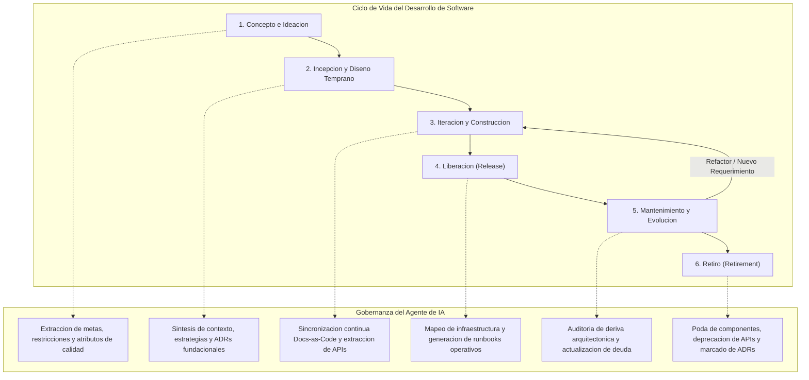

# Mapeo de SDLC con arc42 y Diataxis

Este documento establece las directivas operativas que el agente de IA debe ejecutar para gobernar, generar y mantener la documentacion tecnica de un sistema durante todas las fases de su ciclo de vida de desarrollo de software (SDLC). Integra los 12 capitulos del estandar [[arc42-structure|arc42]] con los cuatro cuadrantes de la metodologia [[diataxis-framework|Diataxis]].

> [!IMPORTANT]
> Todas las directivas contenidas en este documento estan formuladas como instrucciones algoritmicas directas para el agente de IA. El agente debe actuar de manera proactiva basandose en eventos del repositorio (triggers) y garantizar la trazabilidad bidireccional entre codigo, arquitectura y documentacion.

---

## 1. Diagrama de flujo del ciclo de vida

El siguiente diagrama modela la progresion a traves de las seis fases del SDLC y las transiciones gobernadas por el agente de IA:



---

## 2. Tabla maestra de mapeo SDLC

| Fase SDLC | Actividad Principal | Capitulos arc42 Activos | Cuadrantes Diataxis Activos | Estrategia del Agente | Triggers de Activacion |
| :--- | :--- | :--- | :--- | :--- | :--- |
| **Concepto e Ideacion** | Formalizacion del problema, alcance preliminar y viabilidad. | Cap 1 (Introduccion y Metas)<br>Cap 2 (Restricciones de la Arquitectura)<br>Cap 10 (Requerimientos de Calidad - Arbol preliminar) | **Explicacion** (Conceptos fundacionales, vision del dominio, glosario) | **Rol: Analista de Requerimientos**<br>Ingestar tickets epicos, PRDs e historias de usuario iniciales. Sintetizar objetivos de negocio y forzar la explicitacion de restricciones tecnicas, legales y organizacionales. | Creacion de repositorio, inicializacion de proyecto, asignacion de epica fundacional, kickoff. |
| **Incepcion y Diseno Temprano** | Definicion del diseno macro, seleccion de stack y delimitacion de limites del sistema. | Cap 3 (Contexto y Alcance)<br>Cap 4 (Estrategia de Solucion)<br>Cap 9 (Decisiones de Arquitectura - ADRs fundacionales) | **Explicacion** (Justificacion tecnica del stack, trade-offs de arquitectura) | **Rol: Arquitecto de Sistemas**<br>Generar diagramas de contexto del sistema en formato Mermaid. Sintetizar decisiones clave en registros formales [[nygard-adr-specification\|ADR Nygard]]. Justificar elecciones tecnicas frente a restricciones. | Definicion de stack tecnologico, diseno de topologia inicial, primer commit estructural/arquitectonico. |
| **Iteracion y Construccion** | Desarrollo incremental de modulos, servicios, contratos de interfaz e infraestructura base. | Cap 5 (Vista de Bloques - Niveles 1 a 3)<br>Cap 6 (Vista de Tiempo de Ejecucion)<br>Cap 8 (Conceptos Transversales) | **Referencia** (Especificacion de APIs, esquemas de BD, CLI)<br>**Tutoriales** (Entornos locales de desarrollo, onboarding guiado) | **Rol: Ingeniero Docs-as-Code**<br>Ejecutar sincronizacion bidireccional continua. Extraer esquemas y firmas de metodos directamente del codigo fuente. Mantener diagramas de componentes C4 actualizados tras cada Pull Request. | Merge de Pull Request, creacion de nuevos servicios/modulos, adicion de endpoints o esquemas. |
| **Liberacion (Release)** | Empaquetado, aprovisionamiento de infraestructura y despliegue a entornos objetivo. | Cap 7 (Vista de Despliegue) | **Guias de Uso** (Procedimientos de despliegue, configuracion de variables, runbooks de rollback) | **Rol: Ingeniero de Plataforma/SRE**<br>Analizar manifiestos declarativos (Terraform, Helm, Kubernetes, Docker Compose). Derivar topologia de red y mapeo de nodos. Generar guias operativas paso a paso con comandos validados. | Creacion de Git tag/release, ejecucion de pipeline de staging o produccion, apertura de PR de infraestructura. |
| **Mantenimiento y Evolucion** | Operacion continua, monitoreo de incidentes, mitigacion de riesgos y refactorizacion. | Cap 11 (Riesgos y Deuda Tecnica)<br>Cap 10 (Actualizacion de Escenarios de Calidad) | **Referencia** (Actualizacion continua)<br>**Guias de Uso** (Resolucion de incidencias, procedimientos forenses, playbooks) | **Rol: Auditor de Calidad y Confiabilidad**<br>Monitorear divergencias entre codigo base y diagramas estructurales ([[architectural-drift-detection\|Deriva Arquitectonica]]). Convertir post-mortems en guias operativas y documentar deuda tecnica acumulada. | Cierre de incidentes de produccion, cambios en dependencias (CVEs), refactorizaciones mayores, auditorias programadas. |
| **Retiro (Retirement)** | Desmantelamiento planificado de componentes, modulos, servicios o sistemas completos. | Cap 3 (Eliminacion de actores y canales)<br>Cap 9 (Transicion de ADRs a Obsoleto/Sustituido) | **Referencia** (Etiquetado de endpoints y contratos como deprecados con alternativas de migracion) | **Rol: Coordinador de Transicion y Decomiso**<br>Actualizar metadatos de estado en ADRs afectados. Eliminar nodos y aristas en diagramas de bloques y contexto. Preservar registros historicos y publicar guias de migracion saliente. | Marcado de servicio como deprecado, inicio de migracion de plataforma, fecha limite de sunset. |

---

## 3. Directivas de ejecucion por fase

### 3.1 Fase 1: Concepto e Ideacion

#### Directivas para el Agente
1. **Inspeccion de fuentes de entrada**:
   - Escanear archivos de requerimientos preliminares (`README.md`, issues fundacionales, documentos de requerimientos del producto o transcripciones de kickoff).
2. **Generacion de arc42 Capitulo 1 (Introduccion y Metas)**:
   - Extraer exactamente de 3 a 5 metas de negocio primarias en formato SMART.
   - Definir los stakeholders principales con sus roles, intereses y expectativas en una tabla formal.
3. **Generacion de arc42 Capitulo 2 (Restricciones de la Arquitectura)**:
   - Clasificar restricciones en tres categorias obligatorias: tecnicas (ej. versiones de runtime, latencia maxima), organizacionales (ej. equipo, presupuesto, calendarios) y regulatorias/legales (ej. GDPR, PCI-DSS).
4. **Generacion de arc42 Capitulo 10 preliminar (Arbol de Calidad)**:
   - Mapear las metas a caracteristicas ISO/IEC 25010 (Rendimiento, Seguridad, Mantenibilidad, Disponibilidad).
5. **Generacion del cuadrante Diataxis Explicacion**:
   - Redactar documentos de vision y glosario del dominio, explicitando el modelo mental subyacente sin instrucciones imperativas.

> [!NOTE]
> En esta fase no deben redactarse manuales de instalacion ni tutoriales detallados, dado que la arquitectura tecnica no se encuentra fijada.

#### Ejemplo de directiva de transformacion aplicada
```markdown
# Directiva de Agente: Formalizacion de Restricciones
Entrada: "El cliente requiere que la aplicacion sea rapida y funcione en la nube actual sin pagar licencias caras."
Salida generada en arc42 Cap 2:
| ID | Restriccion | Categoria | Justificacion / Impacto |
| :--- | :--- | :--- | :--- |
| RES-01 | Despliegue exclusivo en infraestructura AWS existente | Organizacional / Infraestructura | Evitar sobrecostos de aprovisionamiento multi-cloud. |
| RES-02 | Uso estricto de componentes de codigo abierto bajo licencias MIT/Apache 2.0 | Legal / Financiera | Restriccion presupuestaria de licenciamiento comercial. |
| RES-03 | Tiempo de respuesta P95 < 200 ms para endpoints de consulta | Tecnica | Meta de usabilidad no funcional vinculada al SLA del negocio. |
```

---

### 3.2 Fase 2: Incepcion y Diseno Temprano

#### Directivas para el Agente
1. **Generacion de arc42 Capitulo 3 (Contexto y Alcance)**:
   - Construir dos diagramas delimitados:
     - **Contexto de Negocio**: Actores humanos y sistemas externos de alto nivel.
     - **Contexto Tecnico**: Protocolos de transporte (HTTP/REST, gRPC, AMQP), formatos de intercambio (JSON, Protobuf) y fronteras de red.
2. **Generacion de arc42 Capitulo 4 (Estrategia de Solucion)**:
   - Resumir las decisiones de diseno fundamentales (ej. arquitectura hexagonal, event-driven architecture, monorreposito modular).
3. **Formalizacion de arc42 Capitulo 9 (Decisiones de Arquitectura - ADRs)**:
   - Por cada eleccion de tecnologia, framework o patron estructural, generar un archivo [[nygard-adr-specification|ADR Nygard]] estructurado: `Title`, `Status`, `Context`, `Decision`, `Consequences`.
4. **Generacion de Diataxis Explicacion**:
   - Articular la justificacion comparativa de las tecnologias elegidas (evaluacion de trade-offs frente a opciones descartadas).

#### Ejemplo de plantilla Mermaid para Contexto Tecnico (Cap 3)
```mermaid
graph TB
    subgraph Boundary ["Frontera del Sistema: Nucleo Transaccional"]
        System["Servicio Core\n[Go / Echo]"]
    end

    User["Cliente Web\n[React]"] -->|"HTTPS / JSON"| System
    Partner["Pasarela de Pagos Externa"] <--|"mTLS / REST"| System
    DB[("Base de Datos Relacional\n[PostgreSQL 16]")] <--|"TCP / SQL"| System
    Cache[("Cache Distribuida\n[Redis 7]")] <--|"TCP / RESP"| System
```

---

### 3.3 Fase 3: Iteracion y Construccion

#### Directivas para el Agente
1. **Sincronizacion continua de arc42 Capitulo 5 (Vista de Bloques)**:
   - **Nivel 1**: Descomposicion del sistema en subsistemas o servicios ejecutables.
   - **Nivel 2**: Descomposicion interna de cada subsistema en modulos, paquetes o adaptadores hexagonales.
   - **Nivel 3**: Inspeccion estatica del codigo base para mapear clases y estructuras criticas solo cuando aporten alto valor explicativo.
2. **Construccion de arc42 Capitulo 6 (Vista de Tiempo de Ejecucion)**:
   - Generar diagramas de secuencia Mermaid para los flujos mas criticos (ej. ciclo de autenticacion, procesamiento asincrono de eventos, manejo de transacciones distribuidas).
3. **Consolidacion de arc42 Capitulo 8 (Conceptos Transversales)**:
   - Documentar patrones repetitivos implementados en el codigo: manejo global de excepciones, auditoria y logging estructurado, estrategia de hashing de contrasenas, serializacion temporal UTC.
4. **Generacion de Diataxis Referencia**:
   - Sintetizar automaticamente las definiciones de interfaces a partir de codigo (OpenAPI 3.1 para endpoints REST, GraphQL Schemas, archivos `.proto`, esquemas relacionales DDL o esquemas ORM Prisma/TypeORM).
5. **Generacion de Diataxis Tutoriales**:
   - Redactar guias de orientacion al principiante para arrancar el entorno de desarrollo local paso a paso desde cero.

> [!IMPORTANT]
> El agente no debe inventar firmas de metodos ni esquemas. Toda especificacion en el cuadrante de Referencia debe ser extraida directamente de los archivos fuente validados del repositorio.

---

### 3.4 Fase 4: Liberacion (Release)

#### Directivas para el Agente
1. **Extraccion y generacion de arc42 Capitulo 7 (Vista de Despliegue)**:
   - Analizar los archivos de orquestacion e infraestructura como codigo:
     - Archivos `docker-compose.yml`, Helm Charts, manifiestos K8s (`Deployment`, `Service`, `Ingress`, `ConfigMap`), plantillas Terraform o CloudFormation.
   - Mapear cada elemento de software (bloque de Cap 5) a su nodo de ejecucion fisico o virtual (contenedor, pod, instancia EC2, bucket S3).
   - Indicar canales de comunicacion, variables de entorno requeridas y volumenes de persistencia montados.
2. **Generacion del cuadrante Diataxis Guias de Uso (How-To Guides)**:
   - Procedimiento de despliegue paso a paso para el operador.
   - Guia de configuracion y rotacion de credenciales / secretos.
   - Manual de diagnostico de fallas comunes y runbook de rollback de emergencia.

#### Ejemplo de directiva para Guia de Despliegue (Diataxis How-To)
```markdown
# Directiva de Agente: Estilo de Redaccion para Guias de Despliegue
- Titulo: Debe iniciar con un verbo de accion orientado a la meta del operador (ej. "Como desplegar el servicio de pagos en staging").
- Enfoque: Resolver un problema concreto paso a paso.
- Formato de comandos: Bloques bash ejecutables con flags explicados.
- Sin teoria abstracta: La justificacion conceptual pertenece a Explicacion, no a la Guia de Uso.
```

---

### 3.5 Fase 5: Mantenimiento y Evolucion

#### Directivas para el Agente
1. **Gestion de arc42 Capitulo 11 (Riesgos y Deuda Tecnica)**:
   - Mantener un registro activo de vulnerabilidades detectadas en dependencias, cuellos de botella de escalabilidad identificados y desviaciones respecto a los estandares de arquitectura acordados.
   - Clasificar cada riesgo segun su probabilidad (Baja, Media, Alta) e impacto (Bajo, Medio, Alto).
2. **Monitoreo de [[architectural-drift-detection|Deriva Arquitectonica]]**:
   - Comparar periodicamente las dependencias importadas en el codigo fuente contra las relaciones permitidas en los diagramas de bloques (Cap 5).
   - Disparar una alerta documental si se detectan dependencias circulares no autorizadas o componentes no catalogados.
3. **Actualizacion de Diataxis Guias de Uso**:
   - Incorporar runbooks de resolucion rapida basados en incidentes reales (post-mortem synthesis).
4. **Refinamiento de arc42 Capitulo 10**:
   - Cuantificar el cumplimiento de los escenarios de calidad con base en metricas reales de telemetria (latencia P95/P99 observada, tasa de disponibilidad mensual).

> [!WARNING]
> La falta de actualizacion de los diagramas ante cambios estructurales en el codigo provoca obsolescencia critica. El agente debe bloquear la aprobacion documental si detecta deriva no sincronizada.

---

### 3.6 Fase 6: Retiro (Retirement)

#### Directivas para el Agente
1. **Actualizacion de arc42 Capitulo 9 (ADRs)**:
   - Localizar todos los ADRs vinculados a las tecnologias o componentes retirados.
   - Cambiar su estado a `Deprecated`, `Superseded` (indicando el nuevo ADR mediante wikilink) o `Obsolete`.
2. **Poda de arc42 Capitulo 3 (Contexto) y Capitulo 5 (Bloques)**:
   - Eliminar actores, dependencias externas y componentes decomisados de los diagramas Mermaid.
   - Dejar una anotacion textual de trazabilidad historica en la seccion de evolucion del capitulo.
3. **Deprecacion en Diataxis Referencia**:
   - Anadir encabezados de deprecacion explicitos a las especificaciones de API, esquemas y endpoints afectados, especificando fecha limite de sunset y endpoints de sustitucion.
4. **Publicacion de Guia de Migracion (Diataxis Guias de Uso)**:
   - Detallar los pasos necesarios para que clientes o servicios consumidores migren sus integraciones hacia los nuevos modulos o alternativas vigentes.

---

## 4. Artefactos esperados por fase

La siguiente tabla enumera los artefactos documentales concretos que el agente de IA debe verificar y asegurar al completar cada fase del SDLC:

| Fase SDLC | Ruta Estandar del Artefacto | Descripcion del Contenido | Estado Requerido | Documento Relacionado |
| :--- | :--- | :--- | :--- | :--- |
| **Concepto e Ideacion** | `docs/arc42/01-introduction-and-goals.md` | Metas SMART del negocio, lista formal de stakeholders y prioridades. | Validado | [[arc42-structure#cap-1\|Metas y Stakeholders]] |
| **Concepto e Ideacion** | `docs/arc42/02-architecture-constraints.md` | Restricciones clasificadas (tecnicas, organizacionales, normativas). | Aprobado | [[arc42-structure#cap-2\|Restricciones]] |
| **Concepto e Ideacion** | `docs/diataxis/explanation/domain-vision.md` | Conceptos de negocio, modelo mental del dominio y terminologia. | Preliminar | [[diataxis-framework#explicacion\|Vision del Dominio]] |
| **Incepcion y Diseno** | `docs/arc42/03-context-and-scope.md` | Diagramas de contexto de negocio y tecnico en Mermaid con delimitaciones de frontera. | Aprobado | [[arc42-structure#cap-3\|Contexto]] |
| **Incepcion y Diseno** | `docs/arc42/04-solution-strategy.md` | Decisiones clave de alto nivel, patrones arquitectonicos y seleccion de stack. | Aprobado | [[arc42-structure#cap-4\|Estrategia]] |
| **Incepcion y Diseno** | `docs/adr/ADR-0001-*.md` a `ADR-000N-*.md` | Decisiones fundacionales individuales en formato Nygard estandarizado. | Aceptado | [[nygard-adr-specification\|ADRs Fundacionales]] |
| **Incepcion y Diseno** | `docs/diataxis/explanation/tech-stack-rationale.md` | Justificacion tecnica y trade-offs entre tecnologias evaluadas. | Activo | [[diataxis-framework#explicacion\|Justificacion Tecnologica]] |
| **Iteracion y Construccion** | `docs/arc42/05-building-block-view.md` | Jerarquia C4 de componentes (Nivel 1 a 3) sincronizada con el codigo fuente. | Sincronizado | [[arc42-structure#cap-5\|Vista de Bloques]] |
| **Iteracion y Construccion** | `docs/arc42/06-runtime-view.md` | Diagramas de secuencia y estados para flujos de ejecucion primarios y criticos. | Actualizado | [[arc42-structure#cap-6\|Tiempo de Ejecucion]] |
| **Iteracion y Construccion** | `docs/arc42/08-crosscutting-concepts.md` | Estandares de seguridad, persistencia, telemetria, errores y transaccionalidad. | Activo | [[arc42-structure#cap-8\|Conceptos Transversales]] |
| **Iteracion y Construccion** | `docs/diataxis/reference/api-specification.md` | Especificacion OpenAPI / GraphQL extraida directamente de codigo fuente. | Factual / Codigo | [[diataxis-framework#referencia\|Referencia API]] |
| **Iteracion y Construccion** | `docs/diataxis/tutorials/dev-environment-setup.md` | Guia de onboarding para configurar y levantar el entorno local paso a paso. | Probado | [[diataxis-framework#tutoriales\|Tutorial Setup]] |
| **Liberacion (Release)** | `docs/arc42/07-deployment-view.md` | Mapeo de topologia de infraestructura, nodos de computo, redes y volumenes. | Congelado por Release | [[arc42-structure#cap-7\|Vista de Despliegue]] |
| **Liberacion (Release)** | `docs/diataxis/how-to/deploy-guide.md` | Procedimiento paso a paso para desplegar artefactos en entornos de staging y produccion. | Validado | [[diataxis-framework#guias-de-uso\|Guia de Despliegue]] |
| **Liberacion (Release)** | `docs/diataxis/how-to/rollback-runbook.md` | Procedimiento de mitigacion rapida y retorno a version estable ante fallos en release. | Probado | [[diataxis-framework#guias-de-uso\|Runbook Rollback]] |
| **Mantenimiento y Evolucion**| `docs/arc42/10-quality-requirements.md` | Escenarios de calidad con metricas observadas en produccion y resultados de pruebas. | Dinamico | [[arc42-structure#cap-10\|Requerimientos Calidad]] |
| **Mantenimiento y Evolucion**| `docs/arc42/11-risks-and-technical-debt.md` | Matriz de riesgos actualizada, vulnerabilidades pendientes y registro de deuda tecnica. | Activo | [[arc42-structure#cap-11\|Riesgos y Deuda]] |
| **Mantenimiento y Evolucion**| `docs/diataxis/how-to/incident-resolution-*.md` | Playbooks de mitigacion de incidentes operacionales especificos derivados de post-mortems. | Auditado | [[diataxis-framework#guias-de-uso\|Playbooks Incidencias]] |
| **Retiro (Retirement)** | `docs/adr/ADR-*-deprecated.md` | ADRs correspondientes con metadatos actualizados a estado Obsoleto o Sustituido. | Obsoleto | [[nygard-adr-specification\|ADRs Retirados]] |
| **Retiro (Retirement)** | `docs/diataxis/how-to/migration-guide-*.md` | Guia detallada de desincorporacion, exportacion de datos y migracion alternativa. | Congelado | [[diataxis-framework#guias-de-uso\|Guia de Migracion]] |

---

## 5. Metricas de completitud documental

El agente de IA debe evaluar y reportar estas metricas cuantificables de forma continua para certificar la salud documental del repositorio.

### 5.1 Formulas de calculo

#### 1. Cobertura de Capitulos arc42
$$\text{Cobertura arc42 (\%)} = \left( \frac{\sum_{i=1}^{12} \text{CapituloActivo}(i) \times \text{TieneContenidoValido}(i)}{\text{CapitulosExigidosPorFase}} \right) \times 100$$

- Un capitulo se considera con *Contenido Valido* si no contiene marcadores de posicion (`TODO`, `TBD`, texto de plantilla sin editar) y cuenta con al menos un diagrama o tabla formal segun corresponda.

#### 2. Cobertura de Cuadrantes Diataxis
$$\text{Cobertura Diataxis (\%)} = \left( \frac{\text{CuadrantesConDocumentosValidados}}{\text{CuadrantesRequeridosPorFase}} \right) \times 100$$

#### 3. Ratio de Registro de Decisiones de Arquitectura (ADR Ratio)
$$\text{Ratio ADR} = \frac{\text{Numero de ADRs en Estado Aceptado / Reemplazado / Obsoleto}}{\text{Numero de Decisiones Tecnicas Estructurales Identificadas}}$$

- El valor objetivo debe ser siempre $1.0$. Todo cambio mayor de biblioteca, base de datos, protocolo o division modular debe poseer un ADR asociado.

#### 4. Brecha Temporal de Sincronizacion (Sync Lag)
$$\Delta T_{\text{sync}} = \text{Timestamp}_{\text{Ultimo Commit de Codigo Relevante}} - \text{Timestamp}_{\text{Ultimo Commit de Documentacion}}$$

- Umbral de alerta: $\Delta T_{\text{sync}} > 0$ tras el merge de un Pull Request con etiquetas `architecture`, `api-breaking` o `core-refactor`.

---

### 5.2 Checklist de validacion por fase

El agente de IA debe ejecutar las siguientes comprobaciones booleanas antes de certificar la finalizacion de una fase:

#### Checklist: Concepto e Ideacion
- [ ] Cap 1: Se definieron formalmente de 3 a 5 metas de negocio primarias.
- [ ] Cap 1: La tabla de stakeholders contiene al menos 3 roles diferenciados con expectativas documentadas.
- [ ] Cap 2: Existen al menos 3 restricciones clasificadas en tecnicas, organizacionales y regulatorias.
- [ ] Cap 10: Se identificaron los atributos de calidad clave en el arbol de calidad preliminar.
- [ ] Diataxis Explicacion: Se documento la vision general del sistema y el glosario terminologico.
- [ ] Metrica: Cobertura arc42 de la fase >= 100%.

#### Checklist: Incepcion y Diseno Temprano
- [ ] Cap 3: Diagrama de contexto de negocio presente en formato Mermaid.
- [ ] Cap 3: Diagrama de contexto tecnico presente con interfaces y protocolos explicitos.
- [ ] Cap 4: Estrategia de solucion documentada y alineada con las restricciones de Cap 2.
- [ ] Cap 9: Todos los componentes clave del stack tecnologico cuentan con un archivo ADR Nygard en `docs/adr/`.
- [ ] Diataxis Explicacion: Redactada la comparativa de tecnologias evaluadas y justificadas.
- [ ] Metrica: Ratio ADR = 1.0.

#### Checklist: Iteracion y Construccion
- [ ] Cap 5: Vista de bloques Nivel 1 y Nivel 2 actualizada con los modulos actuales del codigo.
- [ ] Cap 6: Al menos 2 diagramas de secuencia modelando los flujos de mayor impacto.
- [ ] Cap 8: Documentadas las politicas transversales (autenticacion, errores, logging).
- [ ] Diataxis Referencia: Esquemas de API y contratos de datos actualizados sin inconsistencias contra codigo.
- [ ] Diataxis Tutoriales: Tutorial de puesta en marcha del entorno local validado funcionalmente.
- [ ] Metrica: Delta T sync = 0 (sincronizacion realizada en el mismo PR o pipeline).

#### Checklist: Liberacion (Release)
- [ ] Cap 7: Vista de despliegue mapeada integralmente desde los manifiestos de infraestructura (K8s/Terraform).
- [ ] Cap 7: Variables de entorno, puertos y puntos de montaje de volumenes explicitados.
- [ ] Diataxis Guias de Uso: Guia de despliegue paso a paso redactada y validada en entorno de staging.
- [ ] Diataxis Guias de Uso: Runbook de rollback disponible con comandos ejecutables directos.
- [ ] Metrica: Cobertura Diataxis Guias de Uso = 100% sobre la matriz de despliegue.

#### Checklist: Mantenimiento y Evolucion
- [ ] Cap 10: Escenarios de calidad contrastados contra datos reales de monitoreo / telemetria.
- [ ] Cap 11: Matriz de riesgos actualizada con evaluacion de severidad y planes de mitigacion.
- [ ] Cap 11: Registro de deuda tecnica categorizado con estimacion de impacto.
- [ ] Auditoria: Verificacion de deriva arquitectonica sin violaciones estructurales abiertas.
- [ ] Diataxis Guias de Uso: Runbooks de incidentes enriquecidos con post-mortems recientes.

#### Checklist: Retiro (Retirement)
- [ ] Cap 3 y Cap 5: Diagramas de contexto y bloques actualizados sin referencias a componentes eliminados.
- [ ] Cap 9: ADRs correspondientes marcados formalmente como Deprecated u Obsolete.
- [ ] Diataxis Referencia: Endpoints retirados etiquetados con advertencia visible de deprecacion.
- [ ] Diataxis Guias de Uso: Publicada guia de migracion saliente o exportacion de datos para usuarios.
- [ ] Integridad: No existen enlaces rotos o referencias huerfanas hacia artefactos purgados.

---

> [!TIP]
> Para mantener la maxima salud documental en repositorios automatizados, el agente de IA debe programar un trabajo periodico de verificacion de enlaces, esquemas desactualizados y discrepancias sintacticas en los bloques Mermaid.
