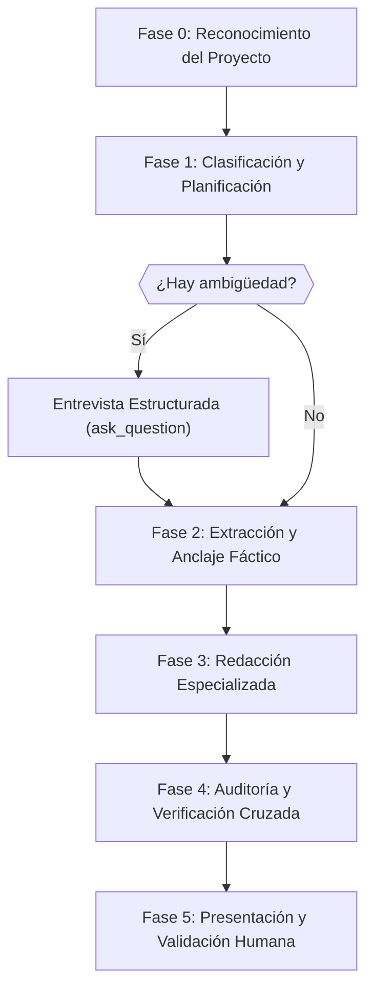

# Flujo de Trabajo en 6 Fases (detalle)

Contenido movido desde SKILL.md. Leer solo cuando se ejecute una fase (0 a 5).

## Flujo de Trabajo en 6 Fases

Cuando se invoque esta skill, ejecutar las siguientes fases en orden estricto:



---

### Fase 0: Reconocimiento del Proyecto (Zero-Trust)

> [!IMPORTANT]
> **Principio Zero-Trust**: No asumir estructura, tecnologías ni estado de la
> documentación existente. Inspeccionar directamente antes de afirmar.

1.  **Detectar estructura documental existente**:
    -   Buscar en el vault de Obsidian carpetas como `docs/`, `arquitectura/`,
        `adr/`, `guias/`, `referencia/`, `tutoriales/` usando `list_directory`
        y `search_notes`.
    -   **Guarda de ausencia de vault**: Si no existe un vault de Obsidian ni carpeta `docs/` en el proyecto, proponer de inmediato al usuario la creación e inicialización de uno con la estructura canónica recomendada.
    -   Identificar si existe documentación arc42 previa (buscar secciones
        como "Introducción y Metas", "Vista de Bloques", "Decisiones
        Arquitectónicas").
    -   Detectar ADRs existentes y su formato/numeración.

2.  **Auditar tecnologías del proyecto**:
    -   Leer `package.json`, `go.mod`, `Cargo.toml`, `requirements.txt`,
        `pom.xml` o equivalente para identificar stack tecnológico.
    -   Detectar manifiestos IaC: `Dockerfile`, `docker-compose.yml`,
        `*.tf`, `k8s/`, `helm/`.
    -   Identificar frameworks de testing, linters y CI/CD configurados.

3.  **Evaluar madurez documental**:
    -   Contar capítulos arc42 con contenido vs vacíos.
    -   Verificar cobertura de cuadrantes Diátaxis.
    -   Calcular antigüedad de la última actualización documental.
    -   Generar un diagnóstico inicial: `{sin_documentacion | parcial | completa}`.

4.  **Indexar el grafo de código**:
    -   Ejecutar `index_repository` de `codebase-memory-mcp` si no hay índice
        reciente.
    -   Usar `get_architecture` para obtener visión macro del proyecto.

---

### Fase 1: Clasificación y Planificación

Determinar qué capítulos de arc42 y cuadrantes de Diátaxis requieren atención
según la solicitud del usuario y la fase actual del SDLC.

1.  **Identificar fase SDLC actual**:
    -   Consultar `sdlc-mapping.md` para determinar qué artefactos
        corresponden a la fase activa.

2.  **Clasificar la solicitud del usuario**:
    -   ¿Es una solicitud de documentación nueva (inicialización)?
    -   ¿Es una actualización tras cambios en el código?
    -   ¿Es una auditoría del estado actual?
    -   ¿Es un registro de decisión arquitectónica?
    -   ¿Es documentación orientada al usuario (Diátaxis)?

    **Triggers Mandatorios para Generación de ADR**:
    Un cambio califica como "impacto considerable o arquitectónico" y exige redactar un ADR cuando cumple cualquiera de los siguientes criterios:
    -   **Abstracciones y Clases Base**: Introducción o modificación de tipos base transversales (ej. jerarquías de errores como `ErrorDominio`, interfaces de puertos núcleo, clases de persistencia base).
    -   **Invariantes y Reglas de Dominio**: Alteración de políticas de negocio que afecten a múltiples entidades, flujos de estados (FSM) o contratos de respuesta.
    -   **Fronteras y Dependencias**: Cambios en reglas de Clean Architecture o FSD, o incorporación/reemplazo de dependencias y librerías externas.
    -   **Resiliencia y Seguridad**: Modificación de esquemas de manejo global de excepciones, autenticación, autorización, tokens o políticas de concurrencia/transaccionalidad.

3.  **Protocolo de Clarificación Automática**:

> [!IMPORTANT]
> **Entrevista Estructurada Automática**: Cuando el agente detecte ambigüedad
> sobre qué documentar, cómo clasificar contenido, o qué rumbo tomar, DEBE
> lanzar automáticamente una sesión de clarificación usando la herramienta
> `ask_question`. NO esperar a que el usuario invoque `/grill-me`.

**Triggers de clarificación automática** (lanzar `ask_question` si se cumple
alguno):

-   La solicitud del usuario puede mapearse a más de un cuadrante Diátaxis.
-   No queda claro si el contenido debe ir en arc42 o en Diátaxis.
-   Hay decisiones arquitectónicas implícitas que no han sido formalizadas.
-   El alcance de la documentación solicitada es ambiguo.
-   Existen conflictos entre restricciones documentadas y la realidad del código.
-   El usuario menciona múltiples capítulos/secciones sin priorizar.

**Formato de la entrevista estructurada**:

```
ask_question con preguntas como:
- "¿Este contenido está dirigido a usuarios finales (Tutorial/Guía) o a
   arquitectos/ingenieros internos (arc42)?"
- "¿El objetivo es enseñar (Tutorial), resolver un problema específico
   (Guía), documentar APIs (Referencia) o explicar decisiones (Explicación)?"
- "¿La audiencia ya conoce el sistema o está aprendiendo?"
- "¿Esta decisión debe registrarse como ADR formal?"
```

El agente debe formular entre 2 y 5 preguntas específicas por sesión de
clarificación, no más.

---

### Fase 2: Extracción y Anclaje Fáctico

> [!WARNING]
> **Prevención de Alucinaciones Operativas**: El agente tiene PROHIBIDO generar
> contenido documental a partir de conocimiento paramétrico interno. Todo dato
> debe extraerse empíricamente del código, configuraciones y artefactos reales.

1.  **Extracción de datos empíricos** (según capítulo/cuadrante objetivo):

    | Fuente | Herramienta | Datos Extraídos | Destino |
    |:-------|:------------|:----------------|:--------|
    | Código fuente | `search_graph`, `trace_path`, `get_code_snippet` | Componentes, dependencias, interfaces | Cap 5, Referencia |
    | APIs | `search_graph`, lectura de archivos OpenAPI/Swagger | Endpoints, parámetros, respuestas | Referencia |
    | Manifiestos IaC | `read_note` o lectura directa de `.tf`, `k8s/` | Nodos, pods, redes | Cap 7 |
    | Tests | `search_code`, `grep_search` | Escenarios de uso, cobertura | Cap 10 |
    | Git history | `git log`, análisis de PRs | Decisiones, cambios arquitectónicos | Cap 9 (ADRs) |
    | Código repetitivo | `search_code`, `query_graph` | Patrones transversales | Cap 8 |
    | FIXME/TODO | `grep_search("FIXME\|TODO")` | Deuda técnica | Cap 11 |

2.  **Validación de restricciones**:
    -   Leer Cap 2 (Restricciones) si existe.
    -   Verificar que ningún dato extraído contradiga las restricciones
        documentadas.
    -   Si hay contradicción, emitir **alerta de deriva arquitectónica**.

---

### Fase 3: Redacción Especializada

Generar el contenido aplicando las restricciones correspondientes según el
destino:

#### Si el destino es un capítulo arc42:

-   Consultar `arc42-chapters-guide.md` para las directrices
    específicas del capítulo.
-   Aplicar nivel **Essential** (default) para la profundidad.
-   Generar diagramas en **Mermaid** para los capítulos 3, 5, 6 y 7.
-   Para Cap 9 (ADRs): usar formato Nygard obligatorio.
-   Mantener el grafo de dependencias entre capítulos: si se modifica Cap 5,
    verificar impacto en Cap 3, Cap 6 y Cap 7.

#### Si el destino es un cuadrante Diátaxis:

-   Consultar `diataxis-quadrants-guide.md` para las reglas de
    estilo y estructura del cuadrante.
-   Aplicar las barreras estrictas entre cuadrantes.
-   Para **Referencia**: extraer SOLO datos factuales del código. PROHIBIDO
    generar parámetros, clases o respuestas HTTP de memoria.
-   Para **Tutoriales**: flujo lineal, sin alternativas, con indicadores de
    retroalimentación ("La salida esperada es Z").
-   Para **Guías de Uso**: pasos imperativos, sin teoría.
-   Para **Explicación**: narrativa de "¿por qué?", sintetizar ADRs y
    decisiones de diseño.

#### Redacción en Obsidian:

-   Usar `write_note` para documentos nuevos.
-   Usar `patch_note` para actualizaciones parciales.
-   Usar `update_frontmatter` para metadatos (tags, estado, fecha).
-   Usar `manage_tags` para clasificación semántica.
-   Incluir wikilinks (`[[nota-relacionada]]`) para interconectar documentos.

---

### Fase 4: Auditoría y Verificación Cruzada (Linting Semántico)

> [!IMPORTANT]
> Esta fase es OBLIGATORIA antes de presentar cualquier artefacto documental.
> Consultar `audit-checklist.md` para el procedimiento completo.

1.  **Consistencia arc42**:
    -   Todo bloque en Cap 5 que interactúe con sistema externo DEBE existir
        en Cap 3.
    -   Todo participante en diagramas de secuencia (Cap 6) DEBE existir
        como bloque en Cap 5.
    -   Toda estrategia (Cap 4) DEBE vincular a una meta de calidad (Cap 1.2).
    -   Todo componente desplegado (Cap 7) DEBE existir en Cap 5.
    -   Toda restricción (Cap 2) DEBE respetarse en Cap 4 y Cap 7.

2.  **Barreras Diátaxis**:
    -   Verificar que el contenido generado NO transgrede las fronteras de su
        cuadrante asignado.

3.  **Deriva arquitectónica**:
    -   Comparar componentes documentados con módulos reales del código usando
        `search_graph` y `check_index_coverage`.
    -   Detectar componentes fantasma (en código, no en docs) y documentación
        zombie (en docs, no en código).

4.  **Linting del glosario**:
    -   Verificar que toda terminología usada en la documentación generada sea
        consistente con el Glosario (Cap 12).

5.  **Persistencia del reporte de auditoría**:
    -   Si se ejecutó una auditoría completa, persistir el reporte en
        `docs/auditorias/AUDIT-{NNN}-documentacion.md` del proyecto vía
        Obsidian MCP, siguiendo el formato estándar de la regla global de
        auditorías.

---

### Fase 5: Presentación y Validación Humana (HITL)

> [!WARNING]
> El agente NO DEBE fusionar documentación en la base documental sin
> aprobación explícita del usuario.

1.  **Presentar artefactos**:
    -   Mostrar un resumen del contenido generado/modificado.
    -   Listar los archivos creados o editados con enlaces directos.
    -   Destacar decisiones tomadas y supuestos asumidos.

2.  **Solicitar aprobación**:
    -   Si se generaron ADRs, presentarlos como borradores para revisión.
    -   Si se detectaron alertas de deriva, reportarlas explícitamente.
    -   Si se identificaron dudas no resueltas, lanzar entrevista estructurada
        (`ask_question`) antes de finalizar.

3.  **Registrar el evento**:
    -   Actualizar el frontmatter de los documentos modificados con la fecha
        de última actualización vía `update_frontmatter`.

---
