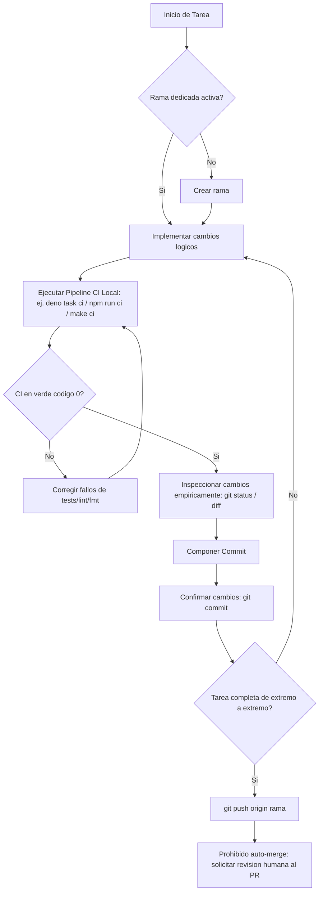

# Git Workflow Mastery - Operaciones Avanzadas y Arquitectura de Control de Versiones

Esta skill dictamina los protocolos operativos de Git de bajo nivel que no estan cubiertos directamente por las reglas globales del proyecto.
> **IMPORTANTE:** Las convenciones estructurales (nomenclatura de ramas, Conventional Commits, pipeline CI, PRs) estan definidas en las reglas de gobernanza o `AGENTS.md` del proyecto y **no se deben duplicar ni invalidar aqui**. Para teoria y fundamentos de las herramientas usadas, consultar la carpeta [references/](./references/).

---

## 1. Ramas Apiladas (Stacked Branches)

Para evitar el bloqueo por code review, se crean ramas que dependen de otras ramas en vuelo. Esto emula la segmentacion de instrucciones (pipelining):
```text
main --o--o
           \
            A1 -- A2 (Rama feat/caracteristica-a)
                   \
                    B1 -- B2 (Rama feat/caracteristica-b, depende de A)
```

### Receta Operativa: Injercion Topologica con `git rebase --onto`
Uso: Cuando la rama base (`feat/caracteristica-a`) fue modificada o integrada, y necesitas migrar la rama hija (`feat/caracteristica-b`) a la nueva base limpia.

1. **Identificar ancestro de corte:** Localiza el hash del ultimo commit de la rama A antigua del cual partio la rama B (`<ancestro_obsoleto_punta_a>`).
2. **Ejecutar el rebase:**
   ```bash
   git checkout feat/caracteristica-b
   git rebase --onto main <ancestro_obsoleto_punta_a>
   ```
3. **Verificacion obligatoria:**
   ```bash
   git log --oneline -n 5
   # Verificar que no haya commits duplicados y que la nueva base sea `main`.
   ```
4. **Recuperacion (Manejo de fallos):** Si hay conflictos irresolubles o te equivocaste de ancestro:
   ```bash
   git rebase --abort
   ```

### Receta Operativa: Rebase Apilado Automatico con `--update-refs`
Uso: Sincronizar un stack entero de ramas dependientes de un solo golpe.

1. **Ejecutar rebase interactivo en la rama superior:**
   ```bash
   git checkout feat/caracteristica-b
   git rebase -i --update-refs origin/main
   ```
2. **Resolver plan:** Git insertara instrucciones `update-ref` en el editor. Guarda y cierra.
3. **Verificacion obligatoria:**
   ```bash
   git log --oneline --graph --all
   # Confirmar que tanto A como B se movieron juntas de forma limpia.
   ```
4. **Recuperacion (Manejo de fallos):**
   ```bash
   git rebase --abort
   ```

---

## 2. Operaciones Avanzadas de Git

Consulta [references/herramientas-avanzadas.md](./references/herramientas-avanzadas.md) para la base teorica de estos comandos.

### Ambientes de Desarrollo Concurrentes (`git worktree`)
Uso: Revision de Pull Requests o tareas paralelas sin interrumpir el entorno local ni usar stashes.

- **Crear un entorno aislado:**
  ```bash
  # Crea la carpeta review-feature un nivel arriba y hace checkout a la rama
  git worktree add ../review-feature origin/feat/nueva-funcionalidad
  ```
- **Verificar:**
  ```bash
  git worktree list
  ```
- **Descartar al finalizar:**
  ```bash
  git worktree remove ../review-feature
  ```

### Memoria de Resolucion de Conflictos (`git rerere`)
Uso: Evitar resolver el mismo conflicto identico en multiples rebases repetitivos.

- **Activar globalmente:**
  ```bash
  git config --global rerere.enabled true
  ```
- **Flujo y Verificacion:** Tras activarlo, en conflictos futuros Git mostrara `Recorded preimage`. Al resolver y confirmar, mostrara `Recorded resolution`. En rebases subsecuentes, dira `Resolved 'ruta' using previous resolution`. Verifica el estado interno con:
  ```bash
  git rerere status
  ```

### Auditoria de Reescritura (`git range-diff`)
Uso: Analizar que cambio entre un rebase o commit modificado con `--amend` y la version previamente enviada al remoto.

- **Ejecucion estandar:**
  ```bash
  git range-diff origin/feat/mi-rama@{1} origin/feat/mi-rama @
  ```
- **Verificacion:** Revisar el output ("diff de diffs") para garantizar que no se inyecto codigo accidental o se perdieron cambios durante la resolucion de merge del rebase.

---

## 3. Checklist Visual de Ejecucion

> **NOTA:** Las reglas de nomenclatura, formato de commits y CI estan definidas estrictamente en el `AGENTS.md`. Aplicalas en todo momento durante este flujo.



---

## 4. Gobernanza de Committer Diferido y Modo Teamwork (Fases 3A, 3B y 5)

Cuando multiples subagentes trabajan en paralelo (`dispatching-parallel-agents`) dentro de un mismo worktree:
1. **Prohibicion de Commits Concurrentes:** Los subagentes implementadores individuales **no** ejecutan `git add` ni `git commit` mientras desarrollan sus tareas atomicas para evitar bloqueos de `.git/index.lock` e historial fragmentado.
2. **Ejecucion Secuencial por el Committer de Fase:**
   - Una vez que el 100% de las tareas de la fase (3A Backend o 3B Frontend) estan en verde y la documentacion Docs-as-Code fue sincronizada en Obsidian, entra en accion el **Committer Diferido**.
   - El committer agrupa los archivos segun la **Matriz de Conventional Commits** disenada en la Fase 2, verificando con `git diff --cached --shortstat` que cada commit respete la ventana de atomicidad (**100 a 400 LOC**, techo de 500 LOC) y el formato comprimido de alta senal (`caveman-commit`, cero emojis).
   - Inmediatamente tras aplicar la secuencia de commits, dispara `index_repository` en `codebase-memory-mcp`.
