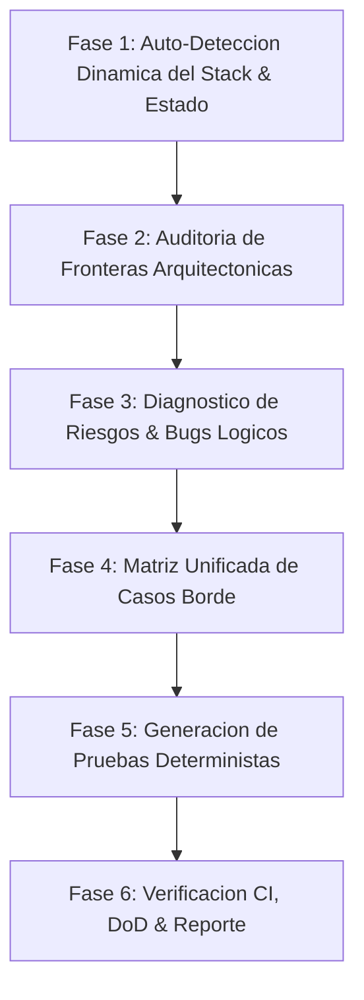

# Workflow en 6 fases (detalle)

Leer solo cuando se ejecute la fase correspondiente.

Skill especializada en la auditoria exhaustiva de suites de prueba, el diagnostico de vulnerabilidades y condiciones de carrera, la deteccion dinamica del stack del proyecto y el diseno sistematico de matrices de casos extremos bajo el paradigma del **Diamante de Pruebas**.

## Flujo de Trabajo en 6 Fases

---

### Fase 1: Auto-Deteccion Dinamica del Stack & Estado (Zero-Trust)

> [!IMPORTANT]
> **Principio Zero-Trust**: Prohibido asumir el stack o sus versiones. La skill debe auto-inspeccionar primero los manifiestos raiz del proyecto antes de proponer o escribir cualquier prueba.

1.  **Inspeccion de Manifiestos y Archivos de Configuracion**:
    *   `deno.json` / `deno.jsonc` -> Runtime Deno. Inspeccionar `tasks` (`ci`, `test`, `check`, `lint`) e `imports`.
    *   `package.json` -> Runtime Node.js / Bun / pnpm. Inspeccionar `dependencies`, `devDependencies` y `scripts`.
    *   `pyproject.toml` / `requirements.txt` -> Ecosistema Python (pytest, unittest).
    *   `Cargo.toml` / `go.mod` -> Rust / Go.

2.  **Clasificacion Automatica del Stack**:
    *   **Runtime & Lenguaje**: Deno, Node.js, Bun, Python, Go, Rust (TypeScript/JavaScript).
    *   **Backend & Routing**: Express, Fastify, Hono, NestJS, Oak, Django, FastAPI.
    *   **Capa de Persistencia & ORM**: Drizzle, Sequelize (v6 vs v7), Prisma, TypeORM, SQLAlchemy, SQL raw (`pg`, `mysql2`).
    *   **Test Runner & Aserciones**: Vitest, Jest, `deno test`, Supertest, Pytest.
    *   **Frontend & Estado**: React, Vue, Svelte, TanStack Query, Redux, Zustand.
    *   **Topologia Arquitectonica**:
        - *FSD (Feature-Sliced Design)*: Carpetas `app/`, `pages/`, `widgets/`, `features/`, `entities/`, `shared/`.
        - *Clean Architecture / Hexagonal / DDD*: Carpetas `dominio/`, `aplicacion/`, `infraestructura/`, `ports/`.
        - *MVC Tradicional*: `controllers/`, `services/`, `models/`.

3.  **Auditoria de Paridad de Entornos de Persistencia**:
    *   **Verificar si se usa SQLite en memoria para pruebas**: Si produccion usa PostgreSQL o MySQL y las pruebas usan `sqlite::memory:`, registrar de inmediato como **Riesgo Critico de Dialecto** (consultar [testing-diamond-framework.md](./testing-diamond-framework.md)).
    *   **Metodo de Limpieza de BD**: Detectar si la suite usa truncamiento destructivo (`truncate`), migraciones repetitivas lentas o rollback transaccional atomico (`afterEach` con transaccion revertida).

---

### Fase 2: Auditoria de Fronteras Arquitectonicas

Antes de evaluar la logica interna, certificar que la estructura respeta las fronteras modulares:

1.  **Frontend - Feature-Sliced Design (FSD)**:
    *   **Jerarquia de Capas**: `app` -> `pages` -> `widgets` -> `features` -> `entities` -> `shared`. Una capa inferior jamas importa de una superior.
    *   **Prohibicion de Cross-Slice Imports**: Un slice en `features/auth` jamas importa directamente de `features/perfil`. La orquestacion ocurre en `widgets` o `pages`.
    *   **Prohibicion de Deep Imports**: Las importaciones externas a un slice deben pasar exclusivamente por su Public API (`index.ts`). Prohibido `import { ... } from '@/features/auth/ui/LoginForm'`.
    *   **Aislamiento Multi-App**: En monorepos con multiples portales o SPAs, verificar que no existan dependencias cruzadas entre aplicaciones hermanas.

2.  **Backend - Clean Architecture & Inversion de Dependencias**:
    *   **Dominio Puro**: Cero dependencias hacia librerias externas, frameworks HTTP o drivers de base de datos.
    *   **Capa de Aplicacion**: Solo depende de Dominio y expone puertos (interfaces). No conoce implementaciones concretas.
    *   **Capa de Infraestructura**: Implementa los puertos sin filtrar detalles tecnologicos (Drizzle, Sequelize, Express, Hono) hacia el dominio.

---

### Fase 3: Diagnostico de Riesgos, Vulnerabilidades y Bugs Logicos

Analizar el codigo bajo prueba buscando activamente patrones de degradacion:

1.  **Condiciones de Carrera y Bloqueos (MVCC)**:
    *   Mutaciones en operaciones concurrentes sobre inventarios, balances, cupones o reservas.
    *   Se usa bloqueo pesimista explicito (`FOR UPDATE`, `transaction.LOCK.UPDATE`) o control de concurrencia optimista (`version` / CAS)?
2.  **Consultas Ineficientes ($N+1$)**:
    *   Iteraciones `map`/`forEach` ejecutando consultas de base de datos individuales en lugar de joins/includes batch.
3.  **Limites Numericos y Tipado**:
    *   Montos o identificadores que exceden `Number.MAX_SAFE_INTEGER` (`9007199254740991`) sin `BigInt`.
    *   Coercion implicita en parametros de consulta (strings pasados como booleanos o numeros sin sanitizar).
4.  **Alineacion de Contratos Cliente-Servidor**:
    *   Discrepancias entre esquemas de validacion backend (Zod, Joi) y contratos del cliente (React/TypeScript).
    *   Estructuras de respuesta de error inconsistentes.

---

### Fase 4: Matriz Unificada de Ataque de Edge Cases

Al disenar pruebas para un componente o caso de uso, cubrir sistematicamente las 6 dimensiones:

| Dimension | Enfoque de Evaluacion | Casos Limite a Disenar |
| :--- | :--- | :--- |
| **1. Frontera de Entrada (Inputs)** | Controladores, Rutas y Formularios | `null`, `undefined`, `""`, strings con espacios en blanco, inyecciones (`<script>`, SQL/NoSQL), desbordamiento de longitud, emojis, Unicode multibyte, enteros negativos, ceros, `MAX_SAFE_INTEGER`. |
| **2. Concurrencia y Estado** | Transacciones, Servicios y Hooks | Peticiones simultaneas duplicadas (idempotencia), condiciones de carrera en mutaciones, clics rapidos repetidos en UI, invalidacion de tokens a mitad de operacion. |
| **3. Ciclo de Vida y Red** | Frontend y Clientes HTTP | Respuestas 4xx/5xx, timeouts de red, abortos por desmontaje de componente (*unmounted state updates*), reintentos masivos sin jitter. |
| **4. Contratos y Esquemas** | DTOs, Zod y CDC (Pact) | Payloads con campos omitidos, propiedades adicionales no documentadas, tipos invertidos, colecciones vacias `[]` vs pobladas, discrepancias de fecha ISO 8601. |
| **5. Fronteras de Arquitectura** | FSD y Clean Architecture | Violaciones de importaciones entre slices hermanos, deep-imports fuera de `index.ts`, fugas de infraestructura al dominio. |
| **6. Persistencia y Transaccionalidad** | BD, Repositorios y UnitOfWork | Violacion de restricciones de unicidad o clave foranea, caida a mitad de transaccion con verificacion de rollback integral, transacciones zombi. |

---

### Fase 5: Generacion de Pruebas Deterministas (Adaptadas al Stack)

Generar pruebas concretas empleando el patron idoneo para las tecnologias detectadas en Fase 1:

1.  **Para Node / Express / Sequelize**:
    *   Pruebas de integracion en proceso con Supertest (`request(app)`) sin puertos fisicos.
    *   Aislamiento ultra-rapido mediante transacciones CLS (`cls-hooked`) y rollback incondicional en `afterEach`.
    *   Consultar recetario en [tech-stacks-recipes.md](./tech-stacks-recipes.md#1-suite-de-integracion-con-supertest-vitestjest-y-cls-rollbacks).
2.  **Para Deno / Hono / Drizzle**:
    *   Pruebas con `deno test` usando `app.request()` en memoria.
    *   Transacciones de prueba con rollback explicito o base de datos efimera en contenedor con Testcontainers.
3.  **Pruebas de Contrato (CDC) con Pact.js v3**:
    *   Definir interacciones en el consumidor con matchers estructurales (`MatchersV3.like()`, `MatchersV3.eachLike()`).
    *   Verificacion en proveedor con *Provider States* para inicializar datos reales.
4.  **Pruebas de Estres y Carga con k6 / Autocannon**:
    *   Scripts declarando SLOs estrictos: $p(95) < 250\text{ms}$, tasa de error $< 0.5\%$.
5.  **Fabricas Dinamicas**:
    *   Usar `@faker-js/faker` o factorias deterministas en lugar de fixtures estaticas globales que generen colisiones de estado.

---

### Fase 6: Protocolo de Verificacion CI, Definition of Done & Reporte

1.  **Ejecucion Obligatoria del Pipeline CI**:
    *   Ejecutar la suite configurada en el proyecto (`deno task ci`, `npm run ci`, `pnpm test`, etc.).
    *   Certificar que pasan todos los pasos: formateo/linter, chequeo estatico de tipos, suites de tests unitarios/integracion y empaquetado/build.

2.  **Definition of Done (DoD)**:
    - [ ] **Stack Identificado**: Runtime, framework, ORM y runner documentados formalmente.
    - [ ] **Cero Errores de Tipos y Compilacion**: Compilacion limpia con codigo de retorno 0.
    - [ ] **Fronteras Arquitectonicas Intactas**: Respeto estricto de FSD y Clean Architecture.
    - [ ] **Cobertura de Casos Extremos**: Al menos 3 pruebas de Edge Cases por funcionalidad critica.
    - [ ] **Aserciones Semanticas**: Validacion de estado, payload y efectos secundarios (`toMatchObject`, aserciones de rollback).
    - [ ] **Pipeline Verde**: Suite de CI validada con salida 0.

3.  **Formato de Reporte al Usuario**:
    *   **Resumen del Stack Detectado**: Tecnologias, runner y arquitectura identificados.
    *   **Diagnostico de Pruebas & Brechas**: Analisis de la suite existente.
    *   **Matriz de Edge Cases Implementados**: Tabla con entradas, comportamiento y aserciones.
    *   **Certificacion de CI**: Salida de comandos y confirmacion del estado verde.
